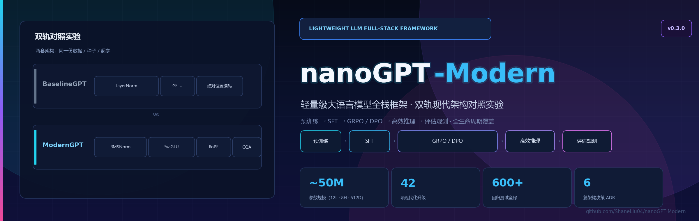

<p align="center">
  
</p>

<p align="center">
  <a href="https://github.com/ShaneLiu04/nanoGPT-Modern/actions/workflows/ci.yml"></a>
  <a href="LICENSE"></a>
  <a href="pyproject.toml"></a>
  <a href="requirements.txt"></a>
  
  
</p>

# nanoGPT-Modern

一个**端到端的轻量级大语言模型全栈框架**，基于 Andrej Karpathy 的 [nanoGPT](https://github.com/karpathy/nanoGPT) 思想构建。在 **~50M 参数**规模下，以**双轨对照实验**的方式完整验证现代 Transformer 组件的架构增益与效率 trade-off，并覆盖 **预训练 → SFT → GRPO/DPO 对齐 → 高效推理 → 评估** 全生命周期。

> v0.3.0 完成模型架构、训练系统、数据管道、推理服务、评估观测与工程 DevOps 六大领域共 **42 项现代化升级**；v0.5.0 完成 HPC 就绪化改造（DDP/FSDP 分布式训练栈、云迁移 Runbook、组件消融编排器），并在本机 GPU 迁移演练中定位并修复 3 个真实性能 bug（详见 [docs/MIGRATION.md](docs/MIGRATION.md) §8）。
>
> 技术白皮书 [docs/TECH_REPORT.md](docs/TECH_REPORT.md) · 变更日志 [docs/CHANGELOG.md](docs/CHANGELOG.md) · 实验记录 [docs/EXPERIMENTS.md](docs/EXPERIMENTS.md) · 实验运行手册 [docs/RUNNING_EXPERIMENTS.md](docs/RUNNING_EXPERIMENTS.md) · 架构决策 [docs/adr/](docs/adr/README.md)

---

## 为什么读这个仓库

面向深度学习工程与 LLM 全栈方向的学习/面试仓库，三条阅读线：

1. **架构线**：`model/` 两个 GPT 变体 + [docs/adr/](docs/adr/README.md) 架构决策记录——每个组件为什么这么选、取舍依据是什么（GQA grouped-broadcast、MoE grouped GEMM、KV 量化、GRPO vs PPO）。
2. **系统线**：`training/trainer_base.py` 模板方法训练基座（DDP/FSDP/AMP/EMA/checkpoint 生命周期，[docs/ARCHITECTURE.md](docs/ARCHITECTURE.md)）+ `inference/` 推理引擎（KV cache 家族、投机解码、连续批处理）——工程能力的主展示面。
3. **证据线**：[docs/EXPERIMENTS.md](docs/EXPERIMENTS.md) 第 6 节是 2026-10-12 在 RTX 6000D 上的实测（OpenWebText 前缀、七组 18000 step）。负面结果保留在同一节：SwiGLU 没有超过 GELU，top-1 MoE 没有超过稠密模型，弱草稿的投机解码接受率为 0，单卡 FSDP 没有扩展收益。

> 质量保障：628+ 回归测试（含确定性测试：固定种子 loss 曲线逐位一致）· CI 四检（pytest + mypy + black + ruff + CPU 冒烟训练）· 实验编排器支持断点续跑。

## 云端实测

2026-10-12，AutoDL RTX 6000D（86 GB）、PyTorch 2.8.0+cu128、bf16、seed 1337。语料是 OpenWebText 训练分片 0–10，1.244B GPT-2 token。每组 18000 step、batch 32、block 1024，共见到 5.90 亿 token，不到这批语料的一半。验证集是分片 79 的前 10000 篇（11,147,787 token）。

| 变体 | val loss | 相对 baseline | 吞吐 |
|------|----------|---------------|------|
| baseline | 3.612 | — | 180k tok/s |
| modern-full（GQA-2） | 3.573 | −1.07% | 146k tok/s |
| no-rope | 3.626 | +0.39% | 157k tok/s |
| no-swiglu（GELU） | 3.559 | −1.45% | 153k tok/s |
| mha | 3.540 | −1.99% | 138k tok/s |
| moe（top-1，4 专家） | 3.582 | −0.81% | 115k tok/s |
| qk-norm | 3.556 | −1.55% | 133k tok/s |

在这个预算下，验证损失最低的是完整 MHA（3.540）。GQA-2 比 MHA 高 0.033，KV cache 从 18432 B/token 降到 4608 B/token。去掉 RoPE 是唯一比 baseline 更差的改动（3.626）。SwiGLU 没有超过 GELU，top-1 MoE 没有超过稠密 modern。NTK-aware RoPE 在 4096 token 上的困惑度是 52.5，朴素外推是 214。append KV cache 在 prompt 128–896 上保持约 180 tok/s，整段重算降到 141 tok/s。bf16 训练吞吐是 fp32 的 2.10 倍。

完整表、命令和每张图的读法在 [docs/EXPERIMENTS.md](docs/EXPERIMENTS.md) 第 6 节，复现步骤在 [docs/RUNNING_EXPERIMENTS.md](docs/RUNNING_EXPERIMENTS.md)。


七组验证损失都从 5 以上降到 3.5–3.6。MHA 最终最低，去掉 RoPE 的那条最高。


训练长度是 1024。放到 4096 时，朴素 RoPE 的困惑度是 214，NTK 是 52。


append KV 在 prompt 128–896 上保持约 180 tok/s。paged 在这条单请求路径上更慢，prompt 越长越慢。int8 在这么短的上下文里几乎省不出显存，因为权重占了峰值的大部分。


16 条请求并发时，吞吐从单条的约 108 tok/s 升到约 1920 tok/s。


4 层 / 256 维、只训了 1200 step 的草稿，接受率是 0。换成 8 层 / 512 维、同宽度、4000 step 的草稿之后，draft 长度 2 / 4 / 8 的接受率是 53% / 38% / 33%。吞吐仍在 91–94 tok/s，低于 append 的约 180 tok/s。接受率回来了，验证开销还没被省掉的重算抵消。


64 个新 token 上 torch.compile 是 94 tok/s，eager 是 182。放到 256 个新 token，compile 是 294 tok/s，eager 是 185，约 1.59 倍。短解码付的是编译成本，长解码才开始赚回来。


bf16 的训练吞吐是 fp32 的 2.10 倍。单卡 FSDP 和 bf16 几乎相同，这里没有多卡扩展数据。


16 个专家时，分组 GEMM 是逐专家循环的 5.8 倍。这解释了实现选择。训练损失上，top-1 MoE 仍没有超过稠密 modern。


2000 条、2 个 epoch 之后，平均格式分是 0.45。这个分数的上限是 0.5，0.45 已经是上限的 90%。标签缺失率只有 0–2.5%。


120 step、batch 64 下，G4 / G8 / G16 的验证奖励在 step 20 之后都落在 0.63–0.65。


同一份 SFT 上，GRPO-G8 的平均规则奖励是 0.634，DPO 是 0.624，IPO 是 0.623，SFT 是 0.572。准确率没有跟着升。


## 面试时怎么讲这些结果

仓库要回答的是「这个组件在什么预算下值不值得」，不是「现代组件全部更好」。四条容易被追问的结果，对应的说法如下。

**SwiGLU 和 top-1 MoE 没有赢。** 在 12 层 / 512 维、18000 step、大约半个 epoch 上，GELU 的 val loss 是 3.559，SwiGLU 是 3.573；激活参数对齐的 4 专家 MoE 是 3.582，稠密 modern 是 3.573。分组 GEMM 把专家前向从随专家数变慢变成几乎持平，所以 MoE 的实现是成立的，缺的是这个规模上的损失收益。面试里把「kernel 更快」和「损失更低」分成两句话。

**GQA 是一笔显存交易。** 损失最低的是 MHA（3.540）。GQA-2 高 0.033，KV 从 18432 B/token 降到 4608 B/token。要省的是推理时的 KV，不是训练损失。

**推理路径要看场景。** 单条、几十个新 token：用 append KV。很多短请求拼在一起：连续批处理几乎按并发放大吞吐。4 层弱草稿的接受率是 0；同宽度的 8 层草稿把接受率做到 53%（draft 长度 2），吞吐仍低于 append。torch.compile 在 64 token 上更慢，在 256 token 上是 eager 的 1.59 倍。

**对齐预算决定你能声称什么。** 格式分满分是 0.5。2000 条 SFT 的平均分 0.45，是满分的 90%；标签缺失率 0–2.5%，二元遵从率已经超过 97%。同一条数据再训到 8 个 epoch，分数停在 0.45。把每档样本加到 8000 和 20000，分数升到 0.478 和 0.492，也就是上限的 95% 和 98%，easy 准确率从 8% 升到 14%。算术本身仍然大部分不会。120 step 的 GRPO 没有把组大小变成奖励差距。单独测组内奖励噪声时，组均值的标准误从 G4 的 0.033 降到 G16 的 0.022，均值奖励仍在 0.56–0.57。组更大，基线估计更稳；它不会凭空变出更高的奖励。

**规则奖励升高要拆开看。** 用 SFT 自己的 8 条采样做成 1333 对偏好（打平率 13%，chosen 比 rejected 高 0.281），再训 DPO 和 IPO。和三组 GRPO 放在同一套 80 条评测上：奖励都在 0.623–0.634，SFT 是 0.572。格式分从 0.457 掉到大约 0.30，过程分从 0.076 顶到 0.30。过程分只奖励答案前面的推导记号。准确率从 SFT 的 3.9% 降到 DPO 的 2.6%。离线 DPO 没有比在线 GRPO 更高效，0.63 的奖励也不是学会了算术。图上的横轴是策略自己采样上的 `log π_SFT - log π_θ`，不是 KL；五个对齐模型都落在 -0.75 到 -0.79。

后续补测（更长的 SFT 数据预算、组内奖励噪声、同宽度草稿）记在同一节，数字以 `docs/results/` 里的 JSON 为准。

## 核心亮点

### 双轨对照实验
同一仓库实现两种架构，共享数据顺序、随机种子与超参——**唯一变量是架构本身**：

- **BaselineGPT** — GPT-2 经典架构（LayerNorm + GELU + 可学习绝对位置编码）
- **ModernGPT** — LLaMA/Gemma 风格现代架构（RMSNorm + SwiGLU + RoPE + GQA）

### 现代组件全集成
| 类别 | 组件 |
|------|------|
| 归一化 | RMSNorm（自动探测 PyTorch ≥ 2.4 fused kernel）· QK-Norm |
| 激活/FFN | SwiGLU (8d/3) · **MoE top-1 gating**（分组 GEMM + 负载均衡辅助损失） |
| 位置编码 | RoPE + **NTK-aware 长度外推** |
| 注意力 | MHA / **GQA（零拷贝 grouped broadcast）** / FlashAttention 封装 / SDPA 后端切换 / Sliding Window / Attention Temperature |
| 序列 | 多 Token 预测（MTP heads）· **Ring Attention**（纯 PyTorch blockwise，长上下文确定性回退） |

### 完整对齐流水线
- **预训练** — OpenWebText 因果语言建模
- **SFT** — 算术 + Chain-of-Thought 逐步推理格式（`<reasoning>` + `<answer>`）
- **GRPO** — 组相对策略优化（组大小可调 G4/G8/G16，KL 惩罚 + PPO clip + 优势归一化/裁剪）
- **DPO / IPO / KTO** — 偏好对齐，支持**从 GRPO 轨迹自动生成偏好对** + 胜率评估
- **Iterative GRPO** — 拒绝采样微调 + EMA 参考模型更新循环

### 生产级推理
- **KV Cache 家族** — 静态环形缓存 / Paged KV Cache（块表管理）/ **INT8·FP8 量化缓存**
- **投机解码** — draft-then-verify，支持 batch > 1 与接受率自适应降级
- **连续批处理** — `RequestQueue` + `ContinuousBatchScheduler` + **Prefix Cache** 共享 prefill
- **API 服务** — FastAPI，OpenAI 兼容（`/v1/completions` + `/v1/chat/completions`）
- torch.compile 自动探测与回退 · CUDA Events 精确计时（prefill/decode 分离）

### 评估与可观测
- 标准 Benchmark 集成（lm-eval：MMLU / ARC / HellaSwag / GSM8K …）+ 本地 PPL
- **Needle-in-Haystack** 长上下文检索评估
- **胜率评估**（RuleJudge / LengthPenaltyJudge）· 对齐质量评估（reward 分解 + KL）
- **注意力可视化**（heatmap）+ **Logit Lens**（逐层 top-k 预测）
- 训练/推理 Profiler（Chrome trace + 显存分层报告）· 监控工具箱（Loss Spike >3σ 检测、梯度范数分层）

### 工程化设施
- **统一训练抽象** — `BaseTrainer` 模板方法，五种训练器共享基础设施
- **分布式与显存** — DDP / FSDP（full/grad/no 分片策略）· AMP bf16/fp16 · 梯度累积 · 梯度检查点
- **训练稳定性** — EMA 影子权重 · Early Stopping · LR 调度（cosine/linear/WSD/constant + warmup）· 完整 checkpoint 生命周期（模型 + 优化器 + scaler + scheduler + EMA + RNG + resume offset，`keep_last_n` 自动清理）
- **配置系统** — YAML + argparse 双向覆盖 · Hydra 可组合配置 · Pydantic 结构化校验（`n_head % n_kv_head == 0` 等规则）
- **数据管道** — 全局 Shuffle（预计算索引）· 质量评分过滤 · MinHash+LSH 增量去重 · 多语言（tiktoken/SentencePiece + 语言检测加权采样）· 代码数据（AST 语法过滤）· 文档边界 / Packing（跨文档 mask）· 对话模板（chatml/llama-2/gemma）
- **生态互操作** — HuggingFace 格式导出/加载（round-trip）· GGUF 导出（f32/f16/q8_0，内置无依赖 writer）· ONNX 导出（动态轴 + Runtime 验证）
- **质量保障** — 628+ 回归测试（含确定性测试：固定种子 loss 曲线完全一致）· CI（pytest + mypy + black + ruff + CPU 冒烟训练）· 多阶段 Docker（训练 + TensorBoard + API）· pre-commit · 6 篇 ADR
- **HPC 就绪（v0.5.0）** — 单卡到多卡的完整分布式路径（DDP `static_graph + gradient_as_bucket_view` / FSDP full-grad-no 分片 + per-block auto-wrap + `use_orig_params`）· 组件消融编排器（断点续跑 + 抢占恢复）· 云迁移 Runbook（uv 精确复现 + 数据校验 + GPU 冒烟）· 本机 GPU 演练已验证全链路并修复 3 个真实 bug（SDPA GQA 显存物化、ReduceOp.AVG gloo 兼容、DDP device_ids CPU 兼容）

---

## 架构对比

| 维度 | BaselineGPT | ModernGPT |
|------|-------------|-----------|
| 归一化 | LayerNorm | RMSNorm（fused kernel 自动探测） |
| FFN | GELU (4×) | SwiGLU (8d/3) / MoE grouped GEMM |
| 位置编码 | 可学习绝对 Embedding | RoPE + NTK-aware 外推 |
| Attention | MHA / SDPA | MHA / GQA / FlashAttention / Sliding Window / QK-Norm |
| KV Cache | — | ring / paged + INT8/FP8 量化 |
| MTP | — | n_future heads |
| 长上下文 | block_size | + Ring Attention blockwise |

**参数量对齐（12L / 8H / 512D，精确计算值）：**

| 配置 | 总参数量 | 非嵌入参数 | KV Cache (B/tok) |
|------|----------|-----------|------------------|
| BaselineGPT | 54.6M | 28.4M | — |
| ModernGPT MHA (n_kv=8) | 54.0M | 28.3M | 18,432 |
| ModernGPT GQA-4KV | 51.7M | 26.0M | 9,216 **(-50%)** |
| ModernGPT GQA-2KV | 50.5M | 24.8M | 4,608 **(-75%)** |
| ModernGPT GQA-2KV + KV-INT8 | 50.5M | 24.8M | 2,304 **(-87.5%)** |

上表是按权重绑定估算的设计值。2026-10-12 编排器的 `get_num_params` 原始计数更高（baseline 64.1M，modern-full 59.6M，mha 64.3M，moe 总参数 137.4M / 激活 59.6M），因为绑定的 embedding 可能被 `parameters()` 计了两次。组间差值以同一次计数为准，见 [docs/EXPERIMENTS.md](docs/EXPERIMENTS.md) §6.1。

---

## 快速开始

### 1. 安装

```bash
pip install -r requirements.txt          # 基础依赖
pip install -e ".[dev,eval,quant,hf]"    # 开发 / lm-eval / 量化 / HF 兼容（可选）
```

安装后即可使用控制台命令：`nanogpt-train-pretrain`、`nanogpt-train-sft`、`nanogpt-train-grpo`、`nanogpt-train-dpo`、`nanogpt-generate`、`nanogpt-export-gguf` 等（含全部 `-hydra` 变体）。

### 2. 准备数据

```bash
python data/prepare.py --split train --full   # --full = 全量 7,913,597 docs（省略则默认 1M 子集！）
python data/prepare.py --split val --full         # val 全量 10K docs（与默认等价，显式化避免歧义）
python data/validate.py data/openwebtext/train.bin   # 抽样解码 + token 直方图检查

# 可选：生成全局随机索引，训练时全局 shuffle（v0.3.0）
python -c "from data.openwebtext import generate_shuffle_index; generate_shuffle_index('data/openwebtext/train.bin', seed=1337)"
```

### 3. 冒烟预训练（1000 步，CPU 亦可）

```bash
python training/train_pretrain.py --config config/pretrain.yaml --max_iters 1000 --n_kv_head 2
```

### 4. 推理

```bash
python inference/generate.py \
  --checkpoint out/pretrain/best_ckpt.pt \
  --max_new_tokens 200 --num_samples 5
```

### 5. 启动 OpenAI 兼容 API

```bash
python api_server.py --checkpoint out/pretrain/best_ckpt.pt --model modern --port 8000

curl http://localhost:8000/v1/completions \
  -H "Content-Type: application/json" \
  -d '{"prompt": "The future of AI is", "max_tokens": 50}'
```

### 6. 回归测试

```bash
python -m pytest tests/ -q
```

---

## 完整对齐流水线

```bash
# ① 预训练（EMA + checkpoint 自动清理）
python training/train_pretrain.py --config config/pretrain.yaml --use_ema --keep_last_n 3

# ② SFT（注入 CoT 推理格式；--variant sft-only | sft-continued）
python training/train_sft.py --config config/sft.yaml --init_from out/pretrain/best_ckpt.pt

# ③ GRPO 对齐（组大小可调，--beta 为 KL 惩罚系数）
python training/train_grpo.py --config config/grpo.yaml \
  --init_from out/sft/best_sft-only.pt \
  --ref_from  out/sft/best_sft-only.pt \
  --group_size 8

# ④ DPO 偏好对齐（从 GRPO 轨迹自动生成偏好对 + 胜率评估）
python training/train_dpo.py \
  --init_from out/sft/best_sft-only.pt \
  --preference_source grpo \
  --grpo_checkpoint out/grpo/best_grpo_g8.pt \
  --win_rate_eval

# ⑤ 对齐评估（reward 分解 + KL）
python evaluation/eval_alignment.py \
  --checkpoint out/grpo/best_grpo_g8.pt \
  --ref_checkpoint out/sft/best_sft-only.pt

# ⑥ Benchmark（本地 PPL + 可选 lm-eval 下游任务）
python evaluation/eval_benchmark.py \
  --checkpoint out/pretrain/best_ckpt.pt \
  --tasks mmlu,arc,hellaswag,gsm8k \
  --output_json out/benchmark_results.json
```

---

## 更多用法

<details>
<summary><b>Hydra 可组合配置入口</b></summary>

```bash
python training/train_pretrain_hydra.py                     # 默认配置
python training/train_pretrain_hydra.py batch_size=16 n_layer=2
python training/train_sft_hydra.py init_from=out/pretrain/best_ckpt.pt
python training/train_grpo_hydra.py init_from=out/sft/best_sft-only.pt ref_from=out/sft/best_sft-only.pt
python training/train_dpo_hydra.py init_from=out/sft/best_sft-only.pt preference_source=grpo
python inference/generate_hydra.py checkpoint=out/pretrain/best_ckpt.pt prompt="Hello"
```

配置组位于 `config/hydra/`（model / training / optimizer / data 可自由组合）。

</details>

<details>
<summary><b>训练速查</b></summary>

```bash
# 现代模型 + GQA-2KV + EMA + 梯度检查点
python training/train_pretrain.py --model modern --n_kv_head 2 --use_ema --gradient_checkpointing

# 基线对照组
python training/train_pretrain.py --model baseline

# 梯度累积（effective batch = 48）
python training/train_pretrain.py --model modern --gradient_accumulation_steps 4

# FSDP 多卡（full / grad / no 三种分片策略）
TORCH_DISTRIBUTED_DEBUG=DETAIL torchrun --nproc_per_node=4 \
  training/train_pretrain.py --model modern --fsdp --fsdp_sharding_strategy full

# 断点续训 / Early Stopping / WSD 调度
python training/train_pretrain.py --model modern --resume out/pretrain/latest_ckpt.pt
python training/train_pretrain.py --model modern --early_stopping_patience 5 --lr_schedule wsd

# 文档 Packing（跨文档 attention mask）
python training/train_pretrain.py --model modern --use_packing

# Iterative GRPO（拒绝采样 + EMA 参考更新）
python training/iterative_grpo.py \
  --init_from out/sft/best_sft-only.pt --ref_from out/sft/best_sft-only.pt \
  --rejection_interval 50 --ref_update_interval 100
```

</details>

<details>
<summary><b>推理 · 评估 · 性能速查</b></summary>

```bash
# 推理消融（多长度 × 多样本，JSON 输出）
python inference/generate.py --checkpoint out/pretrain/best_ckpt.pt \
  --max_new_tokens 200 400 600 --num_samples 30 --output_json out/ablation.json

# 训练 / 推理性能 Profiler（Chrome trace + 显存报告）
python tools/profiling/profile_training.py --model modern --steps 20 --output_dir out/profile/
python tools/profiling/profile_inference.py --checkpoint out/pretrain/best_ckpt.pt --use_cache

# 训练 / 推理消融矩阵一键运行
python run_ablations.py --mode inference --checkpoint out/pretrain/best_ckpt.pt
python run_ablations.py --mode train --max_iters 200

# 全维度评估（pretrain/SFT/GRPO × easy/medium/hard）
python run_full_evaluation.py
```

</details>

<details>
<summary><b>导出与互操作</b></summary>

```bash
# HuggingFace 格式（config.json + model.safetensors，可 round-trip 加载）
python tools/export/export_to_hf.py --checkpoint out/pretrain/best_ckpt.pt --out_dir hf/nanogpt-modern
python tools/export/load_from_hf.py --hf_dir hf/nanogpt-modern --out out/roundtrip.pt

# GGUF（内置无依赖 writer；Q4_0/Q5_0/Q6_K 类型枚举预留）
python tools/export/export_gguf.py --checkpoint out/pretrain/best_ckpt.pt \
  --out out/pretrain/best_ckpt.q8_0.gguf --quant q8_0

# ONNX（动态 batch/seq 轴 + ONNX Runtime 数值验证）
python tools/export/export_to_onnx.py --checkpoint out/pretrain/best_ckpt.pt \
  --out_path out/pretrain/model.onnx --model modern --validate
```

</details>

<details>
<summary><b>Python API：连续批处理 / Benchmark / 长上下文 / 可视化</b></summary>

```python
# 连续批处理服务引擎（请求队列 + 动态拼批 + Prefix Cache）
from inference.continuous_batching import Request, RequestQueue, ContinuousBatchScheduler

queue = RequestQueue()
queue.enqueue(Request(prompt="The future of AI is", max_tokens=50, temperature=0.8))
scheduler = ContinuousBatchScheduler(queue, model, device="cuda")
# results = scheduler.run(...)  # GPU 持续满载，序列完成即拼入新请求

# 标准 Benchmark 套件（封装 lm-eval）
from evaluation.benchmark_suite import BenchmarkSuite
suite = BenchmarkSuite(checkpoint="out/pretrain/best_ckpt.pt")
suite.run(tasks=["mmlu", "gsm8k"], output_json="out/benchmark.json")
suite.print_summary()

# Needle-in-Haystack 长上下文检索（NTK-RoPE / Ring Attention 压力测试）
from evaluation.needle_in_haystack import NeedleEvaluator
evaluator = NeedleEvaluator(model, tokenizer, max_context_length=4096)
results = evaluator.evaluate(depths=[0.0, 0.5, 1.0], num_trials=5)

# 注意力热图 + Logit Lens 逐层诊断
from inference.visualize_attention import AttentionVisualizer, LogitLens

# 胜率评估（规则判官 / 长度惩罚判官）
from evaluation.eval_win_rate import WinRateEvaluator, RuleJudge
```

</details>

<details>
<summary><b>Docker 容器化</b></summary>

```bash
docker build -t nanogpt-modern:latest .   # 多阶段构建（base / dev / prod）

docker-compose up          # 训练 + TensorBoard(6006) + API(8000)
docker-compose up train    # 仅训练
```

</details>

---

## 实验与结果

完整记录见 [docs/EXPERIMENTS.md](docs/EXPERIMENTS.md)，实验矩阵与执行手册见 [docs/RUNNING_EXPERIMENTS.md](docs/RUNNING_EXPERIMENTS.md)（14 个深度对比实验的规划、状态与云端 SOP）。

### 已验证结果

| 验证项 | 结果 | 环境 |
|--------|------|------|
| 端到端流程 | 预训练 → SFT → GRPO → 评估 → 推理消融全部跑通 | RTX 4060 Laptop |
| KV Cache 正确性 | cache / no-cache 输出 **bit-wise 一致**（fast path 与值路径逐位相同） | CPU/GPU |
| SFT 格式注入（3.3M 快速验证） | `<answer>` 格式遵从率 88–100%（模型容量不足以学会算术本身——诚实边界） | RTX 4060 Laptop |
| 训练确定性 | 固定种子重复训练 loss 曲线完全一致（`tests/test_determinism.py`） | CPU |
| KV append 布局 decode | 值路径 21.4 ms/步 → 零拷贝视图 13.3 ms/步（**1.61x**），GPU 大配置 cache vs 全量重算 **3.75x** | CPU + GPU |
| **KV decode 显存平坦化**（GPU 演练修复） | 峰值显存斜率 12,335 → **~0 B/token**（SDPA GQA head-expansion 物化 bug 修复，单步瞬时分配 57.7MB→0.5MB @L=4096，**114x**），长上下文/batch 不再 OOM | Quadro RTX 5000 |
| 单卡 DDP / FSDP 全链路 | DDP（static_graph + gradient_as_bucket_view）与 FSDP（FULL_STATE_DICT gather + resume round-trip）GPU 构造/训练/checkpoint 全通，并修复 ReduceOp.AVG gloo 兼容等 2 个分布式 bug | Quadro RTX 5000 |

50M 七组消融、NTK、推理扫描和训练系统微基准已经在 RTX 6000D 上跑完，数字和读法在文首「云端实测」以及 [docs/EXPERIMENTS.md](docs/EXPERIMENTS.md) 第 6 节。3.3M 合成数据的结果只说明链路能跑，不参与架构比较。

---

## 项目结构

<details>
<summary>展开完整目录树</summary>

```
nanogpt-modern/
├── config/                  # YAML 配置 + Hydra 可组合配置
│   ├── pretrain.yaml        # 预训练（12L/8H/512D, GQA-2KV, cosine + warmup）
│   ├── sft.yaml             # SFT（sft-only / sft-continued）
│   ├── grpo.yaml            # GRPO（G4, beta=0.04, PPO clip）
│   ├── generate.yaml        # 推理
│   └── hydra/               # Hydra 配置组（model / training / optimizer / data）
├── data/                    # 数据管道
│   ├── prepare.py           # 多进程 shard 化预处理
│   ├── validate.py          # 数据完整性检查（解码抽样 + 直方图）
│   ├── filter.py            # 质量过滤（Length/Repetition/Regex/FastText）
│   ├── dedup.py             # MinHash+LSH 去重（增量签名持久化）
│   ├── mixer.py             # 多源混合
│   ├── openwebtext.py       # Memmap/Packing/DocBoundary + 全局 Shuffle
│   ├── quality_filter.py    # 质量评分与分层采样
│   ├── multilingual.py      # 多语言 tokenizer + 检测 + 加权采样
│   ├── code.py              # 代码数据 + AST 语法过滤
│   ├── arithmetic.py        # 算术 + Chain-of-Thought 数据集
│   └── chat_templates.py    # 对话模板（chatml / llama-2 / gemma）
├── model/                   # 模型
│   ├── modern_gpt.py        # ModernGPT（RMSNorm/SwiGLU/RoPE/GQA/MoE/MTP）
│   ├── baseline_gpt.py      # BaselineGPT（GPT-2 风格）
│   ├── attention_utils.py   # SDPA 后端切换 + GQA broadcast 探测
│   ├── flash_attention.py   # FlashAttention 封装
│   ├── kv_cache_utils.py    # 环形缓存 + INT8/FP8 量化
│   ├── paged_kv_cache.py    # Paged KV Cache（块表管理）
│   ├── ring_attention.py    # 纯 PyTorch blockwise Ring Attention
│   ├── quantization.py      # INT8 / bitsandbytes 权重量化
│   └── hf_model.py          # HuggingFace 兼容层
├── training/                # 训练（共享 BaseTrainer 抽象）
│   ├── trainer_base.py      # DDP/FSDP/AMP/EMA/EarlyStop/ckpt 生命周期
│   ├── train_pretrain.py    # 预训练
│   ├── train_sft.py         # 监督微调
│   ├── train_grpo.py        # GRPO（批量化 + 梯度累积）
│   ├── train_dpo.py         # DPO/IPO/KTO（偏好对生成 + 胜率评估）
│   ├── iterative_grpo.py    # 拒绝采样 + EMA 参考更新
│   └── *_hydra.py           # Hydra 入口
├── inference/               # 推理
│   ├── generate.py          # CLI（KV Cache / compile / 投机解码 / 消融）
│   ├── generate_utils.py    # 采样工具
│   ├── continuous_batching.py  # 连续批处理引擎 + Prefix Cache（库 API）
│   └── visualize_attention.py  # 注意力热图 + Logit Lens（库 API）
├── evaluation/              # 评估
│   ├── eval_alignment.py    # 对齐质量（reward 分解 + KL）
│   ├── eval_benchmark.py    # 本地 PPL + lm-eval（CLI）
│   ├── benchmark_suite.py   # Benchmark 套件（库 API）
│   ├── eval_win_rate.py     # 胜率评估（库 API）
│   └── needle_in_haystack.py   # 长上下文检索（库 API）
├── rewards/                 # 规则奖励（格式/过程/正确性连续评分）
├── utils/                   # 基础设施
│   ├── config.py            # YAML + argparse 双向覆盖
│   ├── config_models.py     # Pydantic 配置校验
│   ├── checkpoint.py        # 完整 checkpoint 管理
│   ├── logging.py           # wandb + TensorBoard 多后端
│   ├── lr_scheduler.py      # cosine / linear / WSD / constant
│   ├── rl_utils.py          # GRPO 工具
│   ├── dpo_utils.py         # DPO/IPO/KTO 损失
│   ├── monitoring.py        # Loss Spike 检测 / 梯度范数分层
│   └── profiler.py          # PyTorch Profiler + Chrome trace
├── tests/                   # 600+ 回归测试
├── docs/                    # 白皮书 / 变更日志 / 实验记录 / 6 篇 ADR
├── tools/export/            # 导出/互操作脚本（export_to_hf / load_from_hf / export_gguf / export_to_onnx）
├── api_server.py            # FastAPI OpenAI 兼容服务
├── tools/profiling/         # 性能剖析脚本（profile_training / profile_inference）
├── run_ablations.py         # 消融矩阵自动化
├── run_full_evaluation.py   # 全维度评估自动化
├── Dockerfile               # 多阶段容器（base / dev / prod）
├── docker-compose.yml       # 训练 + TensorBoard + API
└── .github/workflows/ci.yml # CI（lint + test + CPU 冒烟）
```

</details>

---

## 文档索引

| 文档 | 内容 |
|------|------|
| [docs/TECH_REPORT.md](docs/TECH_REPORT.md) | 技术白皮书：架构设计、模块详解、性能容量、Roadmap |
| [docs/ARCHITECTURE.md](docs/ARCHITECTURE.md) | 训练基座设计：BaseTrainer 模板方法链、DDP/FSDP/AMP/EMA/Checkpoint、监控降级、5 训练器差异矩阵 |
| [docs/GRPO_NOTES.md](docs/GRPO_NOTES.md) | RLHF 家族对比：GRPO / Iterative GRPO / DPO 的优势计算、参考更新、KL 三维度 |
| [docs/MIGRATION.md](docs/MIGRATION.md) | 云租用 GPU 实例迁移 Runbook（环境重建、冒烟、实验矩阵启动、GPU 演练记录与排障速查） |
| [docs/RUNNING_EXPERIMENTS.md](docs/RUNNING_EXPERIMENTS.md) | 实验运行手册：14 个对比实验矩阵、云端 SOP、图表与报告规范、状态跟踪（AR 更新联动） |
| [docs/CHANGELOG.md](docs/CHANGELOG.md) | v0.2.0 → v0.3.0 变更日志、42 项改进清单、已知限制 |
| [docs/EXPERIMENTS.md](docs/EXPERIMENTS.md) | 实验记录、复现命令、关键结论 |
| [docs/adr/](docs/adr/README.md) | 架构决策记录：GQA grouped-broadcast、GRPO vs PPO、KV 量化、MoE grouped GEMM 等 |

---

## 参考文献

- [nanoGPT](https://github.com/karpathy/nanoGPT) — Andrej Karpathy
- RMSNorm — *Root Mean Square Layer Normalization* (Zhang & Sennrich, 2019)
- SwiGLU — *GLU Variants Improve Transformer* (Shazeer, 2020)
- RoPE — *RoFormer: Enhanced Transformer with Rotary Position Embedding* (Su et al., 2021)
- GQA — *Training Generalized Multi-Query Transformer Models* (Ainslie et al., 2023)
- LLaMA — *Open and Efficient Foundation Language Models* (Touvron et al., 2023)
- GRPO — *DeepSeekMath* (Shao et al., 2024)
- DPO — *Direct Preference Optimization* (Rafailov et al., 2023)
- KIVI — *KV Cache Quantization* (Liu et al., 2024)
- vLLM — *Efficient Memory Management for LLM Serving* (Kwon et al., 2023)

---

## 许可

基于 nanoGPT 思想构建，仅供研究与学习使用。[MIT License](LICENSE)。

---

*v0.5.0 · 最后更新 2026-10-11*
