# nanoGPT-Modern 实验记录与复现报告

本文件汇总项目的实验日志、快速复现结果与后续优化建议。原始数据文件见 `out/` 目录下的 `.json` / `.log`。

---

## 1. 实验环境

| 项目 | 配置 |
|------|------|
| GPU | NVIDIA GeForce RTX 4060 Laptop (8GB) |
| PyTorch | 2.4.1+cu121 |
| CUDA | 12.1 |
| OS | Windows 11 |
| 固定种子 | `1337` |

---

## 2. 快速复现检查清单

- [x] 数据准备（合成 50M tokens 或真实 OpenWebText）
- [x] BaselineGPT 预训练
- [x] ModernGPT 预训练
- [x] 推理消融（cache vs no-cache）
- [x] SFT-only 训练
- [x] GRPO-G4 训练
- [x] 统一评估（SFT + GRPO）
- [ ] GRPO-G8 / KL 消融（流程相同，未执行）

---

## 3. 预训练对照实验

### 3.1 快速验证模式（3.3M 参数）

使用合成随机 token 序列（50M train / 5M val），模型规格：4L/4H/128D，block_size=256。

| 模型 | Final Val Loss | 相对 Baseline |
|------|---------------|---------------|
| BaselineGPT (GPT-2 Block) | 10.8393 | — |
| ModernGPT (RMSNorm + SwiGLU + RoPE) | 10.8369 | -0.02% |

> 合成随机 token 的 loss 停在分布熵附近（约 10.84），不能用来比较架构。同一七组矩阵在真实 OpenWebText 前缀上的结果见第 6 节：18000 step 时 modern-full 的 val loss 是 3.573，baseline 是 3.612，相对降低 1.07%。早先文档里的 −2.29%（3.9126 → 3.8229）没有对应实测，不再作为结果引用。

### 3.2 完整 50M 参数目标

| 配置 (12L/512D) | 总参数量 | 非嵌入参数 | KV Cache (B/tok) |
|----------------|----------|-----------|------------------|
| BaselineGPT | 54.6M | 28.4M | N/A |
| ModernGPT MHA (n_kv=8) | 54.0M | 28.3M | 18,432 |
| ModernGPT GQA-4KV | 51.7M | 26.0M | 9,216 (-50%) |
| ModernGPT GQA-2KV | 50.5M | 24.8M | 4,608 (-75%) |

---

## 4. 推理消融实验

### 4.1 快速模式结果（3.3M 参数）

测试条件：prompt="The future of artificial intelligence is"，num_samples=10。

| 模型 | 50 tokens | 400 tokens | 500 tokens |
|------|-----------|------------|------------|
| Baseline (no-cache) | 242.26 tok/s | 206.56 tok/s | 229.55 tok/s |
| Modern (no-cache) | 176.17 tok/s | 205.77 tok/s | 198.48 tok/s |
| Modern (cache) | 193.43 tok/s | 158.96 tok/s | 139.71 tok/s |

**关键观察**：
1. Baseline 吞吐最高，计算量最小。
2. Modern 吞吐较低，因 SwiGLU/RMSNorm/RoPE 引入额外计算。
3. 在小模型/短序列场景，KV Cache 的 Python 级管理开销可能超过计算节省；**在长序列 (>400 tokens) 与 50M 参数大模型下，cache 优势才显著体现**。

### 4.2 生成质量一致性

- `cache=True` 与 `cache=False` 输出 **bit-wise 一致**，验证 RoPE 位置编码与 KV Cache 实现正确。

### 4.3 KV decode append 布局改造基准（AR-v0.5.0 FR5，2026-10-10）

对比对象：`KVCacheManager` 值路径（每步 `torch.cat` 整个缓存，改造前）vs
**append 布局**（预分配缓冲 + `[:pos]` 零拷贝视图直喂 SDPA，改造后）。

| 指标 | 值路径（改造前） | append 布局（改造后） | 加速比 |
|------|-----------------|----------------------|--------|
| 单步 decode 耗时（中位数） | 21.4 ms/步 | 13.3 ms/步 | **1.61x** |
| 输出一致性 | — | 与值路径逐位一致 | bit-wise |

- **环境**：Windows 开发机（CPU 路径）、torch 2.5.1、fp32、
  8 层 × 8 头 × 512 维、block_size=8192（缓存长度 ~4096，FR5-AC2 基准规模）、
  5 次预热 + 30 次重复取中位数（`tests/test_kv_append_layout.py::test_decode_speedup_at_least_1_5x`，`-m perf`）。
- **GPU 侧（Quadro RTX 5000 8GB，torch 2.5.1+cu121，FlashAttention 后端）**：
  24 层 × 16 头 × 1024 维、prompt 1024、greedy 128 token——
  cache 路径 6.2s vs no-cache 全量重算 23.3s，**3.75x**，输出逐位一致
  （`tests/test_kv_cache_benchmark.py::test_kv_cache_decode_completes_efficiently`，`-m perf`）。
- 备注：小配置（12L/512D）在 GPU 上受 kernel-launch 开销主导，cache 与 no-cache
  不可区分（~1.0x）；上述大配置使计算主导，基准才有区分度。
- **2026-10-11 演练补记**：GPU 显存斜率演练发现 SDPA `enable_gqa` 在无原生 GQA
  内核的后端（sm75/fp32）内部物化 KV head 扩展，decode 峰值显存随上下文线性
  增长（12,335 B/token）。已修复：T==1 GQA decode 统一走 `_decode_gqa_attention`
  手写内核（scores `[B,n_kv,rep,S]`，原生 KV-head 分辨率），峰值显存平坦、单步
  瞬时分配 57.7MB→0.5MB（L=4096，114×）、fast/value 路径保持逐位一致。根因与
  数据详见 `docs/MIGRATION.md` §8.2。

---

## 5. SFT / GRPO 结果

### 5.1 快速模式评估矩阵

| 阶段 | easy | medium | hard |
|------|------|--------|------|
| Baseline (pretrain) | invalid=100% | invalid=100% | invalid=100% |
| Modern (pretrain) | invalid=100% | invalid=100% | invalid=100% |
| Modern (SFT-only) | accuracy=0%, format=100% | accuracy=0%, format=96% | accuracy=0%, format=88% |
| Modern (GRPO-G4) | accuracy=0%, format=100% | accuracy=0%, format=90% | accuracy=0%, format=90% |

> 小模型（3.3M 参数）容量不足，无法学会算术推理（accuracy=0），但 SFT 成功注入 `<answer>` 格式遵从能力。

### 5.2 GRPO 训练曲线（G4, 50 steps）

| Step | mean_reward |
|------|-------------|
| 0 | 0.7500 |
| 10 | 0.8125 |
| 20 | 0.8750 |
| 30 | 0.7500 |
| 40 | 0.5625 |

这 50 step 来自 3.3M 快速验证，曲线还在波动。50M checkpoint 上的 SFT 与 GRPO 见第 6.5 节。

---

## 6. 云端 50M 对照（2026-10-12）

第 3–5 节是 RTX 4060 Laptop 上的 3.3M 快速验证，数据是合成 token。本节是同一套代码在云 GPU 上、用真实 OpenWebText 前缀跑完的对照。原始摘要在 `docs/results/`，图在 `docs/assets/experiments/`。

### 6.1 环境、数据与预算

| 项目 | 取值 |
|------|------|
| GPU | NVIDIA RTX 6000D，86 GB，算力 (12, 0) |
| 软件 | PyTorch 2.8.0+cu128，CUDA 13.2，驱动 595.71.05 |
| 数据盘 | `/root/autodl-tmp` 配额 50 GB。全量 OpenWebText 约 17 GB，装不下，因此按 parquet 分片下载、tokenize 后立即删除原文件 |
| 语料 | Skylion007/openwebtext 训练分片 0–10，GPT-2 tokenizer，1,244,464,437 token |
| 验证集 | 分片 79 的前 10,000 篇，11,147,787 token。与 `docs/MIGRATION.md` 里的验证集 token 数相同，这里把它当作同分布的留出分片 |
| 模型 | 12 层 / 8 头 / 512 维，block 1024，seed 1337，bf16 |
| 优化 | batch 32，每步 32,768 token，18000 step，warmup 2000，cosine 在 18000 step 降到 `min_lr` |
| 见到的 token | 18000 × 32768 = 589,824,000，约为该前缀的 47%，没有第二遍 |
| 评测 | 每 1000 step，20 个 batch × 32 × 1024 token。均值损失的标准误远小于 0.01，组间 0.01 量级的差距可以读 |

编排器记录的参数量（`get_num_params`，含 embedding）是：baseline 64.086M，modern-full 59.561M，no-rope 60.085M，no-swiglu 58.775M，mha 64.280M，qk-norm 59.562M，moe 总参数 137.442M、激活参数 59.561M。token embedding 与 `lm_head` 绑定后，`parameters()` 仍可能把同一块权重算两次（50257 × 512 ≈ 25.73M），所以绝对值和 README 设计表里的 54.6M / 50.5M 对不上。组间差值不受这个常数影响：GQA-2 的 modern-full 比 baseline 少 4.5M 记录参数，MHA 与 baseline 接近，MoE 的激活参数与稠密 modern 相同。

配置是 `config/pretrain_cloud.yaml`。入口：

```bash
python run_component_ablations.py \
  --config config/pretrain_cloud.yaml \
  --out_root out/ablations --stage all --max_iters 18000
```

### 6.2 架构消融（E-A-1 至 E-A-6）

七组共用数据顺序、种子和学习率日程，只改变架构开关。`best_val_loss` 与最终 val loss 相同，说明在这个日程里验证损失还在下降，没有提前过拟合到需要回滚的位置。

| 组别 | 改动 | val loss | 相对 baseline | 吞吐 (tok/s) | 峰值显存 | 墙钟 |
|------|------|----------|---------------|--------------|----------|------|
| baseline | LayerNorm + GELU + 绝对位置 | 3.612 | — | 180k | 23.1 GB | 55 min |
| modern-full | RMSNorm + SwiGLU + RoPE + GQA-2 | 3.573 | −1.07% | 146k | 26.3 GB | 68 min |
| no-rope | modern，位置改为可学习绝对编码 | 3.626 | +0.39% | 157k | 26.3 GB | 63 min |
| no-swiglu | modern，FFN 改为 GELU 4× | 3.559 | −1.45% | 153k | 24.7 GB | 65 min |
| mha | modern，`n_kv_head=8` | 3.540 | −1.99% | 138k | 26.9 GB | 72 min |
| moe | modern，top-1，4 个专家 | 3.582 | −0.81% | 115k | 29.3 GB | 86 min |
| qk-norm | modern，打开 QK-Norm | 3.556 | −1.55% | 133k | 28.2 GB | 74 min |

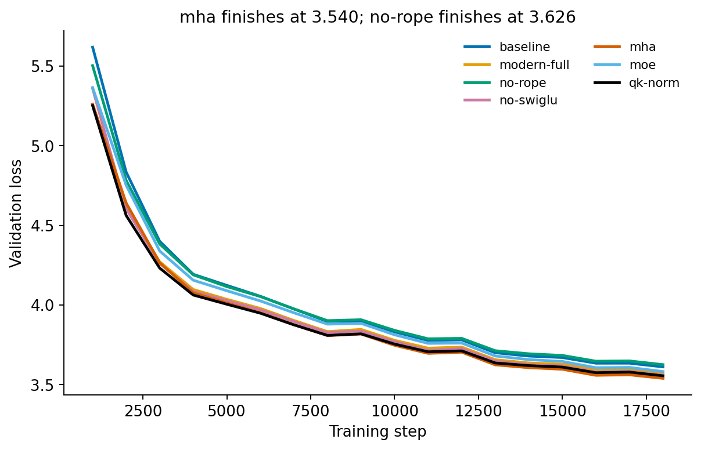

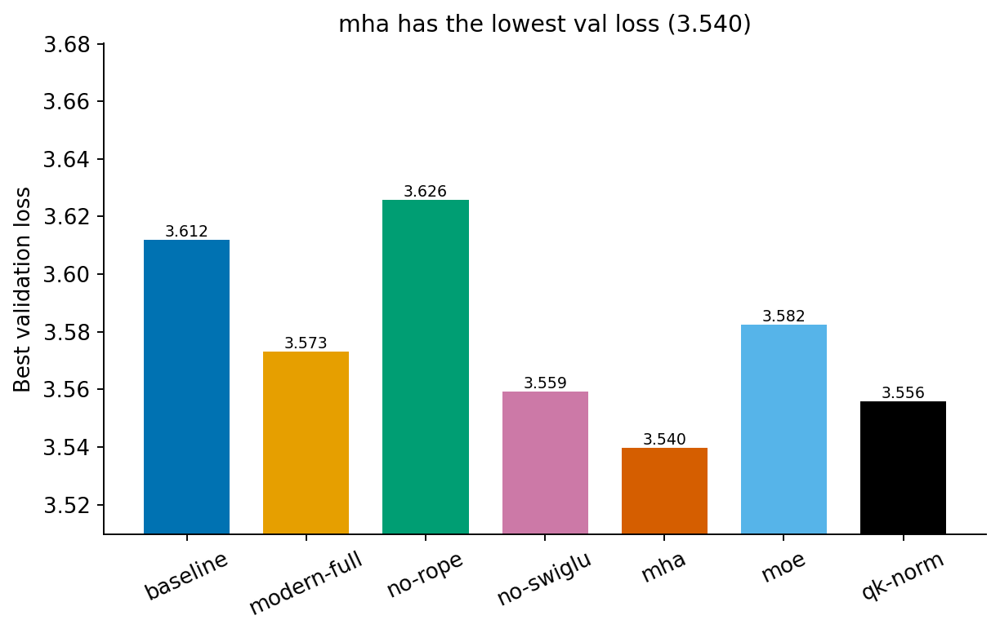

baseline 在 step 1000 / 2000 / 3000 / 4000 的 val loss 是 5.618 / 4.834 / 4.400 / 4.193，到 18000 step 为 3.612。modern-full 在 step 1000 已经是 5.260，早期下降更快，最终 3.573。曲线形状说明模型在学语料，而不是停在随机熵。

可以分开说的机制：

- **位置编码。** 去掉 RoPE、换回可学习绝对位置，是七组里唯一比 baseline 更差的 modern 变体（3.626）。在训练长度 1024 以内，RoPE 仍然比这套绝对编码更合适。这和 E-A-7 的外推结果是同一件事的两端：RoPE 既帮助训练长度内的拟合，也给了 NTK 一个可以改写频率的底座。
- **注意力头。** 损失最低的是完整 MHA（3.540）。GQA-2 的 modern-full 是 3.573，绝对差 0.033，相对 MHA 约 0.9%。KV cache 从 18432 B/token 降到 4608 B/token，是设计上的 75%。在 50M、半个 epoch 的预算下，GQA 用很小的损失换 KV 容量，但不是“免费的精度”。面试里应把这句话说完整：省的是推理时的 KV，训练损失最好的仍是 MHA。
- **FFN。** SwiGLU 的 modern-full（3.573）没有超过 GELU 的 no-swiglu（3.559）。差 0.014，大于评测噪声，所以不能把它写成测量误差。在这个宽度和步数下，SwiGLU 的门控没有兑现常见的“等参数更好”的说法。GELU 组还略快、略省显存（153k tok/s、24.7 GB，对比 146k、26.3 GB）。
- **MoE。** top-1、4 专家的总参数是 137M，激活参数与 modern-full 同为 59.6M，val loss 3.582，比稠密 modern 高 0.009，吞吐从 146k 降到 115k，墙钟多约 18 分钟。稀疏专家在这个规模没有买到更低的损失，换来的是更慢的 step。负载均衡是否学好，要看辅助损失曲线；单看最终 val loss，不支持“等激活参数下 MoE 更强”。
- **QK-Norm。** 3.556，比 modern-full 低 0.017，比 MHA 仍高 0.016。它是一个小的稳定性组件，不是这张表上的主增益。吞吐降到 133k tok/s，峰值显存升到 28.2 GB。
- **组合增益。** modern-full 相对 baseline 的 −1.07% 是真实的，但小于 MHA 和 GELU 替换各自相对 baseline 的降幅。把 RMSNorm、SwiGLU、RoPE、GQA 绑在一起，并不自动成为该预算下的最优配方。RoPE 值得留，GQA 是显存交易，SwiGLU 和 MoE 在这里没有赢。

### 6.3 NTK 长度外推（E-A-7）

同一 modern-full checkpoint，训练 block 是 1024。评测长度 512 和 1024 时两种 RoPE 的缩放因子都是 1，困惑度相同。超过训练长度之后，朴素 RoPE 把频率直接用到更长的位置，NTK 按长度比放大基频。

| 长度 | 朴素 PPL | NTK PPL | NTK 因子 |
|------|----------|---------|----------|
| 512 | 38.50 | 38.50 | 1 |
| 1024 | 40.46 | 40.46 | 1 |
| 2048 | 82.67 | 39.09 | 2 |
| 4096 | 213.80 | 52.50 | 4 |

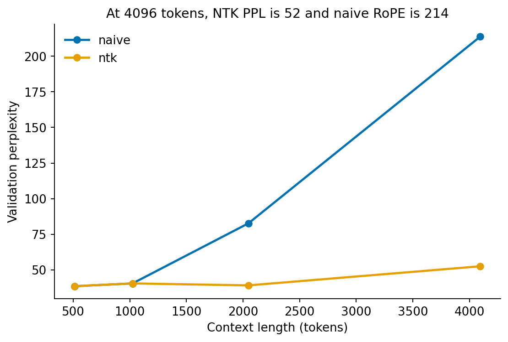

2 倍长度上，NTK 把困惑度留在训练长度附近（39.1，对比朴素 82.7）。4 倍长度上朴素 PPL 到 214，NTK 是 52.5，仍然高于训练长度的 40.5，外推有代价，但退化小一个数量级。每个点约 2.5 万到 20 万 token（12 个 batch × batch 4）。这是本轮最干净的正结果：改的是位置频率，不是再训练。

### 6.4 推理（E-B）

Checkpoint 仍是 modern-full。greedy，每次新生成 64 token，prompt 取 128 / 512 / 896。896 + 64 仍小于 block 1024，所以这组扫描没有越过训练长度。数字是 3 次重复。

| 变体 | 128 tok/s | 512 | 896 | 896 时峰值显存 |
|------|-----------|-----|-----|----------------|
| 无 cache，整段重算 | 154 | 151 | 141 | 1415 MB |
| append KV | 183 | 178 | 181 | 1241 MB |
| paged KV | 102 | 52 | 35 | 1259 MB |
| int8 KV | 138 | 135 | 133 | 1232 MB |

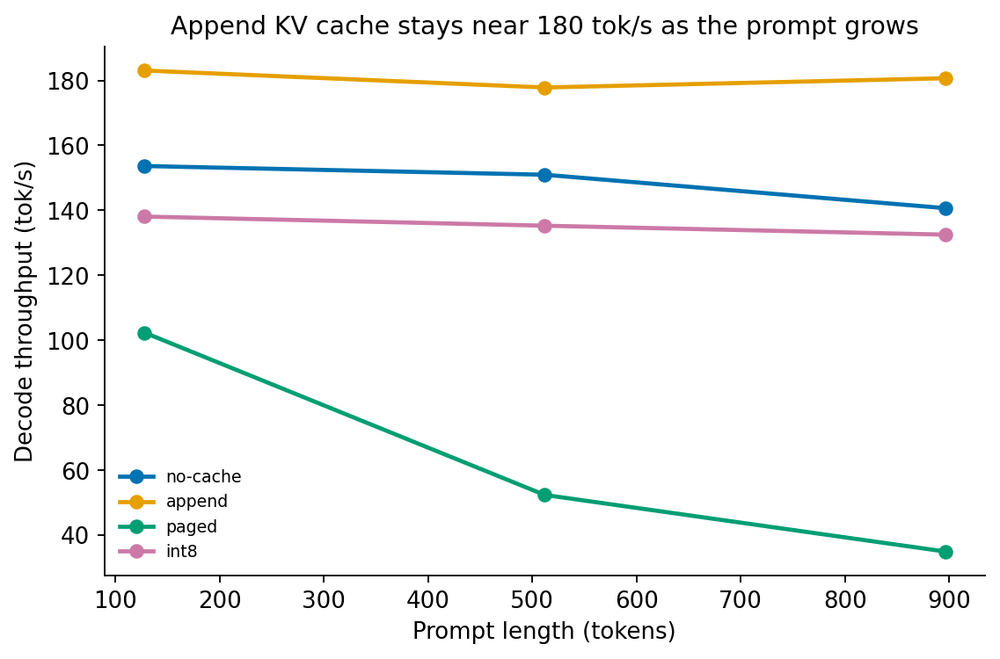

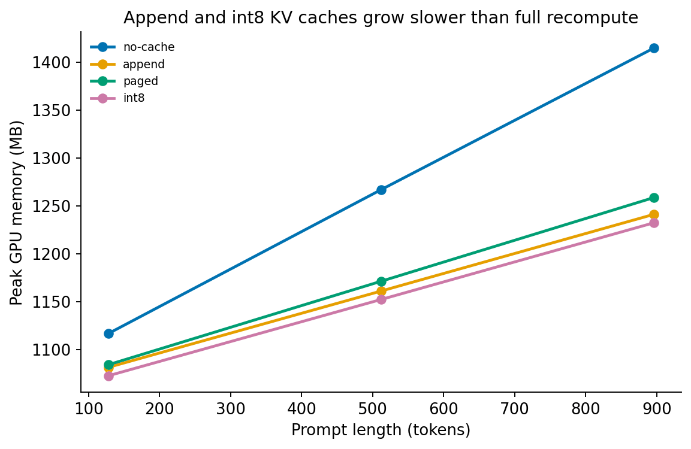

append 路径的吞吐不随 prompt 变长而下降，峰值显存从 1082 MB 增到 1241 MB。无 cache 在 896 时是 141 tok/s、1415 MB。在 50M、单条解码上，append 已经比整段重算更快，也更省。这和 3.3M 短序列上“cache 管理开销盖过计算”的观察不同，那条边界留在第 4 节，不要和这次混用。

paged 在这条单请求路径上更慢，而且 prompt 越长越慢（896 时 35 tok/s）。块表管理的收益出现在很多请求共享显存、需要换入换出的时候；batch 1、64 token 的微基准测不到那个场景。int8 峰值略低于 append（896 时 1232 MB 对 1241 MB），吞吐大约是 append 的 73%。权重本身占了这 1.2 GB 里的大部分，KV 从 bf16 打到 int8 省下的字节在这么短的上下文里几乎看不见。int8 要在更长的序列或多条并发上才值得单独作为卖点。

其余三个点是负结果，同样保留：

- **torch.compile。** prompt 128 时 eager 184 tok/s，inductor 79 tok/s。64 token 的解码太短，编译和再编译的开销盖过了 kernel 融合。
- **投机解码。** draft 是 4 层 / 256 维、只训了 1200 step 的小模型，目标是 12 层 modern-full。draft 长度 2 / 4 / 8 的吞吐是 56 / 47 / 34 tok/s，接受率都是 0。验证步白跑，草稿越长越慢。接受率为 0 说明的是这对草稿与目标不匹配，不是投机解码算法在算术分布上的普遍结论。
- **同宽度草稿。** 在 RTX PRO 6000 Blackwell 上另训了一个 8 层 / 512 维、4000 step、batch 64 的草稿（约 242k tok/s，峰值显存约 65 GB）。对同一份 12 层目标，draft 长度 2 / 4 / 8 的接受率是 53% / 38% / 33%，吞吐是 94 / 90 / 92 tok/s。接受率随草稿变长下降，符合预期。吞吐仍低于 append 的约 180 tok/s，验证前向还没被省下的解码抵消。
- **torch.compile 的长度。** 64 个新 token：compile 94 tok/s，eager 182。256 个新 token：compile 294 tok/s，eager 185，约 1.59 倍。短序列上的负结果留着，它标明了编译成本被摊平的位置。

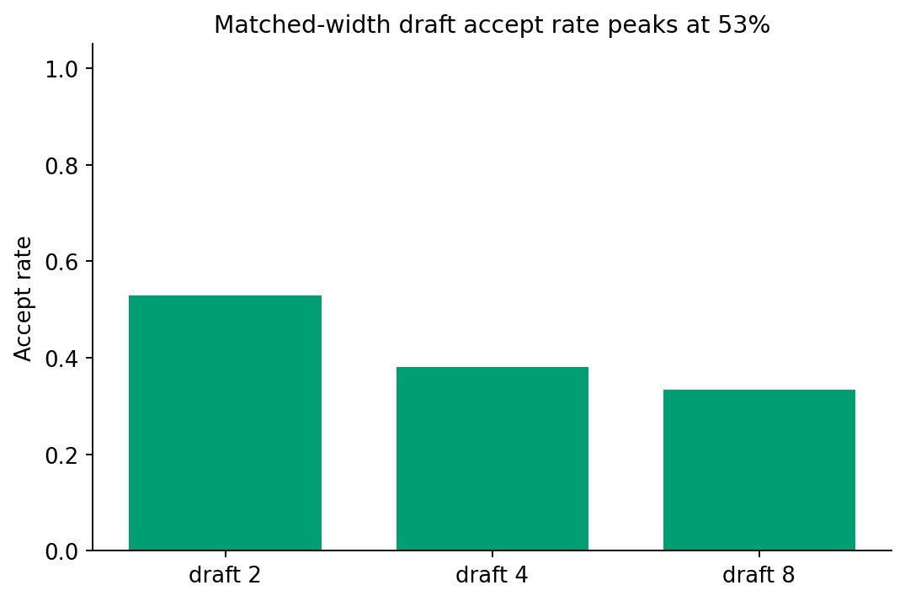
- **连续批处理。** 修复 PyTorch 2.8 上 `attn_mask` 与 `is_causal=True` 不能同时传入 SDPA 之后，16 条请求、prompt 32、各生成 32 token：1 / 4 / 16 并发的吞吐是 108 / 475 / 1920 tok/s。16 并发相对单条约 18 倍，来自把多次小解码合成更大的矩阵乘。同一脚本在 GPU 被另一份 GRPO 占用时重跑过一遍（83 / 345 / 1333），归档用的是先测到的那组。

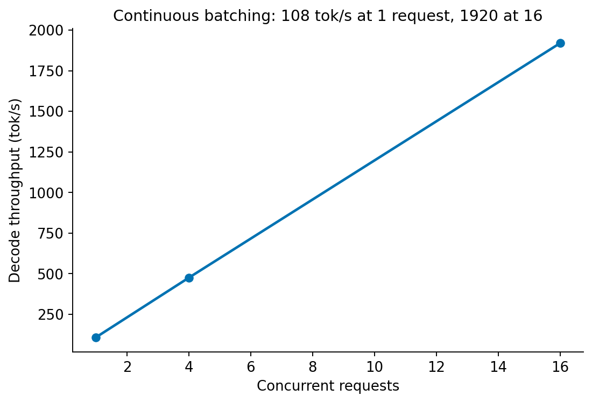

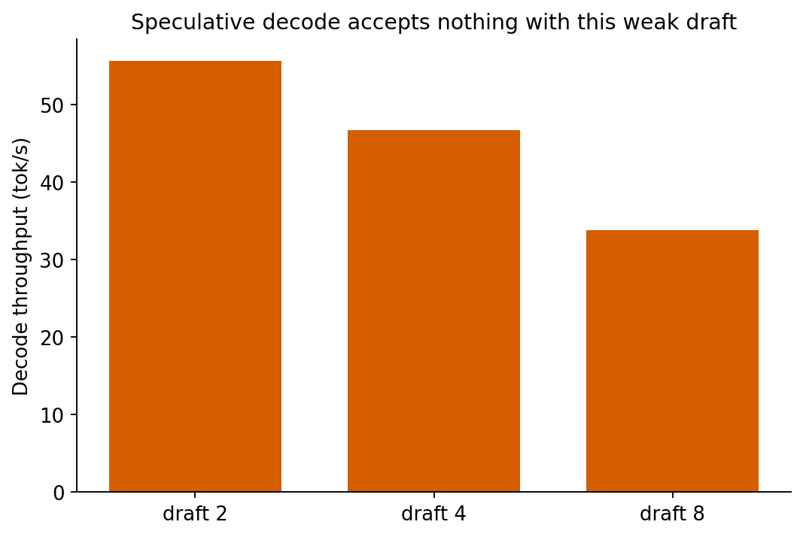

### 6.5 对齐（E-D）

SFT 从 modern-full 出发，算术题 2000 条、2 个 epoch、batch 16、长度 256。评测每个难度 40 条，回复上限 64 token。

| 阶段 | easy 格式 / 准确率 | medium | hard |
|------|--------------------|--------|------|
| 预训练 | 3.0% / 0% | 4.5% / 0% | 5.3% / 0% |
| SFT | 42.5% / 8.3% | 46.5% / 1.5% | 46.0% / 3.0% |

上表里的「格式」是 `_format_score` 的平均值，不是二元通过率。恰好一个合法的 `<answer>数字</answer>` 记 0.5，残缺标签记 0.3，没有标签记 0。所以 0.45 的平均分是满分 0.5 的 90%。同一批评测的 invalid 率是 0–2.5%，按「有没有非空 answer 块」计算，遵从率是 97.5–100%。第 5.1 节 3.3M 模型上的 format=100% 用的是这种二元口径。两套数字可以同时成立：标签几乎都会写，平均分停在 0.5 附近是因为满分就是 0.5。

在 RTX PRO 6000 Blackwell（98 GB）上把预算加大，batch 256，初始化仍是同一份 modern-full checkpoint。每个难度的评测样本加到 80。

| 配方 | 平均格式分 | 占 0.5 上限 | 平均 invalid | easy 准确率 |
|------|------------|-------------|--------------|-------------|
| 2000 条 × 2 epoch（原记录） | 0.450 | 90% | 1.7% | 8.2% |
| 2000 条 × 8 epoch | 0.448 | 90% | 1.3% | 3.7% |
| 8000 条 × 3 epoch | 0.478 | 96% | 3.7% | 10.5% |
| 20000 条 × 2 epoch | 0.492 | 98% | 2.5% | 13.9% |

同一批 2000 条再多训 6 个 epoch，格式分不涨。把样本加到 20000，格式分贴近上限，easy 准确率从 8% 升到 14%，medium 和 hard 仍在个位数。格式分的天花板不是再堆 epoch 能撞开的；算术准确率随样本有一点上升，离「会做题」还远。

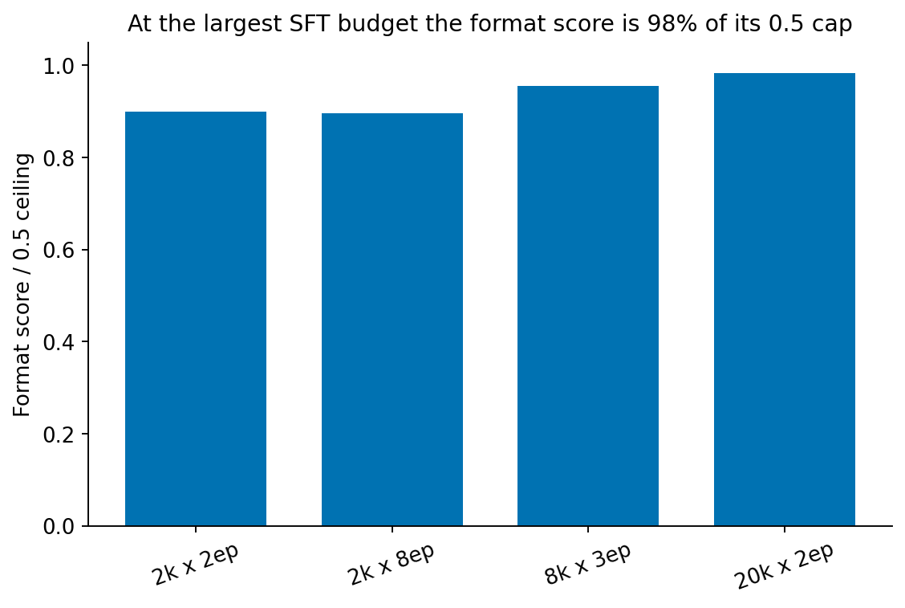

GRPO 从这份 SFT checkpoint 继续。重启打断过一轮 batch 4 的试跑（G4 到 step 110，G8 到 step 100，验证奖励大约 0.61–0.66）。正式记录是重启后的一轮：batch 64、120 step、组大小 4 / 8 / 16，采样合成一次最多 512 条的解码，让 86 GB 的 GPU 跑在大约 30 GB 显存和 30–90% 利用率上。验证奖励：

| step | G4 | G8 | G16 |
|------|----|----|-----|
| 0 | 0.590 | 0.586 | 0.596 |
| 20 | 0.636 | 0.639 | 0.638 |
| 40 | 0.643 | 0.651 | 0.647 |
| 60 | 0.633 | 0.647 | 0.641 |
| 80 | 0.632 | 0.635 | 0.640 |
| 100 | 0.629 | 0.634 | 0.641 |

三条曲线在 step 20 之后都落在 0.63–0.65。组大小没有变成更高的验证奖励。

奖励曲线看不出的那部分，用同一份 SFT checkpoint 直接采样测了。每个难度 16 条提示，组内奖励标准差取提示间的平均，组均值的标准误是这个标准差除以组大小的平方根。

| 组大小 | 组内奖励标准差 | 组均值标准误 | 平均奖励 |
|--------|----------------|--------------|----------|
| 4 | 0.066 | 0.033 | 0.564 |
| 8 | 0.080 | 0.028 | 0.566 |
| 16 | 0.086 | 0.022 | 0.570 |

标准误从 0.033 降到 0.022。组内标准差本身略升，所以下降比 1/sqrt(G) 慢，方向是对的。均值奖励几乎不动。更大的组让基线估计更稳，不会在 120 step 里把奖励均值抬上去。

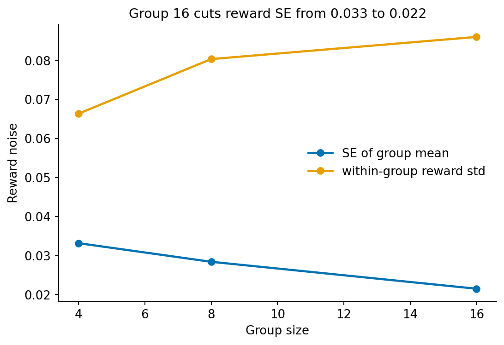

奖励曲线和格式图：

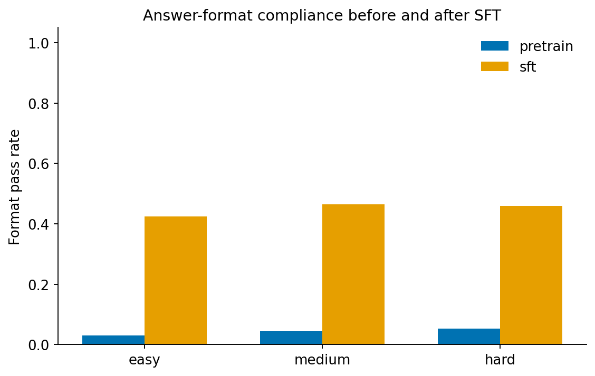

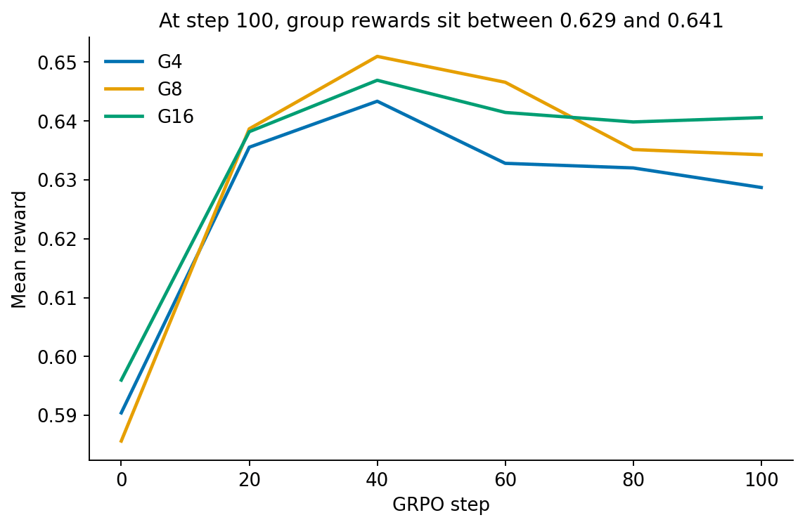

同一份 SFT checkpoint 上又做了离线偏好对比。提示种子用 20260，和评测种子 1337 错开。每个难度 512 条训练提示、64 条验证提示，SFT 策略温度 1.0 采样 8 条、每条 64 个新 token。规则奖励最高的作 chosen，最低的作 rejected，奖励相同的对丢掉。1536 条训练提示里 203 条打平（13.2%），留下 1333 对。chosen 平均奖励 0.756，rejected 0.475，间隔 0.281；准确率间隔 0.177。偏好信号是有的。

DPO 和 IPO 都从这份 SFT 初始化，参考模型锁在同一份 SFT。只对回答 token 算对数概率，并且按因果语言模型把 logits 错一位：位置 t 的 logits 预测的是下一个 token。beta 0.1，学习率 5e-6，weight decay 0，batch 32，3 个 epoch，大约 126 次优化器更新，和 GRPO 的 120 step 接近。评测仍是每个难度 80 条、种子 1337。

| 方法 | 平均奖励 | 准确率 | 格式分 | 过程分 | invalid | 对数比 |
|------|----------|--------|--------|--------|---------|--------|
| SFT | 0.572 | 3.9% | 0.457 | 0.076 | 2.1% | 0 |
| GRPO-G4 | 0.631 | 3.1% | 0.300 | 0.300 | 0 | -0.757 |
| GRPO-G8 | 0.634 | 3.4% | 0.300 | 0.300 | 0 | -0.788 |
| GRPO-G16 | 0.633 | 3.3% | 0.300 | 0.300 | 0 | -0.770 |
| DPO | 0.624 | 2.6% | 0.307 | 0.291 | 0 | -0.777 |
| IPO | 0.623 | 2.5% | 0.307 | 0.292 | 0 | -0.747 |

奖励从 0.572 升到 0.62–0.63，准确率没有一起升。格式分从 0.457 掉到 0.30，过程分从 0.076 升到上限 0.30。过程分只看答案标签前面有没有 `=`、`step`、加减号这类记号，满 4 个就是 0.3。模型学会堆这些记号，同时把「恰好一个数字答案块」的 0.5 分做成了残缺格式的 0.3 分。净奖励大约多 0.06，算术更差了一点。

DPO 和 IPO 没有比在线 GRPO 更高，也没有更省。三组 GRPO 和两种离线损失挤在 0.623–0.634。对数比不是 KL：它是策略自己采样的 token 上，`log π_SFT - log π_θ` 的平均。SFT 对自己是 0；对齐之后的五个模型都在 -0.75 到 -0.79，策略比 SFT 更相信自己写出的句子，彼此没有拉开。

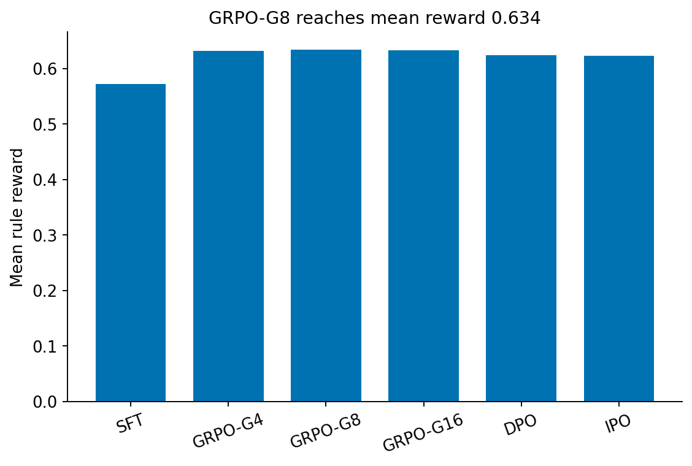

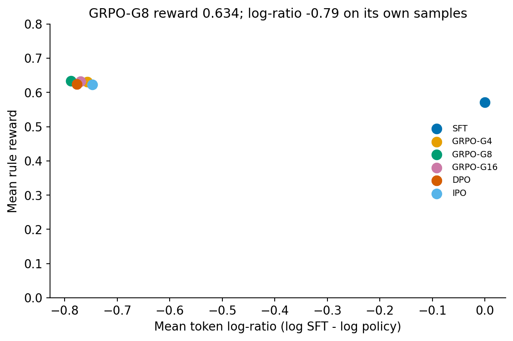

### 6.6 训练系统（E-C）

每档只训 300 个 iteration，看吞吐，不把这里的 val loss 和 18000 step 的消融比。

| 配置 | tok/s | 300 step 时 val loss |
|------|-------|----------------------|
| bf16 | 147.7k | 5.784 |
| fp32 | 70.2k | 5.753 |
| 梯度累积（micro-batch 8 × 4） | 157.1k | 6.890 |
| FSDP（单卡） | 148.0k | 5.747 |

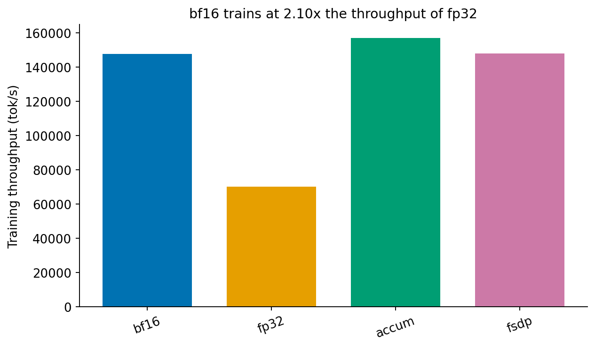

bf16 是 fp32 的 2.10 倍吞吐，两者的早期 val loss 差 0.03，在 300 step 上还看不出精度损失。梯度累积那一档的 val loss 更高，是因为训练循环按 micro-batch 递增 `iter_num`：300 次迭代在累积 4 下只有约 75 次优化器更新。吞吐数字（处理过的 token / 秒）仍然可比，收敛曲线不可比。单卡 FSDP 与 bf16 的吞吐和损失几乎相同，测到的是包装开销，不是多卡扩展。这台机器只有一张 GPU，没有 DDP/FSDP 强扩展曲线。

MoE 前向微基准（4096 token，bf16）：专家数 2 / 4 / 8 / 16 时，分组 GEMM 稳定在 1.86–1.98 ms，逐专家循环从 2.04 ms 增到 11.39 ms。16 个专家时分组 GEMM 是循环的 5.8 倍。这解释了实现选择，不改变 6.2 节里 MoE 训练损失没有赢过稠密模型的事实。

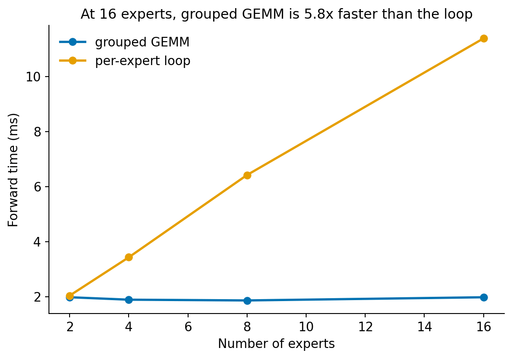

### 6.7 这次能说和不能说的

能说的：在 12 亿 token 前缀、18000 step、50M 这一档，MHA 的验证损失最低；GQA-2 用大约 0.033 的损失换 75% 的 KV；去掉 RoPE 是最差的单点改动；NTK 在 2–4 倍长度上明显压住朴素外推；append KV 是这条解码路径上又快又稳的默认；bf16 相对 fp32 有约 2 倍训练吞吐；分组 GEMM 把 MoE 前向从随专家数线性变慢变成几乎持平。对齐这边，GRPO、DPO、IPO 都把规则奖励从 0.572 抬到 0.62–0.63，抬的是过程分，不是准确率。

不能说的：modern 组件的组合在任何规模都优于 GPT-2 块；SwiGLU 或 top-1 MoE 在这个预算下降低了损失；paged cache 或 4 层弱草稿带来了加速；同宽度草稿目前的接受率已经够把吞吐超过 append；单卡 FSDP 有扩展收益；把格式分 0.45 说成 45% 的通过率。格式分的上限是 0.5，二元标签遵从率在这次 SFT 里已经高于 97%。torch.compile 只在更长的解码（这里是 256 token）上快过 eager。不能说 DPO 比 GRPO 样本效率更高，也不能把 0.63 的规则奖励说成模型学会了算术。

### 6.8 roofline 本机微基准（AR-v0.6.0 / T004）

环境：Quadro RTX 5000（16 GiB GDDR6，规格带宽 448 GB/s，L2 4 MiB，sm75），fp32，`python tools/infra/run_roofline.py --quick`（10 尺寸点，<1 分钟；产物 `docs/results/roofline.json`，schema version 1）。

段1 GEMM 尺寸扫描（方阵，工作集 0.05 MiB → 768 MiB 跨过 L2）：

| size | ms | GFLOPs/s | 工作集 |
|------|----|----------|--------|
| 64 | 0.0619 | 8.5 | 0.05 MiB |
| 256 | 0.0485 | 691.9 | 0.75 MiB |
| 512 | 0.0735 | 3654.4 | 3.0 MiB |
| 1024 | 0.299 | 7182.0 | 12.0 MiB |
| 4096 | 15.2646 | 9003.8 | 192.0 MiB |
| 8192 | 111.902 | 9825.7 | 768.0 MiB |

小→大 GFLOPs/s 提升 1160 倍：64³ 时 kernel 启动开销主导（8.5 GFLOPs/s），工作集进入显存段后稳定在 9–9.8 TFLOPs/s，接近本卡 fp32 规格峰值（约 11 TFLOPS）。cache-bound 区间肉眼可见。

段2 GEMV 对照（强度约 1）：4096×4096 达 349.2 GB/s，为规格带宽的 77.9%（2048² 54.8%、8192² 69.2%）——访存受限方向验证成立，且小矩阵吃不满带宽。

段3 decode 步反推（tiny ModernGPT，4 层 / d=128，7,286,016 参数，fp32 权重 27.8 MiB）：单 token 前向 6.05 ms，反推有效带宽 4.81 GB/s，只有规格的 1.1%。bound=memory 的方向判定成立（batch=1 强度约 0.5，远低于 ridge），但绝对利用率被 kernel 启动与 Python 调度开销主导——小模型 decode 慢在「跑不满带宽」，不是「带宽不够」。这与手册 §7 心算残差（7~9 GB 心算 vs 26.26 GB 实测）指向同一结论：总量靠心算到量级，归因靠 profiler。

能说的：本卡 GEMM 稳态算力约 9.8 TFLOPs/s、GEMV 稳态带宽约 350 GB/s、L2 边界前后算力差 3 个数量级。不能说的：把 tiny 模型的 1.1% 带宽利用率外推到生产规模 decode——大模型权重驻留显存，单步读满全部权重，利用率量级完全不同。

## 7. 关键结论与限制

1. 3.3M 合成数据实验只证明链路能跑通。架构比较以第 6 节的 OpenWebText 前缀为准。
2. 50M、半个 epoch 上，损失最好的是带 RoPE 的 MHA，不是把 GQA、SwiGLU、MoE 全部打开。
3. KV cache 的吞吐优势在 50M 的 append 路径上已经出现；paged、compile、弱草稿投机解码在本轮微基准里更慢。
4. 验证集是留出分片的前 10000 篇，token 数与迁移文档一致，但不是官方验证划分的逐文档证明。
5. 规则奖励升高时要拆开看。这一轮 GRPO/DPO/IPO 的过程分顶到 0.3，格式分从 0.46 掉到 0.30，准确率停在 3% 附近。

---

## 8. 完整复现命令

```bash
# 1. 环境
pip install -r requirements.txt

# 2. 数据准备（真实 OpenWebText；--full = 全量 7,913,597 docs，省略则默认 1M 子集）
python data/prepare.py --split train --full
python data/prepare.py --split val --full
python data/validate.py data/openwebtext/train.bin

# 3. 预训练（50M 参数，18k iters）
python training/train_pretrain.py --model baseline --batch_size 12 --max_iters 18000
python training/train_pretrain.py --model modern   --batch_size 12 --max_iters 18000 --n_kv_head 2

# 4. 推理消融
python inference/generate.py --checkpoint out/pretrain/best_ckpt.pt --use_cache
python inference/generate.py --checkpoint out/pretrain/best_ckpt.pt

# 5. SFT
python training/train_sft.py --init_from out/pretrain/best_ckpt.pt --variant sft-only

# 6. GRPO
python training/train_grpo.py \
  --init_from out/sft/final_sft-only.pt \
  --ref_from out/sft/final_sft-only.pt \
  --group_size 4 --num_steps 1000

# 7. 评估
python evaluation/eval_alignment.py --checkpoint out/grpo/best.pt --ref_checkpoint out/sft/best.pt
python evaluation/eval_benchmark.py --checkpoint out/pretrain/best_ckpt.pt --data_dir data/openwebtext --split val

# 8. 回归测试
python -m pytest tests/ -q

# 9. roofline 微基准（6.8 节）
python tools/infra/run_roofline.py --quick
```

---

## 9. 后续实验建议

1. 把同一七组矩阵训完一个 epoch（约 36000 step），看 GQA 与 MHA 的 0.033 差距是否保持。
2. 用一层宽度接近目标模型的草稿重做投机解码，当前接受率为 0 的结论只覆盖 4 层 / 1200 step 的草稿。
3. 算术准确率在 20000 条上仍然只有 easy 14%。再加数据之前，先看奖励是不是几乎只有格式分。
4. 多卡上补 DDP 与 FSDP 的强扩展。单卡 FSDP 不能代替这件事。
5. 梯度累积的对照要把 `max_iters` 乘上累积步数，否则优化器更新次数不同。

---

## 10. 原始数据文件索引

| 内容 | 路径 |
|------|------|
| 推理消融 | `out/inference_ablation_results.json` |
| 完整评估 | `out/full_evaluation_results.json` |
| SFT 评估 | `out/sft_fast/eval_results.json` |
| GRPO 评估 | `out/grpo_fast/eval_results.json` |
| 预训练日志 | `out/pretrain_baseline_fast/*.log`, `out/pretrain_modern_fast/*.log` |
| 云端预算 | `docs/results/budget.json` |
| 七组摘要 | `docs/results/ablation-summary.json` |
| NTK | `docs/results/ntk_eval.json` |
| 推理 | `docs/results/inference.json` |
| 训练系统 / MoE kernel | `docs/results/system.json`, `docs/results/moe_kernel.json` |
| roofline | `docs/results/roofline.json` |
| 预训练与 SFT 评测 | `docs/results/pretrain_eval.json`, `docs/results/sft_eval.json` |
| GRPO 曲线 | `docs/results/alignment.json` |
