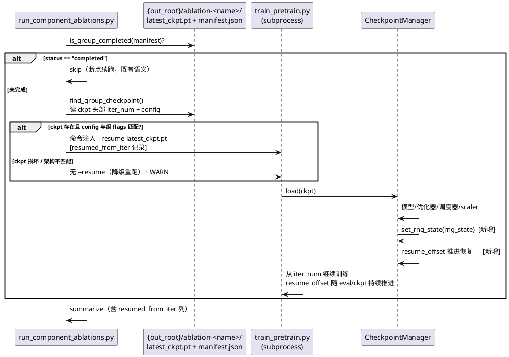
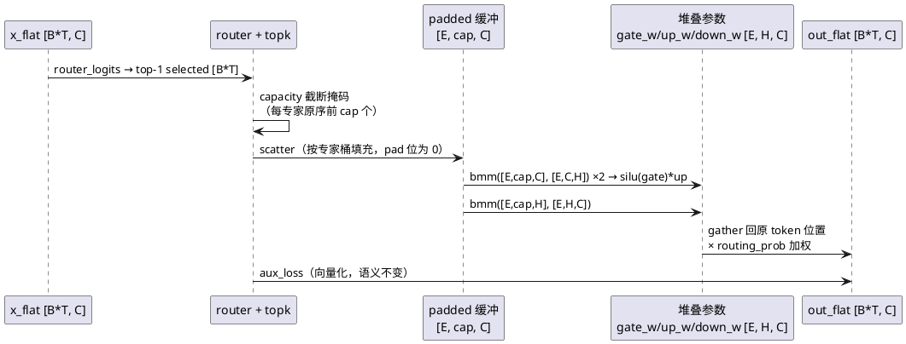
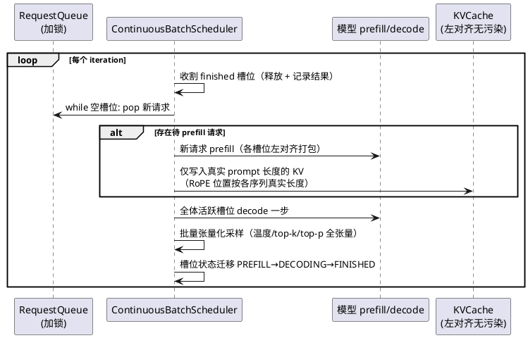
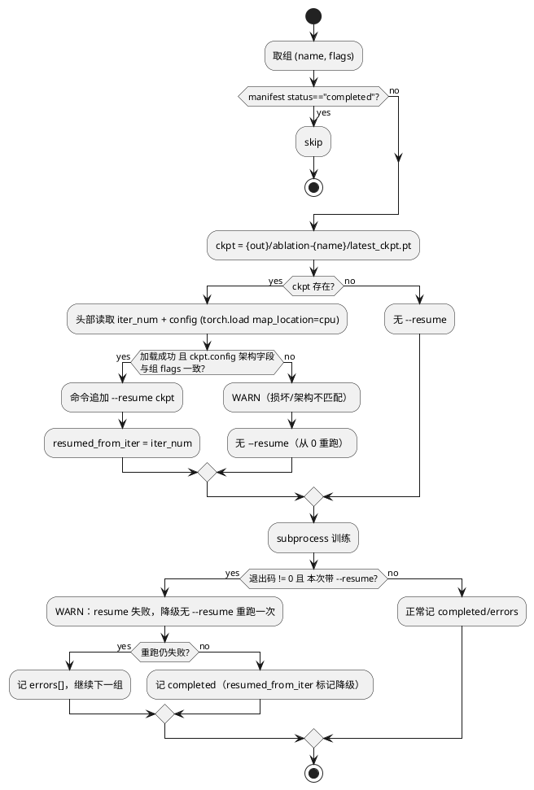
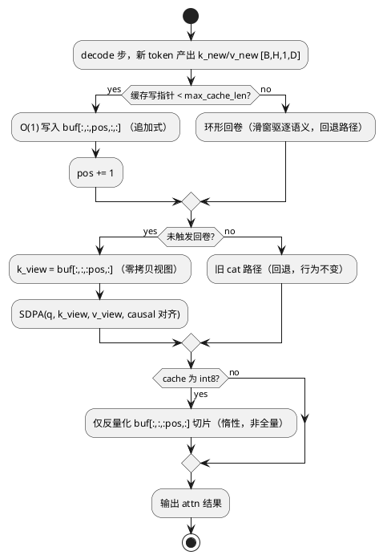

# 1 AR概述

| 组件名称 | nanoGPT-Modern（轻量级 LLM 全栈框架） |
| --- | --- |
| AR系统流水号 | AR-v0.5.0-hpc-readiness |
| AR描述 | 高算力迁移就绪：修复推理子系统正确性缺陷（Paged KV/NTK cache 上限/投机解码分布/greedy）、夯实可移植性（依赖固化/迁移 runbook/断点续跑强化）、按 A100/H100 特性强化训练性能（GQA enable_gqa/MoE 向量化/KV decode 去 cat/DDP 数据分片/FSDP 补齐/连续批处理重构），并以工程整理（重复代码提取/接口统一/lint 修复）与设计文档交付框架理解力。 |

**选定方案：** MoE 路线 B（堆叠参数 + 定容 padded bmm + checkpoint 翻译 hook）+ KV decode 路线 B（追加式预分配缓冲 + 视图切片，ring 环形保留为驱逐回退），flash wrapper 为可选分支。用户已确认。

## 方案对比与决策记录

| 决策点 | 方案 A | 方案 B（选定） | 决策理由 |
| --- | --- | --- | --- |
| MoE 重写（T012） | 保结构循环重写：保留 `nn.ModuleList`（旧 ckpt 零风险），argsort 分桶 + 逐专家真 2D GEMM；Python 专家循环保留、各专家 token 数为动态 shape | 堆叠参数 `Parameter[E,H,C]` + 定容 padded bmm `[E,cap,C]`；load/save 翻译 hook 双向兼容（磁盘格式不变）；零 Python 循环、形状全静态 | srs FR6 验收含「compile 无逐 shape 重编译」+「≥2x」双指标：A 的动态 shape 需 dynamic compile 模式，第一项无法稳定满足；B 的 padding 行贡献精确为 0，atol=1e-5 可达；参数结构 breaking 在 v0.5.0 授权范围内 |
| KV decode 去 cat（T013） | 两段 SDPA 拼接：`attn(q, k_past)` 与 `attn(q, k_new)` 分两次调用 + softmax 权重合并 | 追加式预分配缓冲 + `[:pos]` 视图直喂 SDPA（零拷贝）；ring 仅作驱逐回退（`evicted` 标记）；flash wrapper 可选分支 | A 的 split-softmax 数值路径与原单次 SDPA 不同，atol=1e-5 逐位等价难以保证；B 输出与原 cat 路径逐 bit 同序，等价性风险最小 |
| PrefixCache / _init_decode_compile（T014） | 实现注入逻辑（前缀缓存命中复用 KV） | 删除占位与死代码 | srs 允许二选一；当前无实验依赖 prefix 语义，「不留死代码」原则优先，降低 ~300 行调度器重写的耦合面 |

> 外部 grouped GEMM（flashinfer/cutlass）与「flash-attn 作为主路径强依赖」两个方向因违反 srs 约束「不引入重型强依赖」未予提案。

---

# 2 动态行为

## 交互时序图

### 2.1 编排器断点续跑（FR3，云抢占恢复场景）



### 2.2 MoE 前向（FR6，堆叠参数 + padded bmm）



### 2.3 连续批处理 iteration-level 调度（FR7）



---

# 3 功能点分解

| 序号 | 功能点名称 | 功能点描述 | 追溯 |
| --- | --- | --- | --- |
| 1 | 依赖与环境固化 | pyproject 补 server/validate extras、torch pin ~=2.5、uv.lock 同步、Docker/compose 现代化、CI 补 lock/Docker job | FR1 |
| 2 | 数据迁移 runbook | prepare.py 复现陷阱修复、docs/MIGRATION.md、本机演练 ≤1h | FR2 |
| 3 | 编排器组内自动 resume | ckpt 探测/架构校验/--resume 注入/降级重跑/resumed_from_iter | FR3 |
| 4 | 训练 resume 完整性 | set_rng_state 接线、resume_offset 真实推进、early_stop_counter、--ckpt_interval | FR3 |
| 5 | 运行管理 | 日志轮转、metrics.jsonl 心跳 watchdog、失败 webhook 通知 | FR3 |
| 6 | Paged KV 修复 | get_cache 逐层返回、block table 逐层隔离、n_layer=2 回归测试 | FR4 |
| 7 | NTK 生成路径解锁 | generate 四处 max_cache_len → effective_block_size | FR4 |
| 8 | 投机解码分布修正 | greedy p_d=point mass、完整 q 残差、温度统一、KL 等价测试、temperature=0 greedy | FR4 |
| 9 | KV decode 去 cat | 追加式预分配缓冲 + 视图切片、int8 惰性反量化、滑窗 mask 向量化 | FR5 |
| 10 | MoE 向量化重写 | 堆叠参数 [E,H,C] + 翻译 hook + 定容 padded bmm、compile 兼容 | FR6 |
| 11 | 连续批处理重构 | iteration-level 调度器、padding/位置修复、死代码清理、批量采样张量化 | FR7 |
| 12 | api_server 接线 | asyncio.to_thread + 线程安全队列、--continuous_batching 声称对齐 | FR7 |
| 13 | GQA enable_gqa | SDPA 原生 GQA（torch≥2.5 探测回退）+ 探测移出首 forward（compile 修复） | FR8 |
| 14 | 训练循环性能 | 数据路径/eval 瘦身/EMA foreach/micro-step 去同步/TF32 全训练器/异步 checkpoint | FR8 |
| 15 | DDP 修复 | rank 数据分片（互斥）+ no_sync/static_graph/gradient_as_bucket_view | FR9 |
| 16 | FSDP 补齐 | auto_wrap_policy/use_orig_params/compile 顺序/checkpoint 修复 + round-trip 测试 | FR9 |
| 17 | 根目录收编 | 12 脚本归类、死文件删除、[project.scripts]/CI 路径同步 | FR10 |
| 18 | 重复代码提取 | training/args.py 公共 flag、load_model 统一、conftest.py tiny fixture、test_bugfixes 拆分 | FR11 |
| 19 | 模型接口统一 | BaselineGPT 3-tuple、no-op 显式化、调用点同步、CHANGELOG | FR12 |
| 20 | lint/测试基建 | black 100 统一、ruff 配置、mypy 对齐、脆弱测试改相对断言、文档数字刷新 | FR13 |
| 21 | 理解力交付物 | ARCHITECTURE.md、modern_gpt 分区导航 + docstring、GRPO 家族笔记 | FR14 |
| 22 | 假计时修复 | profile_inference step() 挂入真实 decode 回调 | FR4 |

---

# 4 实现设计

## 4.1 功能实现思路

**总原则：**
1. **正确性优先于性能**：Phase A（功能点 1-8、22）先于 Phase B（9-16）先于 Phase C（17-21）；kernel 级改造（MoE/KV decode）必须先建立「与旧实现逐位等价」的回归测试基线，再切换实现。
2. **数值路径最小变化**：KV decode 走追加式缓冲（值与序完全同旧 cat 路径）；MoE padded bmm 的 padding 行贡献精确为 0（`0 × W = 0`，无累加误差）；两者使 atol=1e-5 等价可达。
3. **兼容层显式化**：MoE 参数结构变更配 `_register_load_state_dict_pre_hook` / save 拆分 hook（旧 checkpoint 双向兼容）；BaselineGPT 3-tuple 为 v0.5.0 唯一授权 breaking（CHANGELOG 记录）。
4. **降级哲学贯穿**：flash wrapper / webhook / 异步 checkpoint / enable_gqa 探测失败均静默或告警回退，不阻塞主路径——与既有「监控失败降级为警告」一致。
5. **测试先行**：每个功能点 Red（测试先行确认缺陷/缺失）→ Green（实现）→ 等价/性能基准（kernel 级）。

## 4.2 功能实现设计

### 4.2.1 流程图

#### A. 编排器组内 resume 决策（FR3）



#### B. KV decode 追加式路径（FR5）



#### C. 心跳 watchdog（FR3 运行管理）

```plantuml
@startuml
start
:watchdog 线程启动（编排器内）;
:baseline = 最近 N 个 train 事件的 ts 间隔均值;
loop 每次轮询
    :now - 最后事件 ts > 3 × baseline?
    if (超时?) then (yes)
        :stderr + webhook 告警「训练疑似停滞」;
        :告警去抖（同组一次）;
    else (no)
    endif
end loop
stop
@enduml
```

#### D. 投机解码接受/拒绝采样（FR4 修正后）

```plantuml
@startuml
start
:draft 采样 γ 个 token;
if (draft_temperature == 0?) then (yes)
    :p_d = point mass（选中 token 概率=1）;
else (no)
    :p_d = 调温后 draft softmax 分布;
endif
:target 验证 forward（与最终采样同温度 softmax）→ p_t;
loop 每个位置 i
    if (rand() < min(1, p_t(tok_i)/p_d(tok_i))?) then (yes)
        :接受 tok_i;
    else (no)
        :拒绝，从 norm(max(0, p_t(x) − p_d(x))) 采样残差 token;
        :停止本轮回合;
    endif
end loop
:若全部接受：额外采样一个 token（同温度）;
stop
@enduml
```

### 4.2.2 流程说明

**MoE padded bmm 细节（FR6）：**
- 参数布局：`gate_w/up_w: Parameter[E, H, C]`，`down_w: Parameter[E, C, H]`（H=intermediate）。`router: Linear(C, E)` 不变。
- 兼容 hook：`_register_load_state_dict_pre_hook` 将旧键 `gate_proj.{e}.weight [H,C]` 沿 dim=0 拼接为 `gate_w`；`state_dict()` 覆写时反向拆分（新 checkpoint 保存为旧键格式，**磁盘格式不变**）。
- 路由：`selected [N]`（N=B·T）→ 每专家容量 `cap = ceil(capacity_factor × N / E)`（与现行 `int(...)` 截断语义对齐，测试锁定）；每专家按**原 token 序**取前 cap 个（`argsort(selected, stable=True)` + 段内截断，与现行 `idx[:capacity]` 逐位一致）。
- scatter：`padded [E, cap, C]` 填 0，`index_put_` 写入选中 token；`slot_idx [N]`（超出容量的 token 槽位标记 -1，gather 时以掩码置零）。
- 计算：`ge = silu(padded @ gate_w.transpose(1,2))`、`ue = padded @ up_w.transpose(1,2)`、`de = (ge*ue) @ down_w.transpose(1,2)`——三次 bmm，形状全静态 `[E,cap,·]`。
- 回写：gather `de[e, slot]` 至原位置 × `router_probs[:, e]`；被容量丢弃的 token 输出 0（与现行 `index_copy_` 不写语义一致——现行实现丢弃 token 输出保持 `out_flat` 初始 0）。
- aux_loss 向量化路径（现行 717-724 行）原样保留。

**KV 追加式缓冲（FR5）：**
- `KVCacheManager` 新增 `layout="append"` 模式（默认启用）：预分配 `[B, H, max_cache_len, D]`（max_cache_len = effective_block_size），写入 `pos` 单调递增；`get_cache()` 返回 `buf[:,:,:pos,:]` 视图。
- `layout="ring"`（现行）保留：仅当 `pos ≥ max_cache_len` 需要驱逐时切换语义（滑窗场景），attention 走旧 cat 路径——两路径输出等价由 `test_kv_cache_equivalence` 锁定。
- int8：`get_cache()` 反量化范围从全 buffer 改为 `[:pos]` 切片；量化写路径不变。
- attention 层（modern_gpt.py:393-407）：`past_kv is not None and not cache.evicted` 分支直取视图，删除该分支的 cat。
- generate 四处 `max_cache_len = block_size` → `effective_block_size`（FR4-7 与 FR5 同一改动面，T005 先行）。

**连续批处理状态机（FR7）：**
- 槽位状态：`EMPTY → PREFILL → DECODING → FINISHED`；每 iteration：收割 FINISHED → 空槽 pop 新请求 → 待 prefill 请求打包（**左对齐**，右侧 pad 不参与 KV 写入：prefill 后按各序列真实长度截断写入，RoPE 位置 = 真实长度）→ 全体 DECODING 槽位步进 → 张量化采样（温度/top-k/top-p 以 `[B]` 张量参与，复用 generate_utils，消灭逐序列 Python 循环）。
- PrefixCache 类与 `_init_decode_compile`：**删除**（死代码不留），`RequestQueue` 加 `threading.Lock`。
- 单请求（B=1）路径与 generate() 输出一致性测试锁定。

**resume_offset 推进（FR3）：**
- `MemmapDataset.__iter__` 产出 chunk 的全局序号 `chunk_no`（shuffle idx 语义下为置换后的逻辑序号）；训练循环每消费一个 batch，`self.resume_offset = start_chunk + consumed`；checkpoint 保存时随 `resume_offset` 存入。恢复时 `_build_data(resume_offset)` 从该逻辑位置继续。
- 与 T010 rank 分片的交互：分片模式下 offset 语义变为「rank 内局部序号」，checkpoint 记录 `world_size`/`rank`，恢复时校验一致（不一致则 WARN 并从该 rank 分片头部开始）。

**GQA enable_gqa（FR8）：**
- `_gqa_mode` 探测移至 `__init__`（构造后空跑一次 dummy forward 前完成探测，或直接按 torch 版本静态判定）；torch≥2.5 时 SDPA 调用加 `enable_gqa=True`（走原生 flash GQA 内核），<2.5 回退现行 5-D broadcast。
- 探测结果缓存为普通属性（compile 图内无 try/except）。

**FSDP（FR9）：**
- `auto_wrap_policy`：按 `transformer_auto_wrap_policy` 以 `Block` 为 unit（per-layer 分片）。
- `use_orig_params=True`；顺序：FSDP 包裹 → torch.compile（官方推荐）。
- checkpoint：接线现行死代码 `_get_model_state_dict`（`train_pretrain.py:365-375` 的 FULL_STATE_DICT 处理）到 `_save_checkpoint`；加载侧对应 `FULL_STATE_DICT` 恢复。单机多卡下 rank0 保存。

**异步 checkpoint（FR8）：**
- `CheckpointManager.save`：CPU staged 拷贝（`state_dict → {k: v.cpu() 非阻塞}`）→ 后台线程 `torch.save` 到 tmp → `os.replace`（原子性保持）；主线程仅承担 H2D 拷贝。保存期间新一次 save 请求排队（串行后台写）；失败回退同步路径 + WARN。

**训练循环性能（FR8）实现要点：**
- 数据路径：`DataLoader(pin_memory=True)` + batch `.to(device, non_blocking=True)`；`persistent_workers = (num_workers > 0)`；num_workers 环境分层默认值：`os.name == "nt" → 0`、Linux → 4，配置显式覆盖优先。
- eval 瘦身：新增 `--eval_batch_size`（默认 train batch 2x）；多卡下 eval loss 各 rank allreduce 取平均（非 master 不再空转）；eval loss 以 tensor 累积、eval 结束单次 `.item()`（消灭逐 iter sync）。
- micro-step 去同步：训练 loss 以 tensor 累积，`accumulation_step` 末统一一次 `all_reduce` + 单次 `.item()`；日志从缓存 tensor 读取。
- EMA：`torch._foreach_lerp_(ema_params, model_params, decay)`（影子参数展平列表，200+ 逐参数 kernel → 2-3 个 foreach kernel）。
- TF32：`torch.backends.cuda.matmul.allow_tf32 = True` + `torch.backends.cudnn.allow_tf32 = True` 提取为公共初始化函数（trainer_base），5 个训练器统一调用。

## 4.3 接口描述

### 4.3.1 `run_component_ablations.py`（FR3）

| 接口 | 签名 | 说明 |
| --- | --- | --- |
| ckpt 探测 | `find_group_checkpoint(out_root: str, name: str) -> Optional[Tuple[Path, int, dict]]` | 返回 (ckpt 路径, iter_num, ckpt 内 config 摘要)；损坏 → None |
| 架构校验 | `ckpt_matches_group(ckpt_cfg: dict, flags: List[str]) -> bool` | 比对 n_kv_head/num_experts/position_encoding/ffn_variant/model |
| 命令组装 | `build_train_command(base_cmd: List[str], out_root: str, name: str, flags: List[str], resume_from: Optional[Path] = None) -> List[str]` | 组装并返回完整子进程命令；`resume_from` 非 None 时注入 `--resume`；不抛异常（降级由调用方决策） |
| summary 字段 | 每组 row 增加 `"resumed_from_iter": Optional[int]` | 降级重跑时为 0 |

### 4.3.2 `CheckpointManager` / `BaseTrainer`（FR3/FR8/FR9）

| 接口 | 变更 | 说明 |
| --- | --- | --- |
| `CheckpointManager.load` | +`set_rng_state(extra["rng_state"])`（存在时） | 恢复 torch/cuda/numpy/python 四套 RNG |
| `load/save` 额外键 | `early_stop_counter`、`consumed_chunks`、`world_size`、`rank` | 旧 ckpt 缺键 → 默认值（兼容） |
| `save` | 异步模式 `async_save: bool = True` | 失败回退同步 + WARN |
| `BaseTrainer` 新增 CLI | `--ckpt_interval: int = 0`（0=跟随 eval_interval） | 5 个训练脚本经 args 提取统一注入 |
| DDP 构造 | `DDP(model, static_graph=True, gradient_as_bucket_view=True)` | 结构固定模型 |
| FSDP 构造 | `auto_wrap_policy=Block 策略, use_orig_params=True` | compile 兼容 |

### 4.3.3 `MoEFFN`（FR6，modern_gpt.py）

| 接口 | 变更 | 说明 |
| --- | --- | --- |
| 参数 | `gate_w/up_w: Parameter[E,H,C]`、`down_w: Parameter[E,C,H]` 替代 ModuleList | **磁盘格式不变**（load/save hook 翻译） |
| `forward(x)` | 签名不变，返回 `(out, aux_loss)` | padded bmm 路径 |
| 兼容 hook | `_register_load_state_dict_pre_hook` + `state_dict` 覆写 | 旧/新 ckpt 双向兼容 |
| 等价断言 | 固定种子下与旧实现 loss atol=1e-5 | 测试锁定 |

### 4.3.4 `KVCacheManager`（FR5，kv_cache_utils.py）

| 接口 | 变更 | 说明 |
| --- | --- | --- |
| 布局 | `layout: str = "append"`（"ring" 保留） | append 为默认快速路径 |
| 写入 | `append(k_new, v_new)` O(1) 写 `pos` 位置 | 替代 cat 后 update |
| 读取 | `get_cache() -> Tensor` 返回 `buf[:,:,:pos,:]` 视图 | int8 模式惰性反量化该切片 |
| 驱逐 | `pos >= max_cache_len` → 切 ring 语义 + `evicted=True` 标记 | attention 走旧路径 |

### 4.3.5 推理路径（FR4/FR7）

| 接口 | 变更 | 说明 |
| --- | --- | --- |
| `PagedKVCache.get_cache` | 逐层 `self._get_layer_blocks(layer_idx)` | 修 bug 1 |
| `PagedKVCache.update` | write_pos/block table 按层隔离 | 修 bug 2 |
| `_sample(logits: Tensor, temperature: float, top_k: Optional[int] = None, top_p: Optional[float] = None) -> Tensor` | `temperature == 0` → argmax | 三处（modern_gpt/generate_utils/continuous_batching） |
| `_draft_sample(logits: Tensor, temperature: float) -> Tensor` | greedy（temperature==0）时 p_d 取 point mass（选中 token 概率 = 1.0），否则调温 softmax | 分布修正 |
| `_verify(draft_tokens: Tensor, target_logits: Tensor, draft_probs: Tensor, temperature: float) -> Tuple[Tensor, int]` | 残差 `norm(relu(p_t − q))` 用完整调温 draft 分布 q；验证 softmax 与最终采样同温度；返回 (接受 token 序列, 接受数)；draft/target vocab 不一致时 `ValueError`（B6） | 分布修正 |
| `ContinuousBatchScheduler.run(max_steps: Optional[int] = None) -> List[GenerateResult]` | iteration-level 状态机（见 4.2.2）；`max_steps=None` 跑至全部 FINISHED | 重构 |
| `api_server` | `+ --continuous_batching` flag；推理移入 `asyncio.to_thread` | 接线 |
| `inference/generate.py benchmark` | CPU 路径 perf_counter、warmup≥3、p50/p95/p99 | 顺带加固 |

### 4.3.6 数据与依赖（FR1/FR2/FR9）

| 接口 | 变更 | 说明 |
| --- | --- | --- |
| `MemmapDataset.__iter__` | +`rank`/`world_size` 参数：消费 `logical_idx % world_size == rank` 的切片 | 互斥性测试锁定 |
| `get_dataloader` | +`rank`/`world_size` 透传；`persistent_workers=num_workers>0` | |
| pyproject | +`server`/`validate` extras；torch `~=2.5`；+`[tool.ruff]`；black line-length=100 | |
| `prepare.py` | `--full` 模式（max_docs=None 全量）+ `--help` 明示默认 1M 语义 | |

## 4.4 代码设计

**新增文件：**
```
docs/MIGRATION.md                    # FR2 迁移 runbook
docs/ARCHITECTURE.md                 # FR14 训练基座设计文档
docs/GRPO_NOTES.md                   # FR14 GRPO 家族对比笔记（或并入 TECH_REPORT 章节）
training/args.py                     # FR11 add_common_trainer_args()
tests/conftest.py                    # FR11 tiny_modern_config/tiny_model fixture + marker 注册
tools/                               # FR10 根目录脚本收编目标（export_*/profile_*）
tests/test_resume_integrity.py       # FR3 RNG/offset/断点续跑
tests/test_orchestrator_resume.py    # FR3 编排器组内 resume
tests/test_run_management.py         # FR3 watchdog/通知
tests/test_paged_kv_multilayer.py    # FR4 n_layer≥2 回归
tests/test_speculative_distribution.py # FR4 KL 等价
tests/test_kv_append_layout.py       # FR5 追加式路径等价
tests/test_moe_vectorized.py         # FR6 等价 + padded bmm
tests/test_continuous_batching_v2.py # FR7 调度器
tests/test_ddp_shard.py              # FR9 rank 分片互斥（单进程模拟）
tests/test_fsdp_checkpoint.py        # FR9 round-trip
tests/test_common_args.py            # FR11 公共 flag
tests/test_training_perf_flags.py    # FR8 enable_gqa 探针/TF32/EMA foreach/异步 ckpt round-trip/num_workers 分层
tests/test_api_server_wiring.py      # FR7 api_server 接线（TestClient）
tests/test_profile_inference.py      # FR4c 假计时回归 + benchmark 统计
tests/test_model_interface_unification.py # FR12 3-tuple/no-op 显式化
tests/test_static_contracts.py       # FR13 lint 规则/marker/文档数字静态契约
```

**修改文件（按功能点）：**

| 文件 | 功能点 | 变更 |
| --- | --- | --- |
| `pyproject.toml` | FR1/FR13 | extras、torch pin、ruff/black 配置 |
| `uv.lock` | FR1 | 重新生成（uv lock） |
| `Dockerfile` / `docker-compose.yml` | FR1 | CUDA 对齐、gpus 写法、api 依赖 |
| `.github/workflows/ci.yml` | FR1/FR13 | lock check、docker build、ruff job |
| `data/prepare.py` | FR2 | --full 模式 |
| `data/openwebtext.py` | FR9 | rank 分片、persistent_workers |
| `run_component_ablations.py` | FR3 | resume 决策 + watchdog + webhook |
| `training/trainer_base.py` | FR3/FR8/FR9/FR11 | RNG 恢复、ckpt_interval、DDP/FSDP 参数、async save、TF32 |
| `training/train_pretrain.py` | FR3/FR8 | offset 推进、eval 瘦身、micro-step 去同步、args 迁移 |
| `training/train_sft/grpo/dpo.py`、`iterative_grpo.py` | FR8/FR11 | TF32、args 迁移 |
| `training/*_hydra.py`（5 个变体） | FR8/FR11 | 处置：优先 import 主脚本的公共初始化（TF32/args 改造随主脚本自动获益）；含独立 argparse/TF32 设置的变体同步迁移至 training/args.py，改后 grep 复核无遗漏 |
| `model/modern_gpt.py` | FR4/FR5/FR6/FR8/FR12/FR14 | MoE 重写、KV 视图路径、enable_gqa、greedy、投机解码修正、docstring |
| `model/baseline_gpt.py` | FR12 | 3-tuple 返回、no-op 显式化 |
| `model/kv_cache_utils.py` | FR4/FR5 | append 布局、int8 惰性、滑窗 mask 向量化 |
| `model/paged_kv_cache.py` | FR4 | 双 bug 修复 |
| `inference/continuous_batching.py` | FR7 | 调度器重写 |
| `inference/generate.py` | FR4/FR7 | effective_block_size、benchmark 加固 |
| `inference/generate_utils.py` | FR4 | greedy |
| `api_server.py` | FR7/FR10 | 接线（asyncio.to_thread + 队列）；**保留根目录**（`uvicorn api_server:app` 入口契约不变） |
| `utils/checkpoint.py` | FR3/FR8 | 新键、async save |
| `utils/monitoring.py`、`utils/logging.py` | FR3 | 轮转 handler |
| 根目录 `export_*.py`、`load_from_hf.py`、`profile_*.py` | FR10/FR11 | 迁 tools/、load_model 统一 |
| `run_full_evaluation.py` | FR12 | 反射 hack（`__code__.co_varnames` 探测）改 `supports_kv_cache` 显式能力属性查询 |
| `run_ablations.py` | FR10 | 标注 deprecated（docstring + README 指引新编排器），保持可运行 |
| `tests/*` | FR11/FR13 | conftest 收敛、bugfixes 拆分、脆弱测试修正 |
| `README.md`、`docs/TECH_REPORT.md`、`CHANGELOG.md` | FR10/FR12/FR13 | 数字刷新、breaking 记录 |

**模块化要点：** `tools/` 与 `docs/figures/` 同级定位（工具脚本包，`__init__.py` 使可导入）；`training/args.py` 为纯 argparse 组装（无副作用，可单测）；`MoEFFN` 的兼容 hook 内聚在类内，不泄漏到加载器；KV 布局切换是 `KVCacheManager` 内部实现细节，对 attention 层仅暴露 `get_cache()` 语义——**调用方零感知**。

> **组件详设说明：** `specs/component-detail-design/` 目录不存在（本项目未建立组件级详设），组件详设刷新按 sdd-task-design Step 7 规则跳过；组件级契约的沉淀由本 AR FR14 的 `docs/ARCHITECTURE.md` 承接。

---

# 5 重构设计

- **FR10 根目录收编**：`export_gguf/export_to_hf/export_to_onnx/load_from_hf` → `tools/export/`；`profile_training/profile_inference` → `tools/profiling/`；删除 `run_inference_ablation.py`、`generate_experiment_log.py`、`logs_prepare*.txt`；`run_component_ablations.py` **保持根目录**（v0.4.0 测试契约 `pythonpath` 引用 + console script 稳定）；`run_ablations.py` 标注 deprecated（docstring + README 指引新编排器）。
- **FR11 重复代码提取**：`add_common_trainer_args(parser)` 收敛 23 个公共 flag（seed/device/backend/config/exp_id/no_metrics/no_monitoring/resume/use_wandb/grad_clip/ckpt_interval/...）；`load_model` 7 份拷贝统一为 `load_model_from_checkpoint(path, device, strict=True, eval_mode=True)` 变体；`tests/conftest.py` 提供 `tiny_modern_config`/`tiny_baseline_config`/`tiny_model` fixture；`test_bugfixes.py` 按主题迁入既有独立文件。
- **FR12 接口统一**：`BaselineGPT.forward` 返回 `(logits, loss, None)`；`attention_mask` no-op → `warnings.warn`（一次性）；generate 的 `top_p/use_cache` → 实现或 `raise NotImplementedError`（实现优先：baseline 复用 ModernGPT 采样代码路径不可行——最小实现 greedy/top-k/top-p 本地采样）；下游 `run_full_evaluation` 反射 hack 改 `getattr(model, "supports_kv_cache", False)` 能力属性。
- **FR13 lint 基建**：`[tool.black] line-length=100` + `[tool.ruff] line-length=100, select=[E,F,I,B,UP]`；mypy `python_version="3.9"`；一次性格式化 commit（独立提交，不与功能混合）。

---

# 6 测试设计

## 6.1 单元测试（UT）

**test_orchestrator_resume.py（FR3）：**
- completed 组跳过不重跑（既有契约回归，流程图 A 首分支）
- `find_group_checkpoint`：存在/损坏（torch.load 失败 → None）/缺失 → 三态
- `ckpt_matches_group`：n_kv_head 不匹配 / num_experts 不匹配 / 匹配 → False/False/True
- `build_train_command` 注入 `--resume` 的精确命令序列
- resume 失败降级：monkeypatch subprocess 首次非零、二次零 → completed + resumed_from_iter 记录降级
- summary 含 `resumed_from_iter` 列

**test_resume_integrity.py（FR3）：**
- `set_rng_state` 接线：save→load 后 `torch.rand` 序列与不中断连续采样一致（对照拼接）
- `resume_offset` 推进：训练 N 步后 ckpt 的 consumed_chunks > 0；恢复后首个 batch 数据 = 不中断运行第 N+1 batch（全局 shuffle 下抽样 token 级相等）
- `early_stop_counter` 往返
- `--ckpt_interval 200` 下 500 步 ≥2 次落盘
- `--ckpt_interval 0`：存档时点 == eval_interval 时点（B2，语义跟随）
- 旧格式 ckpt（无 early_stop_counter/consumed_chunks/world_size 新键）：加载取默认值不报错（前置条件违反/兼容分支）
- 旧 config dict（v0.4.0 产物缺新字段）：`ModernGPTConfig.from_dict` 补默认值不报错（B1）

**test_paged_kv_multilayer.py（FR4）：** n_layer=2 的 ring vs paged 生成逐 token 一致（修复前该测试 Red）
**test_speculative_distribution.py（FR4）：**
- draft==target + greedy：接受率 == 1.0；输出分布 vs 直接 greedy：逐位相等
- draft==target + 温度采样：≥10k token 输出分布 KL < 1e-3
- temperature=0：两次生成完全一致（三处入口各一例）
- draft≠target（stub 模型构造 p_t≠p_d）：拒绝分支触发 + 残差采样输出落在 `relu(p_t−q)>0` 支撑集内（状态机接受/拒绝全分支覆盖——拒绝分支在 draft==target 用例下永不触发，必须独立用例）
- draft 与 target vocab 不一致：启动校验 `ValueError`（B6）
**test_kv_append_layout.py（FR5）：**
- append vs 旧 cat 路径：prefill+decode 生成逐 token 相等（fp32 逐位）
- 显存断言：cache 长度 {512,1024,2048,4096} 各段 max_memory_allocated 线性回归斜率 p>0.05
- int8：惰性反量化输出 == 全量反量化输出（同切片）
- 滑窗驱逐触发后与 ring 旧路径等价
- flash wrapper 包未安装：探测跳过、纯 SDPA 路径输出不变（B9 前置条件违反回退）
**test_moe_vectorized.py（FR6）：**
- 固定种子：新旧实现 loss / aux_loss atol=1e-5（10 组随机输入 + 真实 tiny 前向）
- 容量丢弃语义：构造超容量负载，被丢 token 输出 == 0 且与旧实现丢弃集合完全一致
- 旧 ckpt（ModuleList 键）加载 → 前向等价；新 ckpt 保存 → 键格式 == 旧格式
- torch.compile 100 步 recompile 计数不增长
- num_experts=1：走 SwiGLU 快速路径，输出与等价非 MoE FFN atol=1e-6（参数边界最小值）
**test_continuous_batching_v2.py（FR7）：**
- 槽位回收：2 请求（短/长），短完成后长请求继续产出完整文本；新请求在下一 iteration 边界进入（步骤计数断言）
- 左对齐 padding：不等长 batch vs 逐条单独生成输出一致
- temperature=0 确定性（继承 T006）
- 采样张量化：混合温度 [0.0, 1.0, 0.7] batch 各序列符合各自语义
- 空 slot 混入 batch：活跃槽位输出与满 batch 逐位一致（B12，无 NaN 污染）
**test_ddp_shard.py（FR9）：** 单进程模拟 rank 0/1/2 消费集合互斥且并集 == 全集；resume_offset 分片语义 + world_size 不一致 WARN；world_size=1：消费集合 == 全集且顺序与不分片一致（B3 退化）
**test_fsdp_checkpoint.py（FR9）：** FSDP wrap 后 save → load round-trip state_dict 相等（无 `_fsdp_wrapped_module.` 前缀）；CPU 单进程可跑（小模型）
**test_common_args.py（FR11）：** 5 脚本公共 flag 默认值/类型/`--help` 快照一致
**test_training_perf_flags.py（FR8）：**
- enable_gqa 探针：torch≥2.5 stub 下 SDPA 调用携带 `enable_gqa=True`（mock/trace 断言，正常生效路径）；<2.5 与探测异常 → 回退 broadcast + 一次性 WARN（B8/E6）
- TF32：import 各训练器模块后 `allow_tf32` 为 True（5 训练器参数化，正常路径）
- EMA foreach：tiny 模型 EMA 更新与逐参数循环参考实现 atol=1e-6
- 异步 ckpt 正常路径：save→load state_dict 相等（round-trip）
- B10 并发排队串行：mock 后台线程慢速 `torch.save`，期间发起第二次 `save`，断言两次落盘 tmp→rename 串行完成（无交错写）、最终文件可完整 load 且为后一次状态
- E5 异常回退显式用例：monkeypatch 后台 `torch.save` 抛异常 → 自动回退同步保存 + WARN，checkpoint 不丢失（§6.4 E5 的落位）
- micro-step 去同步：mock 计数 accumulation 窗口内 `all_reduce`/`.item()` 各恰 1 次
- eval 瘦身：mock `Tensor.item` 计数，eval 全程调用 == 1
- num_workers 分层默认：monkeypatch `os.name` 断言 Windows→0 / Linux→4；配置显式覆盖优先；`persistent_workers == (num_workers > 0)`
**test_api_server_wiring.py（FR7）：** TestClient：`--continuous_batching` 开/关两模式 `/generate` 均 200 且文本非空；并发 4 请求（asyncio.to_thread）全部完成；fastapi 缺失 `importorskip` 跳过（E8 语义）
**test_profile_inference.py（FR4c）：** decode 回调挂入：mock step 产出已知延迟序列，报告 per-token 均值/分位数与序列一致（假计时回归）；generate.py benchmark：warmup ≥3 步排除出统计、p50 ≤ p95 ≤ p99 单调、CPU perf_counter 路径无 GPU 同步依赖
**test_model_interface_unification.py（FR12）：**
- BaselineGPT.forward 返回 3-tuple `(logits, loss, None)`；packing 数据 + attention_mask 传入 → warnings.warn 恰好一次（B11，不再静默丢弃）
- generate 的 top_p/use_cache no-op：`NotImplementedError` 或显式 warning（行为锁定，二选一以实现为准）
- 调用点冒烟：trainers/evaluation/export 对两模型统一解包长度 == 3
**test_static_contracts.py（FR13）：** pyproject `[tool.black]/[tool.ruff]` line-length == 100（规则唯一）；`test_kv_cache_benchmark` 相对断言 + `@pytest.mark.perf` marker 存在且 `-m "not perf"` 全绿（收集级断言）；README/CI 测试数字 == `pytest --collect-only` 计数（防漂移回归）
**test_run_management.py（FR3）：** watchdog 超时触发告警（mock ts）；webhook URL 缺失静默；RotatingFileHandler 落盘路径

## 6.2 接口测试

- `uv lock --check` 通过（CI job）；CI Docker build job 绿色（job 本身即 FR1-AC2 验证，Dockerfile/compose 语法与依赖安装可构建）；`pip install -e ".[server]"` 后 `import api_server` 成功
- `prepare.py --full --help` 输出含全量语义说明；`--split train --full` 与现有 bin 规模一致性断言（docs 命令演练）
- `nanogpt-ablations --help`（收编后 console script 仍可用）；`tools/export/export_gguf.py --help`
- 5 个训练脚本 `--help` 快照（公共 flag 语义不变 + `--ckpt_interval` 出现）
- `load_model_from_checkpoint` 各调用点（generate/benchmark/export）行为回归
- `make MIGRATION.md` 演练命令逐条可执行（本机 Docker/venv 演练）

## 6.3 业务场景测试

- **抢占恢复端到端**：真实训练 300 步 → taskkill 模拟抢占 → 重跑编排器 → 断言 resumed_from_iter>0、loss 轨迹恢复点差值 ≤ 2× 历史波动、总步数补齐
- **迁移演练**：干净 venv + uv sync + 数据 rsync + validate + 50 步 GPU 冒烟 ≤1h（FR2 验收，步数以 srs FR2-AC1 为准）
- **NTK 长生成**：factor=4 生成 2048 token，KV 容量按 4096 分配（FR4 验收）
- **并发推理**：16 并发不等长请求，iteration-level 调度下平均延迟较 static batching 降 ≥30%
- **多卡冒烟**（云端复核阶段）：torchrun --nproc_per_node=2 DDP 100 步 + FSDP 100 步，loss 收敛正常

**边界条件矩阵：**

| # | 场景 | 期望 |
| --- | --- | --- |
| B1 | 旧 checkpoint（v0.4.0 baseline/modern-full 产物）加载 | MoE 翻译 hook + from_dict 默认值双路径兼容 |
| B2 | ckpt_interval=0 | 跟随 eval_interval（旧行为不变） |
| B3 | world_size=1（无分布式） | rank 分片退化为全量，行为与单卡现状一致 |
| B4 | capacity < 每专家 token 数 | 丢弃 token 输出 0（与旧实现一致） |
| B5 | cache 写满 max_cache_len | 切 ring 驱逐语义，输出与旧 ring 路径等价 |
| B6 | draft 与 target vocab 不一致 | 启动校验报错（既有语义保持） |
| B7 | webhook URL 未配置 | 静默跳过 |
| B8 | torch < 2.5 | enable_gqa 回退 broadcast 路径（版本探测） |
| B9 | flash wrapper 包未安装 | 跳过可选分支，纯 SDPA 路径 |
| B10 | async save 进行中再次 save | 排队串行，无交错写 |
| B11 | BaselineGPT 收到 attention_mask | 一次性 warning（不再静默） |
| B12 | 空 slot 的连续批处理 iteration | 跳过该槽位计算（无 NaN 污染） |

**边界/异常用例落点（与 6.1/6.4 交叉索引）：** B1→test_moe_vectorized（旧 ckpt 翻译加载）+ test_resume_integrity（旧 ckpt 缺键默认值）；B2→test_resume_integrity；B3→test_ddp_shard；B4→test_moe_vectorized；B5→test_kv_append_layout；B6→test_speculative_distribution；B7→test_run_management；B8/E6→test_training_perf_flags；B9→test_kv_append_layout；B10/E5→test_training_perf_flags（并发排队串行 + 异常回退显式用例）；B11→test_model_interface_unification；B12→test_continuous_batching_v2；E1/E2/E3/E10→test_orchestrator_resume；E4→test_run_management；E7→test_fsdp_checkpoint；E8→test_api_server_wiring；E9→迁移演练场景（6.3）。

## 6.4 异常场景测试

| # | 异常 | 处理 | 验证 |
| --- | --- | --- | --- |
| E1 | latest_ckpt 损坏（截断） | find → None → 无 resume 重跑 + WARN | UT（mock torch.load 抛异常） |
| E2 | ckpt 架构与组 flags 不匹配 | 拒绝 resume + WARN + 从 0 重跑 | UT |
| E3 | resume 子进程首跑失败 | 降级无 resume 重跑一次，仍失败记 errors[] 继续 | UT（monkeypatch subprocess） |
| E4 | 训练停滞（心跳超时） | watchdog 告警 stderr + webhook，不杀进程 | UT（mock 时间） |
| E5 | 异步保存线程异常 | 回退同步保存 + WARN，checkpoint 不丢失 | UT（monkeypatch torch.save） |
| E6 | enable_gqa 探测异常 | 回退 broadcast 路径 + 一次性 WARN | UT |
| E7 | FSDP 保存中断 | tmp+rename 原子性，无半截文件 | UT |
| E8 | pydantic/fastapi 未安装 | utils/config 降级（既有）；api_server 启动明确报错提示安装 extras | UT |
| E9 | 数据文件缺失（迁移不完整） | validate.py 明确报缺失文件与期望大小 | 演练场景 |
| E10 | 编排器收到空 groups 子集 | 语义：全选（既有），非法名 → exit 2（既有回归） | UT |

## 6.5 性能基准与静态检查用例

**性能基准用例（`@pytest.mark.perf`，本机代理基准 + 云端复核两段式；对比数据写入 `out/experiments/` 基准表）：**

| 用例 | 追溯 | 判据 |
| --- | --- | --- |
| decode 基准：4096 ctx、改造前后实现各 ≥200 步取单步中位数 | FR5-AC2 | 改造后/前 ≥1.5x（与 6.1 显存斜率断言同套产出） |
| 基准数据落盘 | FR5-AC3 | 对比表写入 out/experiments/（或 docs 基准表），含环境说明 |
| MoE 基准：num_experts=4 tiny 训练 100 步，MoE 层 forward+backward 模块级计时 | FR6-AC2 | ≥2x；对比表写入实验记录 |
| 训练循环基准：本机 100 步 tok/s 前后对比 + eval 阶段 wall time 占比 | FR8-AC2 | tok/s ≥ 基线 × 0.98 且 eval 占比下降 ≥5pp |
| GQA 探针：GQA 配置下检查 SDPA 后端命中 | FR8-AC1 | flash 后端不再因 5-D broadcast 降级（sdpa_kernel/后端日志探针） |
| 并发推理基准：1-16 并发 static vs iteration-level | FR7-AC3 | 并发 16 平均延迟降 ≥30%，曲线可测出 continuous 语义差异（与 6.3 场景共用执行，判据在此登记） |

**静态检查用例（脚本化，落 tests/test_static_contracts.py 与 CI job）：**

| 用例 | 追溯 | 判据 |
| --- | --- | --- |
| uv.lock provides-extras 一致性 | FR1-AC3 | 全部 extras（eval/quant/server/validate/hf/plot）被 provides-extras 覆盖 |
| TF32 grep | FR8-AC3 | 5 个训练器均含公共 TF32 初始化调用 |
| 根目录 .py 清单 | FR10-AC3 | 仅剩入口白名单（api_server.py、run_component_ablations.py 等），无散落脚本 |
| 收编后全量绿色 | FR10-AC1 | pytest / CI / pre-commit 全绿（无路径断裂） |
| 测试等量通过 | FR11-AC1 | collected ≥338 基线 + 新增全过；运行时长 ≤1.1× 基线 |
| ModernGPTConfig 手工构造计数 | FR11-AC3 | tests/ 中 `ModernGPTConfig(` 计数 < 40 |
| 2-tuple 解包零残留 | FR12-AC1 | grep `logits, loss =` 与 `model(...)[0]` 于 trainers/evaluation/export 零命中 |
| lint 规则唯一 | FR13-AC1 | `black --check` + `ruff check` 绿色且行长规则唯一（100）；mypy python_version=3.9 |
| perf marker 隔离 | FR13-AC2 | `pytest -m "not perf"` 全绿；`-m perf` 可单独运行且断言机器无关 |
| 文档数字一致 | FR13-AC3 | README 徽章/CI 注释测试数 == 实际 collected；TECH_REPORT 行号锚点抽查一致 |
| docstring 覆盖 | FR14-AC2 | modern_gpt.py 公共方法（非下划线开头）docstring 计数 == 公共方法总数（100%，ast 遍历脚本化） |

**覆盖率目标：** 新增模块（args.py/orchestrator resume/watchdog/MoE padded/KV append/调度器）行覆盖 ≥85%；kernel 等价测试以断言强度优先（固定种子 + atol）不计入行覆盖口径。

**srs 验收标准追溯：** srs.md §3.1-§3.14 的每条 Given/When/Then 在 6.1-6.5 均有 ≥1 对应用例（FR1→6.2/6.5、FR2→6.2/6.3、FR3→6.1/6.4、FR4→6.1/6.3、FR5→6.1/6.3/6.5、FR6→6.1/6.5、FR7→6.1/6.3/6.5、FR8→6.1/6.5、FR9→6.1/6.3、FR10→6.2/6.5、FR11→6.2/6.5、FR12→6.1/6.5、FR13→6.1/6.5、FR14→文档审阅）。
