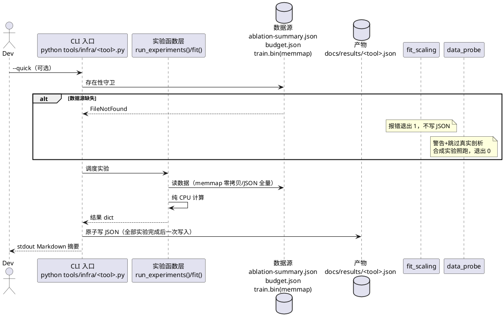

# 1 AR概述

| 组件名称 | nanoGPT-Modern AI infra 学习内容（docs/ai-infra 手册体系 + tools/infra 微实验工具） |
| --- | --- |
| AR系统流水号 | AR-v0.7.5-precision-scaling-data |
| AR描述 | 交付主题 8/9/10 三本分立深潜手册（数值精度与混精 / scaling laws 与训练预算 / 数据管道与 tokenization）+ 三个纯 CPU 微实验工具（precision_probe / fit_scaling / data_probe，TDD）+ 三项文档勘误 + 索引与质量收口（主题地图 7→10、全量回归、gitee 同步） |

设计依据：`specs/changes/AR-v0.7.5-precision-scaling-data/srs.md`（FR1-FR8，req 门控 2026-10-14 PASS）。
先例对齐：AR-v0.7.0-ai-infra-kernels（已归档，design 范式沿用）；工具形态对齐
`tools/infra/run_roofline.py` / `tools/infra/triton_kernels.py`；JSON schema 对齐
`docs/results/triton_kernels.json`（meta + measurements 两段式）。

# 2 动态行为

## 交互时序图

三工具均为本机单进程 CLI，无跨模块调用链；与仓库的交互是**读数据源 → 算 → 写 JSON**：



关键交互约束：
- **不写部分 JSON**：任何实验中途异常 → 不落盘、退出 1（srs FR2/FR4/FR6 异常处理）；
- **只读生产代码与数据**：model/、training/、data/ 零改动，train.bin 只 memmap 读；
- **退出码语义**（对齐仓库先例）：0=全部成功（含 data_probe 守卫降级）；1=数据源缺失
  （fit_scaling）/测量中断；2=argparse 用法错误（argparse 默认即 exit 2）。

# 3 功能点分解

| 序号 | 功能点名称 | 功能点描述 | 溯源 |
| --- | --- | --- | --- |
| 1 | 精度手册 | docs/ai-infra/numerical-precision.md：四精度表示学+AMP 机理+累加精度+本仓锚点+fp8 展望 | FR1 |
| 2 | precision_probe 工具 | dtype 表示剖析/误差注入/fake-quant 累加对照/loss scaling 模拟 → precision_probe.json | FR2 |
| 3 | scaling 手册 | docs/ai-infra/scaling-laws.md：Kaplan/Chinchilla/B_crit/LR schedule/本仓拟合复盘/能说不能说 | FR3 |
| 4 | fit_scaling 工具 | 幂律拟合/外推预测/预算计算器 → scaling_fit.json | FR4 |
| 5 | 数据管道手册 | docs/ai-infra/data-pipeline.md：获取→tokenize→去重→过滤→packing→shard/resume 全链+MIGRATION §3 复盘 | FR5 |
| 6 | data_probe 工具 | train.bin memmap 抽样剖析+合成 corpus 去重/packing 实验 → data_probe.json | FR6 |
| 7 | 勘误三件 | 主题 6 锚点漂移+B 组命令；ADR-006 superseded 注记；TECH_REPORT 口径交叉注 | FR7 |
| 8 | 索引与收口 | 主题地图 7→10/路线图 v0.8.5 行/README 挂载/EXPERIMENTS 记录节/全量回归/三绿/gitee | FR8 |

# 4 实现设计

## 4.1 功能实现思路

三条「手册→工具→实测记录」链（T001→T004→T007 / T002→T005→T007 / T003→T006→T007）汇聚到
勘误（T008）→索引（T009/T010）→收口（T011）。手册先行的原因：工具的实验集合与口径由手册
教学点定义（如 precision_probe 的容差口径必须是手册引用的 triton bf16 1e-2），保证
「手册-工具-JSON」三方数值可互证。

**核心设计决策（全自动模式，均取推荐项）：**

| ID | 决策 | 内容与理由 |
| --- | --- | --- |
| D1 | 工具形态 | 三单文件 CLI：argparse + `--quick` + 可选路径参数，不建包不建子模块——对齐 run_roofline.py/triton_kernels.py 先例，降低 review 面积 |
| D2 | JSON schema | 统一 `{meta, experiments}` 两段式（对齐 triton_kernels.json 的 meta+measurements）；meta 必含 `timestamp/quick/tool/torch/device="cpu"`；各工具扩展字段见 §4.3 |
| D3 | 拟合策略 | **真实数据 D 恒定问题**：ablation 7 组同预算训练（D 相同），L(N,D)=E+A/N^α+B/D^β 的 B/D^β 项不可辨识（吸收进常数）。故：① 主拟合 Kaplan 式 L(N)=E+A/N^α（scipy.optimize.least_squares 多初值，对 params_m 与 best_val_loss）；② Chinchilla 联合式在**合成数据**上演示与验证（测试同样用合成数据）；③ 预算计算器用文献规范参数（Hoffmann 口径 α_N≈0.34/α_D≈0.28、D/N≈20）作默认，附本仓拟合参数对照；④ fit_quality 诚实记录（见 W2 落地） |
| D4 | data_probe 守卫 | train.bin 缺失→stderr 警告+跳过真实剖析，合成实验照跑，退出 0（srs FR6）；dtype 探测：默认 uint16，读首块样本值域 ≤50257（GPT-2 vocab）校验；抽样用**等步长跳跃采样**（stride = total//sample_n），memmap 零拷贝不顺序吃满页缓存，17GB 文件上抽样 ≤2 分钟 |
| D5 | precision_probe 实验 | ① ulp/范围：torch.finfo 逐 dtype 复算（含 2 的幂处 ulp 翻倍规律）；② RNE 统计：构造 tie 案例（如 fp16 中 2048 与 2049 的中点）验证偶数舍入；③ loss scaling：fp16 小梯度（如 1e-8 量级）直接 backward 下溢为 0 vs scale=2^16 补偿后恢复，模拟 GradScaler 的 scale/unscale/infskip 循环；④ fake-quant：同一随机权重/激活，bf16 权重+fp32 分块累加 vs bf16 累加的 K 维 matmul 误差对照（K=4096，纯 CPU） |
| D6 | 勘误纪律 | B 组命令重写**必须先读 run_inference_suite.py argparse 逐参核验**（E-F-4 教训固化为 FR7 验收标准）；ADR-006 仅在状态行加 superseded 注记、原文保留作历史；TECH_REPORT §10.3 加一句口径交叉注不改正文数字 |
| D7 | 手册三段式 | 每手册统一骨架：原理（表示学/推导）→ 本仓锚点（行号+数据文件逐个溯源）→ 能说/不能说（样本点数/教学拟合/纯 CPU 边界）；数值断言 100% 溯源 results/*.json 或 EXPERIMENTS/MIGRATION |

## 4.2 功能实现设计

### 4.2.1 流程图

三工具共用同一控制流骨架（差异仅数据源守卫语义）：

```plantuml
@startuml
start
:parse_args(--quick, 路径参数);
if (数据源存在性守卫) then (fit_scaling: 缺失)
  :stderr 报错含路径;
  exit 1
elseif (data_probe: train.bin 缺失) then
  :stderr 警告;
  :real_experiments = skip 标记;
else (在位)
endif
:按 quick 档位缩样\n(sample_n / iters / K);
:逐实验计算（纯 CPU）;
if (任一实验抛异常?) then (是)
  :不写 JSON;
  exit 1
else (否)
endif
:组装 {meta, experiments};
:原子写 docs/results/<tool>.json\n(tmp 写+rename);
:stdout Markdown 摘要表;
exit 0
@enduml
```

### 4.2.2 流程说明

1. **quick 档位**：全量档抽样/迭代规模按「全量 ≤2 分钟、--quick ≤30 秒」反推定标
   （precision_probe：张量规模 4096²/512；data_probe：全量 200k token 抽样、quick 50k；
   fit_scaling 本身毫秒级，quick 只跳过外推网格细化）。
2. **原子写**：先写 `docs/results/<tool>.json.tmp` 再 `os.replace`——中断不会留下半截 JSON。
3. **stdout 摘要**：每实验一行（名称/关键统计量/口径），供手册与 EXPERIMENTS 记录节直接引用。

## 4.3 接口描述

### 4.3.1 CLI 接口（三工具）

```text
python tools/infra/precision_probe.py [--quick] [--output-json PATH]
    默认输出 docs/results/precision_probe.json；--quick 缩样档

python tools/infra/fit_scaling.py [--quick] [--output-json PATH]
    [--data PATH_ablation] [--budget PATH_budget]
    默认数据源 docs/results/ablation-summary.json + docs/results/budget.json

python tools/infra/data_probe.py [--bin PATH] [--quick] [--output-json PATH]
    默认 --bin data/openwebtext/train.bin；缺失守卫降级（见 D4）
```

参数校验（三工具统一语义）：
- `--output-json`：**父目录必须已存在**，缺失/不可写 → stderr 明确报错、退出 2（用法类错误；
  工具不隐式建目录——调用方显式 mkdir，避免静默写错位置；不可写与缺失共用同一校验分支，
  以「不存在」用例代覆盖，另补只读目录用例作行为双保险）；
- `fit_scaling --data/--budget`：各自独立存在性校验，任一缺失 → 报错含实际探测路径、退出 1；
- `data_probe --bin`：**不走报错**，缺失按 D4 降级（警告+skip 真实剖析，退出 0）——与
  fit_scaling 数据源语义的差异是刻意的（fit 无数据即无产物；data 尚有合成实验）；
- `--quick` 为 flag（argparse action="store_true"）；数值非法（如未来扩展的负数参数）→
  argparse/ValueError 退出 2。argparse 用法错误退出码 2（框架默认）。

### 4.3.2 产物 JSON schema

统一两段式 `{meta, experiments}`（experiments 为数组，每元素含 `name` + 实验专属字段）：

**precision_probe.json**
```jsonc
{
  "meta": {
    "tool": "precision_probe", "device": "cpu", "torch": "2.5.1",
    "timestamp": "...", "quick": false,
    "tolerance_refs": {          // 容差口径溯源（FR2 验收）
      "bf16_atol": 0.01, "bf16_rtol": 0.01,
      "source": "docs/results/triton_kernels.json"
    }
  },
  "experiments": [
    {"name": "dtype_limits", "dtypes": {"float32": {...}, "bfloat16": {...},
      "float16": {...}},   // max/min/eps/smallest_normal/ulp_at_1(由 finfo 复算)
    {"name": "rne_rounding", "cases": [...], "tie_to_even_hits": 0.99x},
    {"name": "relative_error_grid",   // 四精度逐元素相对误差 max/mean/p99
     "fp32_vs_bf16": {"max": ..., "mean": ..., "p99": ...}, ...},
    {"name": "accumulation_precision", // bf16 权重+fp32 累加 vs bf16 累加
     "k_dim": 4096, "fp32_accum_rel_err": ..., "bf16_accum_rel_err": ...},
    {"name": "loss_scaling_simulation", // fp16 下溢 + scale 补偿
     "grad_scale": 65536.0, "unscaled_overflow_detected": true,
     "naive_fp16_zero_fraction": ..., "scaled_recover_fraction": ...}
  ]
}
```

**scaling_fit.json**
```jsonc
{
  "meta": {
    "tool": "fit_scaling", "device": "cpu", "timestamp": "...", "quick": false,
    "data_sources": ["docs/results/ablation-summary.json", "docs/results/budget.json"]
  },
  "fit_quality": {               // W2 落地：诚实报告逃生路径本身可测
    "n_points": 7, "method": "scipy.least_squares(multi-start)",
    "identifiability_note": "D 恒定（7 组同预算），B/D^β 不可辨识，主拟合为 Kaplan 式 L(N)",
    "converged": true, "r_squared": 0.9x,
    "param_uncertainty": {"alpha_std": ..., "A_std": ..., "E_std": ...,
      "method": "least_squares 协方差（J^TJ 逆）传播，教学级近似"},
    "limitations": ["7 点非受控扫参（架构消融混入 N 变化）", "教学拟合非 scaling study"]
  },
  "kaplan_fit": {"E": ..., "A": ..., "alpha": ..., "r_squared": ..., "params_m": [...],
    "val_loss": [...], "fitted": [...]},
  "chinchilla_synthetic_demo": {"true_params": {...}, "recovered_params": {...}},  // 合成数据演示
  "predictions": [ {"name": "...", "N": ..., "D": ..., "pred_loss": ..., "interval": [...] } ],
  "budget_calculator": {         // compute-optimal 算例
    "cases": [ {"name": "...", "flops_budget": ..., "N_star": ..., "D_star": ..., "D_over_N": 20,
      "train_iters_at_repo_throughput": ...,       // 训练时长（FR4）：按本仓吞吐换算的迭代数
      "train_hours_at_repo_throughput": ...,       // 训练时长（FR4）：按 system.json 吞吐口径
      "train_tokens_vs_repo_budget": ...} ],
    "flops_per_token_formula": "6ND 口径（utils/infra_math.py 对照）",
    "literature_defaults": {"alpha_n": 0.34, "alpha_d": 0.28, "d_over_n": 20}
  },
  "repo_budget_review": {        // 本仓 budget.json 对照（FR3 复盘素材）
    "train_tokens": 1244464437, "params_m": 50, "tokens_per_param": 24.9,
    "chinchilla_ref": 20, "verdict": "教学预算与 compute-optimal 同量级，略偏数据侧",
    "bookkeeping": {"corpus_tokens": 1244464437, "consumed_tokens": 589824000,
      "note": "max_iters×tokens_per_iter=0.59B 为实际消耗；corpus 1.24B 为一纪元全量；
               one_epoch_iters=36079 对应 train split（≈95%）——记账口径三件套教学点"}
  }
}
```

**data_probe.json**
```jsonc
{
  "meta": {
    "tool": "data_probe", "device": "cpu", "timestamp": "...", "quick": false,
    "bin_path": "data/openwebtext/train.bin", "bin_available": true
  },
  "experiments": [
    {"name": "bin_profile", "source": "real",      // 缺失时整节替换为
     "size_bytes": 17853806718, "dtype": "uint16", // {"name":"bin_profile","source":"real",
     "value_range": [0, 50256], "sampled_tokens": 200000,  //  "skipped":"bin not found"}
     "eot_freq": 0.00088x, "top_tokens": [[13, freq], ...]},
    {"name": "doc_length_dist", "source": "real", "mean": ~1128, "p50": ..., "p99": ...},
    {"name": "contamination_demo", "source": "synthetic",   // needle 注入对照
     "needle_hit_rate": 1.0, "false_positive_rate": 0.0},
    {"name": "minhash_dedup_curve", "source": "synthetic",
     "dup_rates": [...], "detected_rates": [...], "band_widths": [...]},
    {"name": "greedy_packing", "source": "synthetic",
     "block_size": 1024, "fill_ratio": 0.9x, "padding_waste": ...},
    {"name": "doc_boundary_stats", "source": "synthetic",
     "docs_per_block_mean": ..., "cross_doc_fraction": ...}
  ]
}
```

### 4.3.3 手册骨架（三方互证的「WHAT」契约）

**numerical-precision.md（主题 8）**：§1 为什么混精（E-C bf16 2.10× 开场，147.7k vs 70.2k
tok/s 溯源 system.json）→ §2 四精度表示学（位布局表/ulp 推导/RNE——与 precision_probe
`dtype_limits`/`rne_rounding` 复算对照）→ §3 AMP 机理（autocast 白名单语义/GradScaler 循环，
逐行对照 trainer_base.py build_amp_context L208、enable_tf32 L49）→ §4 累加精度（fp32
master weights/分块累加误差，对照 `accumulation_precision` 实验 + triton kernel
input_precision="ieee" 口径）→ §5 本仓口径交叉（memory-flops §2.1 的 16B vs 12B 显存账、
triton bf16 atol/rtol=1e-2、test_pretrain_precision）→ §6 fp8 理论展望（E4M3/E5M2 位布局/
per-tensor scaling/推理先行原因；标注「验证归 v0.9.0 量化总论」）。

**scaling-laws.md（主题 9）**：§1 问题形态（给定预算求 N/D/时长）→ §2 Kaplan 脉络
（L(N)=E+A/N^α 幂律/样本效率结论）→ §3 Chinchilla 脉络（L(N,D) 联合式/compute-optimal
D/N≈20/两脉络相反根因）→ §4 B_crit（梯度噪声尺度/小 batch 免费并行；对照本仓 batch 32
+ 梯度累积）→ §5 LR schedule（cosine vs WSD 退火语义；对照 lr_scheduler.py）→ §6 本仓拟合
复盘（budget.json 记账口径三件套 + 7 点 Kaplan 拟合 + 50M/1.24B≈25:1 vs Chinchilla 20:1
偏差解读——全部与 scaling_fit.json 数值互证，诚实标注 7 点非受控扫参）→ §7 能说/不能说。

**data-pipeline.md（主题 10）**：§1 全旅程鸟瞰（语料→token→loss 的环节图）→ §2 获取与流式
（curl range 并行/流式 tokenize；prepare.py resolve_max_docs L31 的 1M 子集陷阱）→
§3 Tokenize（BPE/vocab 权衡 50k vs 100k/uint16-uint32 自动选择 _select_dtype L307）→
§4 去重（MinHash L31→LSH L69→Jaccard L117 逐行 + data_probe 去重率曲线对照）→ §5 过滤
（filter.py CompositeFilter.stats L202/quality_filter.py 熵分）→ §6 Packing（贪心拼接/
doc_boundary 稀疏记录/跨文档 mask；PackingDataset L326/_build_samples L349；对照
data_probe packing 填充率实验 + test_packing 6 用例）→ §7 Shard 与 resume（MemmapDataset
L110/_rank_positions L159/GlobalShuffledDataset L485）→ §8 本仓实测锚点（MIGRATION §3 判据表
8,926,903,359 tokens/7,913,597 docs/avg 1128/EOT≈8.87e-4，与 data_probe 实测量级互证）→
§9 数据质量边界（污染检测思路/质量 vs 数量权衡）。

## 4.4 代码设计

新增文件（生产代码零改动，全部为新增）：

```text
docs/ai-infra/numerical-precision.md   # 手册 3 份（TDD 先写测试涉及工具，手册先行定口径）
docs/ai-infra/scaling-laws.md
docs/ai-infra/data-pipeline.md
tools/infra/precision_probe.py         # 单文件 CLI，~200-300 行/件
tools/infra/fit_scaling.py             # scipy.optimize.least_squares + numpy
tools/infra/data_probe.py              # numpy memmap + data/dedup.py 的 MinHash 复用（只读 import）
tests/test_precision_probe.py          # 纯 CPU，无 17GB 依赖
tests/test_fit_scaling.py
tests/test_data_probe.py
docs/results/precision_probe.json      # 运行产物（随 T007 实测提交）
docs/results/scaling_fit.json
docs/results/data_probe.json
```

修改文件（勘误+索引，全部纯增量）：`docs/ai-infra/README.md`（主题 6 锚点勘误 + 主题地图
7→10 + 路线图 v0.8.5 行）、`docs/RUNNING_EXPERIMENTS.md`（B 组命令勘误）、
`docs/adr/adr-006-moe-grouped-gemm.md`（状态行注记）、`docs/TECH_REPORT.md`（§10.3 交叉注）、
`README.md`（挂三手册+badge）、`docs/EXPERIMENTS.md`（新记录节）。

模块边界：工具不 import 训练/模型代码；data_probe 允许只读 import `data/dedup.py` 的
MinHash/LSH（合成实验直接用生产实现验证语义一致性，符合「零改动」约束——只调用不修改）；
fit_scaling 允许只读 import `utils/infra_math.py` 对照 6ND 口径。

# 5 重构设计

无（本 AR 不触碰生产代码，无重构）。

# 6 测试设计

## 6.1 单元测试（UT）

**覆盖率目标**：三工具模块语句覆盖率 ≥90%（pytest --cov 实测；无法安装 coverage 的环境下
以本节用例覆盖点清单逐项核对代替，T011 收口时记录实际口径）。

三测试文件共约 39 用例（共有组 4×3=12 + 专属 8+10+9=27），全部纯 CPU、无 17GB 依赖、
单文件 <10 秒；**三工具共有用例组**（每工具各一份，语义相同仅参数不同）：

**共有用例组（×3 工具）**：
- 实验中途异常注入：monkeypatch 任一实验函数 raise → 子进程退出 1 且目标 JSON **未落盘**
  （tmp+rename 原子写的行为级断言，覆盖 §4.2.1 异常分支）
- `--output-json` 父目录不存在 → 退出 2 + stderr 报错（§4.3.1 校验语义触发用例）；
  父目录只读（chmod 0o500）→ 同分支退出 2（Windows ACL 不支持时以 skipif 标记）
- 非法入参（未知 flag / 坏类型）→ argparse 退出 2
- `--help` 可用、`--quick` flag 冒烟（子进程调用，断言退出 0 + JSON 落盘）

**test_precision_probe.py**（~8 用例）：
- dtype_limits 与 torch.finfo 逐字段一致（max/min/eps/smallest_normal/ulp_at_1 手算对照）
- RNE tie 案例舍入到偶（如 fp16 中点案例批量统计 tie_to_even 命中率=1.0）
- 相对误差网格：bf16 > fp16 逐元素相对误差 max（bf16 尾数 7 位 < fp16 10 位）断言方向
- 累加精度：fp32 累加相对误差 < bf16 累加（K=4096 随机 matmul，容差宽松断言方向+量级）
- loss scaling：naive fp16 小梯度 zero_fraction 显著 > scaled 路径；unscale 后 inf 检测触发
- JSON：含 meta.tolerance_refs 且 bf16_atol/rtol=0.01；--quick 冒烟（smoke 子进程调用）
- 非法入参 → ValueError/退出码
- meta.device == "cpu"

**test_fit_scaling.py**（~10 用例）：
- 合成数据参数恢复：按文献量级生成 L=E+A/N^α（+噪声）→ 拟合恢复 α 相对误差 <10%
- Chinchilla 合成演示：生成 L(N,D) 网格 → 联合拟合恢复 α_N/α_D 误差 <15%
- 不可辨识守卫：D 恒定数据集上 fit_quality.identifiability_note 存在且不输出 B/β 参数
- 外推：predictions 含区间字段且区间宽度>0
- 预算计算器：给定 FLOPs=6×50e6×1.24e9，输出 N*/D* 满足 D/N≈20（文献口径下手算对照）
- repo_budget_review：tokens_per_param = 1244464437/50e6 ≈ 24.9 断言
- 记账口径：consumed_tokens = 18000×32768 = 589,824,000 断言
- 数据源缺失 → 子进程退出码 1 且不写 JSON
- **--data/--budget 单独缺失**：仅 --data 指向不存在路径（--budget 在位）→ 退出 1 报错含该
  路径；仅 --budget 缺失对称验证（§4.3.1 各自独立校验的触发用例）
- 拟合不收敛（构造病态数据）→ 诚实降级：converged=false + 仍有 fit_quality，退出 0
- 真实 7 点拟合 smoke：读 ablation-summary.json 成功产出（不硬断言 R² 阈值；断言字段齐全
  含 param_uncertainty 三字段与 budget_calculator 时长字段、r_squared 数值已落盘且
  fit_quality.limitations 非空——诚实报告字段的存在性断言）

**test_data_probe.py**（~9 用例）：- 合成 corpus 全路径：MinHash 去重率曲线单调（重复率↑→检出率↑，用 data/dedup.py 实现跑）
- 去重语义：完全重复文档检出率=1.0；独立文档误杀率≈0
- 贪心 packing：填充率 >0.9（合成长度分布）；padding_waste 字段一致
- doc_boundary：每 block 文档数统计与合成构造对照（精确断言）
- EOT 频率：合成 token 序列（按已知间隔插 EOT=50256）→ 实测频率≈构造频率
- top-token 直方图：Zipf 合成分布 top1 命中
- train.bin 缺失守卫：--bin 指向不存在路径 → 退出 0 + JSON 含 skipped 标记 + 合成实验在
- uint16 值域校验：合成小 bin（含越界值）→ value_range 报告正确
- JSON schema：experiments[].source ∈ {real, synthetic} 全覆盖

## 6.2 接口测试

CLI 契约按 §4.3.1 逐工具核验：`--help` 可用、默认路径、`--quick` flag、退出码语义
（0/1/2 三态）；产物 JSON 与 §4.3.2 schema 字段级对照（测试内加载断言必填字段）。

## 6.3 业务场景测试

T007 实测（工具作者视角端到端）：本机全量运行三工具 → 三个 JSON 落盘 → 与手册数值互证
（EOT 频率 vs MIGRATION §3 量级一致、拟合参数 vs 手册复盘一致、容差口径 vs triton_kernels
一致）→ EXPERIMENTS.md 记录节（含能说/不能说）。

## 6.4 边界条件矩阵

正常/边界/异常三类中「边界」类的系统枚举（正常见 §6.3，异常见 §6.5）：

| 边界场景 | 期望行为 | 覆盖 |
| --- | --- | --- |
| data_probe sample_n > bin 总 token 数 | stride 退化保护：截断为全量可用点数，不越界、不除零 | UT（合成小 bin） |
| data_probe 空/极小 bin（<100 token） | 剖析照常产出（统计量标注样本点少），不崩溃 | UT（合成小 bin） |
| fit_scaling 可用点 ≤2（groups 被过滤后） | 点数不足拟合 → fit_quality.converged=false 诚实降级（同不收敛路径），退出 0 | UT |
| fit_scaling 空 groups 数组 | 同上降级路径；不抛未捕获异常 | UT |
| precision_probe tie 恰在中点（RNE 偶舍入） | tie_to_even 命中率=1.0（构造案例） | UT |
| uint16 值域边界（0 与 50256 恰出现） | value_range 报告 [0, 50256]，含端点 | UT（合成小 bin） |
| --quick 档位下抽样/张量缩样 | 全部实验仍产出（规模缩、不缺实验） | UT（冒烟） |

## 6.5 异常场景测试

| 场景 | 期望 | 覆盖 |
| --- | --- | --- |
| fit_scaling 数据源缺失（--data/--budget 任一） | 退出 1、不写 JSON | UT |
| data_probe train.bin 缺失 | 退出 0、真实剖析 skip、合成照跑 | UT |
| 实验中途异常（monkeypatch 注入） | 不写部分 JSON（原子写）、退出 1 | UT（三工具各 1 例） |
| 非法入参（未知 flag/坏类型/坏路径） | 明确报错退出 2/ValueError | UT（三工具） |
| --output-json 父目录不存在 | 报错退出 2，不隐式建目录 | UT（三工具） |
| 拟合不收敛 | converged=false 诚实降级、退出 0 | UT |
| 17GB 文件抽样超时 | 不触发（--quick 档位+等步长跳跃采样；ST 实测 ≤2 分钟） | ST |

## 6.6 勘误与收口验证（ST 级用例）

功能点 7（勘误三件）/8（索引与收口）为文档型交付，用脚本化核验用例覆盖（开发内执行，
不新增常驻测试文件；核验脚本可临时或并入 T008/T011 步骤）：

| 用例 | 核验方法 | 溯源 |
| --- | --- | --- |
| ST-C1 主题 6 锚点核验 | 勘误后 ai-infra/README.md 主题 6 行引用的文件+函数名与 modern_gpt.py/run_inference_suite.py 实际位置（grep `_draft_sample`/`_verify`/`_generate_speculative`）逐项对照 | FR7-1 |
| ST-C2 B 组命令 argparse 核验 | 解析勘误后 RUNNING_EXPERIMENTS.md B 组命令的每个 flag，与 run_inference_suite.py argparse 定义集合比对，0 个不存在参数（E-F-4 教训固化） | FR7-2 |
| ST-C3 注记结构检查 | ADR-006 状态行含 superseded 注记、原文 L18-19 保留；TECH_REPORT §10.3 交叉注存在且 694 MB 数字未被改动 | FR7-3 |
| ST-C4 链接存在性 100% | ai-infra/README.md 与 README.md 中本 AR 新增/修改的仓内链接逐个 Test-Path（脚本核验） | FR8-1 |
| ST-C5 全量回归零回归 | 全量 pytest 实测 = 基线 711 passed/2 skipped + 新增全过或合规 skip | FR8-2 |
| ST-C6 gitee 同步验证 | `python tools/gitee_mirror.py` 后远端 refs 与本地镜像 HEAD 一致 | FR8-3 |
| ST-C7 手册-AMP 逐行对照 | numerical-precision.md §3 引用的 autocast/GradScaler 语义描述与 trainer_base.py build_amp_context L208 逐行核对（人工+代码锚点 grep） | FR1-2 |
| ST-C8 手册-工具数值互证 | 三手册引用的全部数值断言与三个 JSON / results 数据文件逐一对照（T007 执行） | FR1-1/FR1-3/FR3-1/FR5-1 |
| ST-C9 三绿零新增 | black --check（line-length=100）/ruff（E,F,I,B,UP）/mypy 与基线比对：零新增（遗留 19 处为 db3b7ff 前旧账不新增即可） | FR8-2（T011） |

## 6.7 srs 验收标准追溯表（24 条全覆盖）

| srs 验收标准 | 追溯用例 |
| --- | --- |
| FR1-1 表示学与 precision_probe 复算一致 | UT dtype_limits/rne_rounding + ST-C8 |
| FR1-2 AMP 机理与 build_amp_context 逐行一致 | ST-C7 |
| FR1-3 存量数据（2.10×/16B/1e-2）溯源一致 | ST-C8 + UT tolerance_refs |
| FR2-1 纯 CPU 全实验 ≤2 分钟出 JSON | UT 冒烟 + ST（T007 实测计时） |
| FR2-2 bf16 容差口径与 triton_kernels.json 一致 | UT（tolerance_refs 断言） |
| FR2-3 测试套件纯 CPU 全过 | UT 全量 |
| FR3-1 compute-optimal 推导与 fit_scaling 复算一致 | UT 预算计算器对照手算 + ST-C8 |
| FR3-2 手册拟合复盘与 scaling_fit.json 一致 | ST-C8 + UT 真实 7 点 smoke |
| FR3-3 预算数据溯源 budget.json/ablation-summary 一致 | UT（repo_budget_review 断言）+ ST-C8 |
| FR4-1 7 组拟合产出 JSON 残差合理或诚实记录 | UT（合成参数恢复 + fit_quality 字段存在性断言 + 不收敛降级） |
| FR4-2 50M/budget 对照与手册一致 | UT（tokens_per_param ≈24.9 断言） |
| FR4-3 测试合成数据全过 | UT 全量 |
| FR5-1 packing/shard 描述与 openwebtext.py 锚点一致 | ST-C8（手册锚点 grep 核对） |
| FR5-2 EOT 频率量级与 MIGRATION §3 一致 | UT（合成 EOT 构造）+ ST（T007 实测） |
| FR5-3 MinHash/Jaccard 语义与 dedup.py 一致 | UT（用 data/dedup.py 实现跑合成实验） |
| FR6-1 真实+合成实验产出 JSON ≤2 分钟 | UT 守卫用例 + ST（T007 计时） |
| FR6-2 合成 corpus 测试不依赖大文件 | UT 全量（tmp_path 合成 bin） |
| FR6-3 EOT 频率对照 8.87e-4 量级 | UT + ST |
| FR7-1 勘误后主题 6 锚点与实际位置一致 | ST-C1 |
| FR7-2 B 组命令参数全部存在 | ST-C2 |
| FR7-3 ADR/TECH_REPORT 注记清晰不破坏结构 | ST-C3 |
| FR8-1 链接存在性 100% | ST-C4 |
| FR8-2 全量 pytest 711+2 基线零回归 | ST-C5 |
| FR8-3 gitee 镜像推送成功 | ST-C6 |

## 附：设计决策与 srs 的追溯

| srs 条目 | 设计落点 |
| --- | --- |
| FR1/FR3/FR5 手册 | §4.3.3 三手册骨架（锚点全部经 req 门控 16 处核查验证） |
| FR2/FR4/FR6 工具 | §4.3.1 CLI + §4.3.2 schema + D1-D5 |
| FR4「R²>0.9 或诚实记录不达」 | fit_quality 字段使逃生路径可测（req 门控 W2 落地） |
| FR4 拟合式偏差 | **D3 显式偏差记录**：srs FR4 原文「对 7 组做 L(N,D) 联合拟合」在真实数据上
  不可行（D 恒定→B/D^β 不可辨识），设计改为 Kaplan 主拟合+联合式合成演示；
  srs FR4 措辞已同步更新（见 srs 附澄清记录 Round 4），非静默偏离 |
| FR7 勘误 | D6（B 组命令 argparse 核验纪律）+ ST-C1/C2/C3 |
| FR8 收口 | §4.4 修改文件清单 + ST-C4/C5/C6 |
| NFR 纯 CPU/零改动 | §4.4 模块边界（只读 import 白名单：dedup.py/infra_math.py） |
