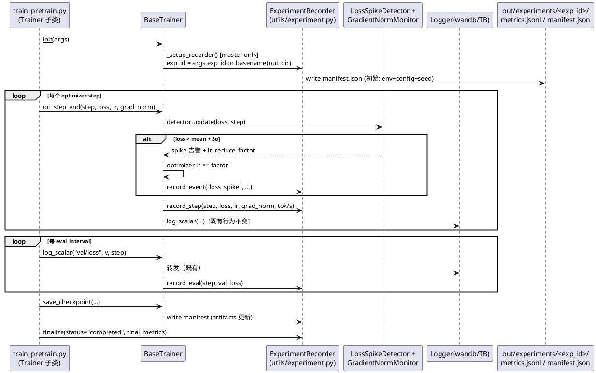
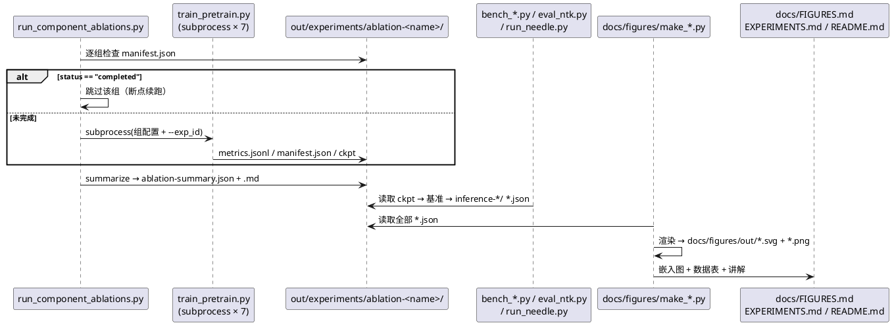
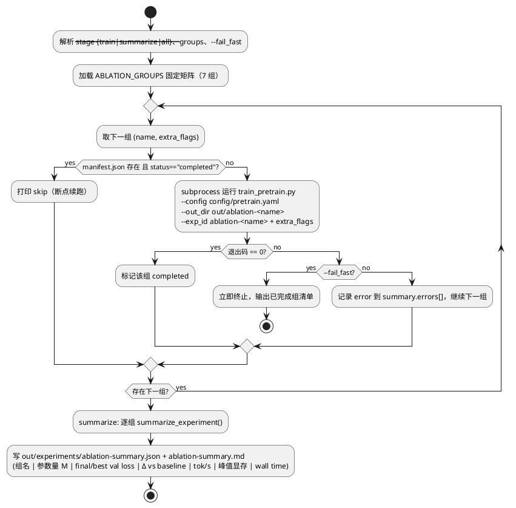
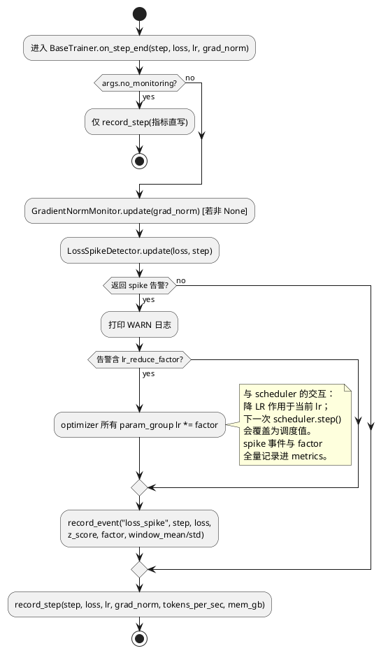
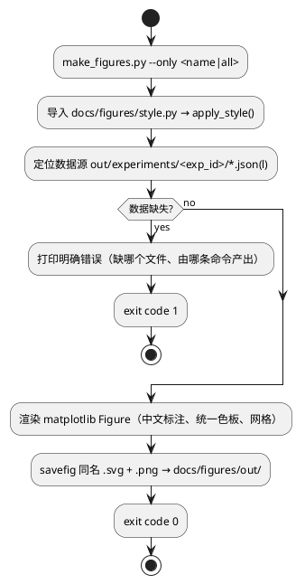

# 1 AR概述

| 组件名称 | nanoGPT-Modern（轻量级 LLM 全栈框架） |
| --- | --- |
| AR系统流水号 | AR-v0.4.0-experiments |
| AR描述 | 实验证据化与出版级可视化平台：为训练器补齐结构化实验记录（metrics.jsonl + manifest）、将监控接入 BaseTrainer、新增消融架构开关（learned 绝对位置编码 / GELU FFN）、实现 7 组组件消融编排器与全套推理/长上下文/对齐实验，并以统一风格的出版级图表（SVG+PNG）+ 图库文档 + EXPERIMENTS/README 重写交付全部证据。 |

**选定方案：** 方案 A（Trainer 内嵌 Recorder + log 层自动双写 + 子进程消融编排），用户已确认。

---

# 2 动态行为

## 交互时序图

### 2.1 训练会话：记录与监控（正常 + spike 分支）



### 2.2 消融编排与实验链路



---

# 3 功能点分解

| 序号 | 功能点名称 | 功能点描述 | 追溯 |
| --- | --- | --- | --- |
| 1 | ExperimentRecorder | metrics.jsonl 逐事件追加写 + manifest.json（环境/配置/种子/产物/状态）+ resume 兼容 | FR1 |
| 2 | BaseTrainer 双写接入 | `log_scalar/log_scalars/log_text/log_memory_stats` 自动双写 Recorder；`_setup_recorder` 进模板方法链 | FR1 |
| 3 | on_step_end 监控钩子 | LossSpikeDetector（>3σ，自动降 LR）+ GradientNormMonitor 接入；事件入 metrics；`--no_monitoring` 可关 | FR2 |
| 4 | position_encoding 开关 | ModernGPT 支持 `learned`（可学习绝对 PE，GPT-2 风格）替代 RoPE；wpe 按需创建；KV cache/生成路径一致 | FR3 |
| 5 | ffn_variant 开关 | ModernGPT 支持 `gelu`（GELU 4×）替代 SwiGLU(8d/3)；intermediate_size 语义随变体切换 | FR3 |
| 6 | 配置层贯通 | 两开关进 train_pretrain CLI / YAML / Hydra / Pydantic（含非法组合校验：learned + rope_scaling 拒绝） | FR3 |
| 7 | 组件消融编排器 | run_component_ablations.py：7 组固定矩阵、manifest 断点续跑、单组失败隔离、汇总 JSON+MD | FR4 |
| 8 | 全量数据准备 | prepare.py 全量 OpenWebText + validate + 全局 shuffle 索引（执行型任务） | FR5 |
| 9 | 7 组 50M 消融训练 | baseline / modern-full / no-rope / no-swiglu / mha / moe / qk-norm，每组 18k iters，seed=1337 | FR6+E7 |
| 10 | KV cache 基准 | bench_kv_cache.py：{none, ring-fp16, int8, paged} × {256,1024,4096}，显存+prefill/decode 吞吐 | FR8 |
| 11 | 投机解码基准 | bench_speculative.py：draft 模型（4L/128D 快速预训）+ 接受率/加速比（batch=1 与 >1） | FR8 |
| 12 | 连续批处理/compile 基准 | bench_continuous_batching.py（并发 1-16 吞吐/延迟）+ bench_compile.py | FR8 |
| 13 | NTK 外推评估 | eval_ntk.py：{1024,2048,4096,8192} × {base, ntk} ppl 曲线 | FR9 |
| 14 | Needle 评估驱动 | run_needle.py：NeedleEvaluator 网格（5 深度 × 4 长度 × ≥3 trials） | FR9 |
| 15 | 对齐全链路实验 | SFT → GRPO(G4/G8) → DPO(胜率)，全部带 exp_id 记录（用现有 CLI） | FR10 |
| 16 | 图表样式与生成器 | docs/figures/style.py + ≥11 个 make_*.py，SVG+PNG 双输出，中文科技风 | FR11 |
| 17 | 文档交付 | docs/FIGURES.md 图库 + EXPERIMENTS.md 全量重写 + README 嵌入 | FR12 |
| 18 | 质量收口 | 新增测试 + 既有 230+ 测试 + mypy/black/ruff/CI 全绿 | FR13 |

---

# 4 实现设计

## 4.1 功能实现思路

**总原则（方案 A）：**
1. **记录零侵入**：`ExperimentRecorder` 由 `BaseTrainer` 在模板方法链末尾构建；现有 `log_*` 方法在转发 Logger 的同时追加写入 Recorder —— 五个训练器主体代码不改即获得记录能力；每训练循环仅新增一次 `on_step_end()` 调用（监控钩子）。
2. **编排子进程化**：消融编排沿用 `run_ablations.py` 已验证的 subprocess 模式——单组崩溃不污染进程状态，天然支持跨会话断点续跑（以 manifest `status=="completed"` 为完成判据）。
3. **实验目录统一**：所有机器可读产物收敛到 `out/experiments/<exp_id>/`；checkpoint 仍存于各组 `--out_dir`（避免改动 CheckpointManager 语义），manifest 记录两者映射。
4. **配置只增不破**：新字段全部带默认值（`position_encoding="rope"`、`ffn_variant="swiglu"`），`to_dict/from_dict` 沿用 `getattr` 默认值惯例 → 旧 checkpoint 加载零影响。
5. **诚实报告**：环境限制（sm_75 无 flash/bf16）写入 manifest 与 EXPERIMENTS.md；MoE 组同时报告 total/active 参数两列。

## 4.2 功能实现设计

### 4.2.1 流程图

#### A. 消融编排主流程（含断点续跑与失败隔离）



#### B. on_step_end 监控钩子（含 spike 自动降 LR 分支）



#### C. 图表生成流水线



### 4.2.2 流程说明

**消融矩阵固定定义（ABLATION_GROUPS，seed=1337、数据顺序由全局 shuffle 索引锁定）：**

| 组名 | 额外 flags（相对 config/pretrain.yaml） | 隔离的变量 |
| --- | --- | --- |
| `baseline` | `--model baseline` | GPT-2 经典架构（对照组） |
| `modern-full` | `--model modern --n_kv_head 2` | 全部现代组件（对照组） |
| `no-rope` | `--model modern --n_kv_head 2 --position_encoding learned` | RoPE 的贡献（其余现代组件保留） |
| `no-swiglu` | `--model modern --n_kv_head 2 --ffn_variant gelu` | SwiGLU 的贡献 |
| `mha` | `--model modern --n_kv_head 8` | GQA 的贡献（MHA 对照） |
| `moe` | `--model modern --n_kv_head 2 --num_experts 4` | MoE top-1 的贡献（每专家同 intermediate；**报告 total 与 active 参数两列**，结论按同 active 参数口径） |
| `qk-norm` | `--model modern --n_kv_head 2 --qk_norm` | QK-Norm 的贡献 |

统一约定：7 组均不启用 EMA（减少变量）；`baseline`/`modern-full` 即 FR6 主对照。

**position_encoding=learned 实现要点：**
- `ModernGPT.__init__`：`position_encoding=="learned"` 时创建 `self.wpe = nn.Embedding(block_size, n_embd)`（+1024×512=524K 参数，报告中列明）；`"rope"` 时不创建（现有行为）。
- forward：learned 分支在 token embedding 后加 `wpe(positions)`；attention 计算跳过 `apply_rope`。
- 生成/KV cache：绝对 PE 与 `start_pos` 无耦合（位置由绝对索引决定），天然与 cache 路径一致——用既有 `test_determinism` 风格断言 cache/no-cache 输出一致来验证。
- 上下文长度硬上限 = block_size（超出报错），与 RoPE+NTK 的可外推性形成实验对照点。

**ffn_variant=gelu 实现要点：**
- `intermediate_size` 缺省规则：`swiglu → 8d/3 对齐 128`（现有）；`gelu → 4×n_embd`。
- Block 内 FFN 分支按变体实例化 `SwiGLUFFN` 或 `GELUFFN`（fc→gelu→proj，GPT-2 风格）。

**metrics.jsonl 事件 schema（每行一个 JSON 对象）：**
```json
{"ts": "2026-10-07T14:30:00", "step": 1234, "type": "train", "loss": 3.21, "lr": 5.1e-4, "grad_norm": 0.87, "tokens_per_sec": 41200.0, "mem_gb": 9.8}
{"ts": "...", "step": 2000, "type": "eval", "val_loss": 3.05}
{"ts": "...", "step": 2500, "type": "event", "event": "loss_spike", "z_score": 3.4, "lr_reduce_factor": 0.5}
```
- `type ∈ {train, eval, event, info}`；字段开放式（ recorder 不校验业务字段）。
- 追加写、行级 flush；进程崩溃最多丢最后一行（O_APPEND 语义）。

**manifest.json schema：**
```json
{
  "exp_id": "ablation-no-rope", "status": "running|completed|failed|interrupted",
  "git_commit": "<sha>", "seed": 1337, "start_ts": "...", "end_ts": "...",
  "resume_count": 0, "epoch_repetition": 0.0,
  "env": {"gpu": "Quadro RTX 5000", "vram_gb": 16, "sm": "7.5",
           "torch": "2.x", "cuda": "12.x", "python": "3.11", "os": "Windows"},
  "config": {完整合并后训练配置},
  "artifacts": {"out_dir": "out/ablation-no-rope", "checkpoints": ["best_ckpt.pt", ...]},
  "final_metrics": {"best_val_loss": ..., "final_val_loss": ..., "wall_time_s": ...}
}
```
- 写时机：训练启动、每次 save_checkpoint、finalize（三处幂等重写）。

**draft 模型（投机解码前置子步骤）：** 4L/4H/128D ModernGPT（~3.4M 参数）在真实数据上预训 2k iters（<30min），exp_id=`spec-draft`，供 bench_speculative.py 使用。

**图表清单（FR11，docs/figures/）：**

| 脚本 | 图 | 数据源 |
| --- | --- | --- |
| make_loss_curves.py | 7 组 train/val loss 曲线（双面板） | 各组 metrics.jsonl |
| make_ablation_summary.py | final val loss 条形图 + Δ% 标注 + 参数量副轴 | ablation-summary.json |
| make_kv_memory.py | KV cache 显存阶梯图（4 模式 × 3 长度） | inference-kv/matrix.json |
| make_kv_throughput.py | prefill/decode 吞吐分组柱状 | 同上 |
| make_speculative.py | 接受率与加速比（batch=1/>1） | inference-speculative/*.json |
| make_cb_curve.py | 吞吐/平均延迟 vs 并发（双轴） | inference-cb/curve.json |
| make_compile.py | compile on/off 加速比 | inference-compile/*.json |
| make_ntk_ppl.py | ppl vs 上下文长度（base vs NTK 双线） | ntk-ppl/curve.json |
| make_needle_heatmap.py | 深度×长度检索成功率热图 | needle-matrix.json |
| make_reward_curves.py | GRPO G4/G8 reward 曲线 | grpo-g4/g8 metrics.jsonl |
| make_win_rate.py | DPO 胜率对比图 | dpo/win_rate.json |
| make_gradnorm_monitor.py | grad_norm 曲线 + spike 事件标记 | modern-full metrics.jsonl |

统一样式（style.py）：白底、无衬线中文（`font.sans-serif: Microsoft YaHei, SimHei, DejaVu Sans`、`axes.unicode_minus=False`）、固定色板（indigo #6366F1 / cyan #06B6D4 / violet #8B5CF6 / rose #F43F5E / amber #F59E0B / emerald #10B981 / slate #64748B）、统一网格与 dpi（svg 矢量 + png 200dpi）、图例风格统一。

## 4.3 接口描述

### 4.3.1 新增模块：`utils/experiment.py`

| 接口 | 签名 | 说明 |
| --- | --- | --- |
| 环境采集 | `collect_env() -> Dict[str, Any]` | GPU 名称/VRAM/sm、torch/cuda/python 版本、OS、git commit（`git` 缺失时置 `"unknown"`，不抛错） |
| 记录器 | `ExperimentRecorder(exp_dir: str, exp_id: str, config: Optional[dict], resume: bool)` | `exp_dir` 通常为 `out/experiments/<exp_id>`；`resume=True` 时不覆写既有 jsonl |
| 逐事件写入 | `record(event: dict) -> None` | 自动补 `ts`；写失败捕获 OSError → console WARN，**不中断训练** |
| 训练步事件 | `record_step(step: int, **fields)` | `type=train` |
| 评估事件 | `record_eval(step: int, **fields)` | `type=eval` |
| 告警事件 | `record_event(event: str, step: int, **fields)` | `type=event` |
| 清单写入 | `write_manifest(**extra) -> str` | 幂等重写 manifest.json；合并 `final_metrics`/`artifacts` |
| 收尾 | `finalize(status: str, final_metrics: dict)` | status ∈ completed/failed/interrupted |
| 读取工具 | `load_metrics(path: str) -> List[dict]` | 逐行 `json.loads`，容忍末行残缺（崩溃保护） |
| 汇总工具 | `summarize_experiment(exp_dir: str) -> dict` | final/best val loss、tokens/s 均值、峰值 mem、wall time、参数量（从 config 计算） |

### 4.3.2 BaseTrainer 变更（`training/trainer_base.py`）

| 接口 | 变更 | 说明 |
| --- | --- | --- |
| `_setup_recorder()` | 新增（模板方法链 `_maybe_resume` 之后） | master 进程独占；非 master 置 `self.recorder=None`；无 exp_id 语义时默认 `basename(out_dir)` |
| `log_scalar(tag, value, step)` | 扩展：追加 `recorder.record_event("scalar", step, tag=tag, value=value)` 仅当 tag 属于白名单（`val/loss`→eval 等） | 避免高频 train loss 走双路径（train loss 由 `on_step_end` 直写，粒度更丰富） |
| `on_step_end(step, loss, lr=None, grad_norm=None, tokens_per_sec=None)` | 新增公共钩子 | 见流程图 B；五个 trainer 训练循环各调用一次 |
| CLI 约定 | 各训练脚本新增 `--exp_id`（默认 None→basename(out_dir)）、`--no_metrics`（默认记录开启）、`--no_monitoring` | 只增不破 |

### 4.3.3 ModernGPT 变更（`model/modern_gpt.py`）

| 接口 | 变更 | 说明 |
| --- | --- | --- |
| `ModernGPTConfig.__init__` | 新增 `position_encoding: str = "rope"`、`ffn_variant: str = "swiglu"` | 取值校验：非法值 ValueError |
| `to_dict()/from_dict()` | 新增两键 | `getattr` 默认值 → 旧 checkpoint 兼容 |
| forward / generate / KV cache | learned 分支 | 见 4.2.2 |
| `train_pretrain.py` CLI | 新增 `--position_encoding {rope,learned}`、`--ffn_variant {swiglu,gelu}` | YAML/Hydra 同步 |

### 4.3.4 Pydantic 校验（`utils/config_models.py`）

| 规则 | 行为 |
| --- | --- |
| `ModernGPTModelConfig.position_encoding` | 枚举 {rope, learned}；非成员 → ValidationError |
| `ffn_variant` | 枚举 {swiglu, gelu} |
| 非法组合 | `position_encoding=="learned" && rope_scaling is not None` → `model_validator` 报错，消息含人可读提示（"learned 绝对位置编码不支持 NTK 缩放，请去掉 rope_scaling"） |

### 4.3.5 消融编排器（`run_component_ablations.py`）

```
CLI:
  --stage {train, summarize, all} (默认 all)
  --groups "baseline,modern-full,..."   # 子集选择（默认全部 7 组）
  --config config/pretrain.yaml         # 基础配置
  --max_iters 18000                     # 透传
  --fail_fast                           # 默认关闭（失败隔离）
产出:
  out/experiments/ablation-summary.json / .md
```

### 4.3.6 实验脚本（新增，均为 CLI + JSON 产出）

| 脚本 | 关键参数 | 产出 |
| --- | --- | --- |
| `evaluation/bench_kv_cache.py` | `--checkpoint --modes none,ring,int8,paged --lengths 256,1024,4096` | `out/experiments/inference-kv/matrix.json` |
| `evaluation/bench_speculative.py` | `--checkpoint --draft_checkpoint --batch_sizes 1,4` | `out/experiments/inference-speculative/result.json` |
| `evaluation/bench_continuous_batching.py` | `--checkpoint --concurrencies 1,2,4,8,16` | `out/experiments/inference-cb/curve.json` |
| `evaluation/bench_compile.py` | `--checkpoint` | `out/experiments/inference-compile/result.json` |
| `evaluation/eval_ntk.py` | `--checkpoint --lengths 1024,2048,4096,8192 --modes base,ntk --ntk_factor 4.0` | `out/experiments/ntk-ppl/curve.json` |
| `evaluation/run_needle.py` | `--checkpoint --depths 0.0,0.25,0.5,0.75,1.0 --lengths 1024,2048,4096,8192 --trials 3` | `out/experiments/needle-matrix/matrix.json` |

### 4.3.7 图表生成（`docs/figures/`）

```
CLI: python docs/figures/make_figures.py --only loss_curves|ablation_summary|...|all
产出: docs/figures/out/<name>.svg + <name>.png
```

## 4.4 代码设计

**新增文件：**

```
utils/experiment.py                     # ExperimentRecorder + collect_env + load/summarize
run_component_ablations.py              # 7 组编排（根目录，与 run_ablations.py 并列）
evaluation/bench_kv_cache.py
evaluation/bench_speculative.py
evaluation/bench_continuous_batching.py
evaluation/bench_compile.py
evaluation/eval_ntk.py
evaluation/run_needle.py
docs/figures/__init__.py                # 使目录可导入 style（pythonpath=["."] 已配）
docs/figures/style.py                   # apply_style() + PALETTE + save_dual()
docs/figures/make_figures.py            # 入口 CLI（--only）
docs/figures/make_loss_curves.py        # 以下每个对应一类图
docs/figures/make_ablation_summary.py
docs/figures/make_kv_memory.py
docs/figures/make_kv_throughput.py
docs/figures/make_speculative.py
docs/figures/make_cb_curve.py
docs/figures/make_compile.py
docs/figures/make_ntk_ppl.py
docs/figures/make_needle_heatmap.py
docs/figures/make_reward_curves.py
docs/figures/make_win_rate.py
docs/figures/make_gradnorm_monitor.py
docs/FIGURES.md
tests/test_experiment.py
tests/test_monitoring_integration.py
tests/test_ablation_switches.py
tests/test_component_ablations.py
tests/test_bench_scripts.py             # 基准脚本冒烟（tiny model + 1 长度 + CPU）
```

**修改文件（边界清晰、均为增量）：**

| 文件 | 变更 |
| --- | --- |
| `training/trainer_base.py` | +`_setup_recorder`/`on_step_end`/recorder 双写（~80 行） |
| `training/train_pretrain.py` | +`on_step_end` 调用 ×1、+CLI 3 flags（exp_id/no_metrics/position_encoding/ffn_variant） |
| `training/train_sft.py` `train_grpo.py` `train_dpo.py` `iterative_grpo.py` | +`on_step_end` 调用 ×1、+CLI 2 flags（exp_id/no_metrics） |
| `model/modern_gpt.py` | +两 config 字段、learned wpe 分支、GELU FFN 分支（~120 行） |
| `utils/config_models.py` | +两字段 + 组合 validator |
| `config/hydra/model/modern.yaml` | +两键默认值 |
| `pyproject.toml` | +`plot` extras（matplotlib）、console script `nanogpt-ablations` |
| `README.md` / `docs/EXPERIMENTS.md` | 图表嵌入 + 全量重写（T012） |

**模块化要点：** Recorder 是纯函数式 I/O 封装（无 torch 依赖，可单测）；监控钩子与记录解耦（`--no_monitoring` 只关监控不关记录）；基准脚本只依赖库 API + torch.cuda events，不 import trainer；图表只依赖 JSON 文件——**实验执行层与呈现层完全解耦**（图表可在任何有数据文件的机器重渲染）。

---

# 5 重构设计

无独立重构。`run_ablations.py`（旧 cache 消融）保持原样不迁移，避免破坏 CI smoke test 引用；新编排器独立成文件。

---

# 6 测试设计

## 6.1 单元测试

**test_experiment.py（FR1）：**
- recorder 写入：record_step/record_eval/record_event 后 jsonl 可逐行解析、ts/step/type 字段存在
- manifest：write_manifest 幂等重写、finalize 状态流转、collect_env 字段齐全（git 缺失 monkeypatch → "unknown"）
- resume：已有 jsonl 时 resume=True 追加不覆写
- load_metrics：容忍末行残缺 JSON（截断文件）
- summarize_experiment：伪数据目录 → final/best loss 提取正确
- 写失败：exp_dir 指向只读路径（Windows 下用 monkeypatch open 抛 OSError）→ 警告不抛异常

**test_monitoring_integration.py（FR2）：**
- 固定种子 tiny 模型 100 步：metrics.jsonl 出现 grad_norm 字段
- 注入 spike（monkeypatch loss 序列）→ loss_spike 事件写入 + optimizer lr 被乘以 factor
- `--no_monitoring` → 无 spike 检测调用（detector 未构建）

**test_ablation_switches.py（FR3）：**
- `position_encoding="learned"`：wpe 存在、参数量差 = block_size×n_embd、前向形状正确
- learned + KV cache 生成：cache/no-cache 输出 allclose（bitwise 断言沿用现有测试风格）
- learned 上下文 > block_size：报 ValueError
- `ffn_variant="gelu"`：FFN 参数量 = 2×n_embd×4n_embd（fc+proj）、前向正确
- Pydantic：learned + rope_scaling → ValidationError 含中文提示；非法枚举 → ValidationError
- 旧 checkpoint（无新字段）→ from_dict 默认 rope/swiglu，加载成功

**test_component_ablations.py（FR4）：**
- 伪造 2 个已完成 manifest → runner `--stage train` 跳过它们（subprocess 未被调用，monkeypatch 计数）
- 汇总：伪造 7 组目录 → summary.json/md 含全部组与全部列
- 单组失败（monkeypatch subprocess 返回码 1）→ 默认继续并在 errors[] 记录；`--fail_fast` → 提前终止

**test_bench_scripts.py（FR8/FR9 冒烟）：**
- tiny 模型（2L/64D，CPU）+ 单长度 + 单模式跑 bench_kv_cache/eval_ntk/run_needle → JSON 产出且 schema 正确

## 6.2 接口测试

- CLI 接口：`train_pretrain.py --help` 含新 flags；`--position_encoding learned` 与 YAML 中 `position_encoding: learned` 等价（merge 优先级不变）
- `make_figures.py --only xxx`：有数据 → 0 退出码 + .svg/.png 双产出；无数据 → 非零退出码 + 指明缺失文件
- 消融编排 CLI：`--groups` 子集、`--stage summarize` 独立可跑

## 6.3 业务场景测试

- **端到端冒烟（小规模）**：合成数据 → train_pretrain 30 步（带 exp_id）→ metrics.jsonl/manifest 产出 → make_loss_curves 渲染成功——验证「训练→记录→画图」全链路
- **消融真实冒烟**：7 组 × 50 iters × tiny 模型 → summary 生成，作为 CI 可选 job（`@pytest.mark.slow`）
- **断点续跑场景**：训练中断（SIGKILL 模拟或 max_iters 分段）→ 重跑编排器 → manifest resume_count 递增、jsonl 追加、不重复训练已完成组

**边界条件矩阵：**

| # | 场景 | 期望 |
| --- | --- | --- |
| B1 | resume 时 jsonl 已存在 | 追加，不覆写 |
| B2 | exp_id 目录已存在且 status=completed | 编排器跳过 |
| B3 | learned PE + 请求长度 > block_size | ValueError（与 RoPE 可外推形成对照） |
| B4 | MoE 组参数量（total > active） | summary 双列呈现，不混入 Δ% 排名主轴 |
| B5 | 非_master 进程（DDP） | recorder=None，不写文件 |
| B6 | grad_norm=None（未反传） | 字段缺省，不写 NaN |
| B7 | 基准脚本在 CPU 机器 | 跳过 CUDA 计时路径，输出 cpu 标记（test_bench_scripts 依赖此） |
| B8 | matplotlib 中文字体缺失 | style.py 回退 DejaVu 并打 WARN，图仍产出（英文标注兜底需避免乱码：缺失时切英文标签） |

## 6.4 异常场景测试

| # | 异常 | 处理 | 验证 |
| --- | --- | --- | --- |
| E1 | metrics 写入失败（磁盘满/权限） | 捕获 OSError → WARN，训练继续 | UT 单测 |
| E2 | 消融单组训练崩溃（OOM/异常退出） | 记录 errors[] 继续；fail_fast 提前停 | UT（monkeypatch） |
| E3 | 图表数据缺失 | 明确错误 + 非零退出码 | 接口测试 |
| E4 | 非法配置组合 | Pydantic ValueError（中文提示） | UT |
| E5 | 训练进程被杀（跨会话中断） | jsonl 追加语义 + manifest status 恢复 | 6.3 断点续跑场景 |
| E6 | draft 模型 vocab 与主模型不一致 | bench_speculative 启动时校验并报错 | UT |
| E7 | gpu 不可用（CI） | collect_env 记 "cpu"；基准脚本走 CPU 路径或 skip | test_bench_scripts |

**覆盖率目标：** 新增模块（experiment/ablation switches/component runner）行覆盖 ≥85%；基准脚本以冒烟为主（计时逻辑不追求分支覆盖）。

---

# 7 附录：设计决策记录（本 AR 内）

| 决策 | 选择 | 备选与理由 |
| --- | --- | --- |
| 记录位置 | BaseTrainer log 层双写 | EventBus（重构面大）；外挂 TB 解析（FR2 不可实现） |
| 编排方式 | subprocess | 进程内 import（崩溃隔离差） |
| exp_id 默认值 | basename(out_dir) | 强制必填（破坏旧脚本兼容） |
| MoE 公平性口径 | active 参数对齐，total 单列 | 缩 intermediate 对齐 total（破坏 active 对比意义） |
| 7 组 EMA | 统一关闭 | 统一开启（多一个变量 + 显存） |
| train loss 记录路径 | on_step_end 直写（每 log_interval） | log_scalar 双路径（会重复记录） |
