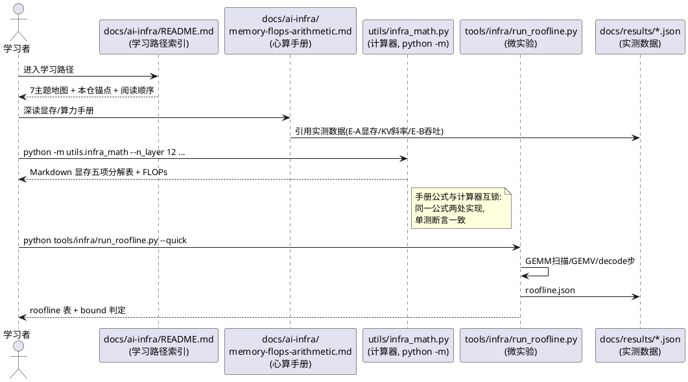
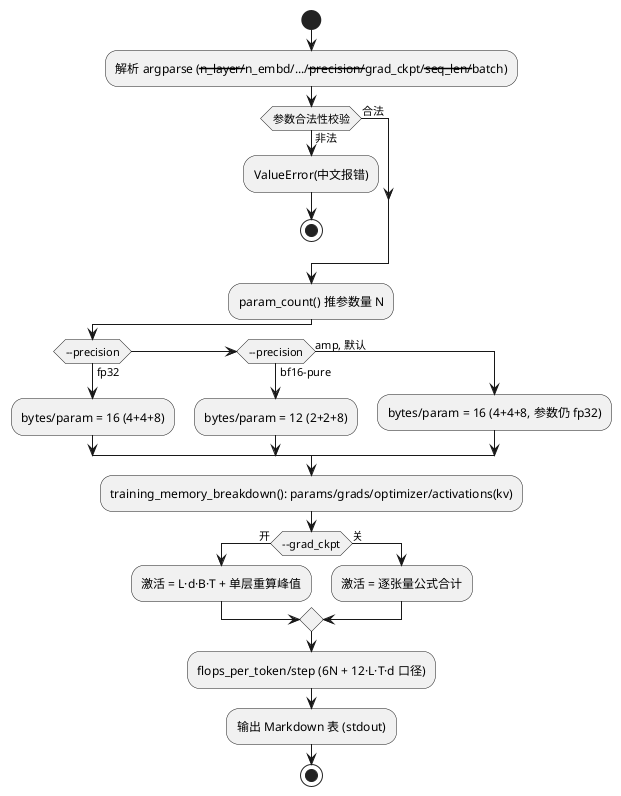
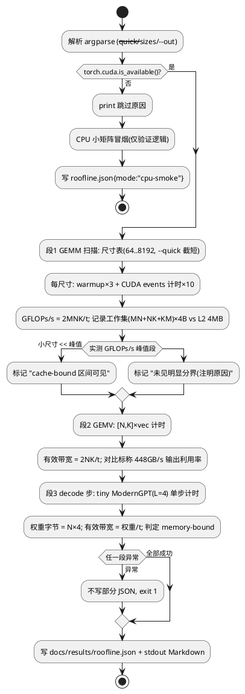

# 1 AR概述

| 组件名称 | nanoGPT-Modern AI infra 学习内容（第一階：显存/算力心算） |
| --- | --- |
| AR系统流水号 | AR-v0.6.0-ai-infra-foundations |
| AR描述 | 为 AI infra 学习系列奠基：显存/算力心算深度手册 + 公式可测的计算器工具 + 本机 roofline 微实验 + 延后执行的高算力实验 SOP + 学习路径索引骨架。核心定位：**每个公式都被本仓真实数据交叉验证**（区别于博客式转载）。 |

关联：`./srs.md`（FR1-FR7，验收标准已含 Given/When/Then）；`./tasks.md`（T001-T007）。
门控：req 门控 PASS（第 1 轮，W1-W5 已修正——显存锚点改云端 E-A 23.1/26.3/29.3GB、KV 斜率口径 12,335 B/token 层数无关、GPU 规格 16GB/448GB/s）。

# 2 动态行为

## 交互时序图



# 3 功能点分解

| 序号 | 功能点名称 | 功能点描述 | srs 追溯 |
| --- | --- | --- | --- |
| 1 | 学习路径索引 | docs/ai-infra/README.md：7 主题地图 + 4-AR 路线图 + 本仓锚点 + 延伸阅读 | FR1/T001 |
| 2 | 显存/算力心算手册 | docs/ai-infra/memory-flops-arithmetic.md：五项分解推导 + FLOPs + roofline + 逐条数据验证 | FR2/T002 |
| 3 | infra_math 计算器 | utils/infra_math.py：param_count / training_memory_breakdown / inference_kv_bytes / gqa_kv_materialization_slope / flops_per_token / flops_per_step / arithmetic_intensity + CLI | FR3/T003 |
| 4 | roofline 微实验 | tools/infra/run_roofline.py：GEMM 扫描 + GEMV 对照 + decode 步反推；--quick ≤5min；CPU fallback | FR4/T004 |
| 5 | F 组实验 SOP | RUNNING_EXPERIMENTS.md 新增 E-F-1/2/3（通信带宽/多卡 MFU/KV 物化复测），文档化待高算力 GPU | FR5/T005 |
| 6 | README 挂载 | 文档索引新增 ai-infra 入口；badge 测试数顺带修正 | FR6/T006 |
| 7 | 质量收口 | 全量回归零回归 + 三绿（新目录入 CI） + gitee 同步 + 状态表更新 | FR7/T007 |

# 4 实现设计

## 4.1 功能实现思路

三个代码交付物（计算器、微实验、CI 扩展）+ 四个文档交付物（索引、手册、SOP、README 挂载）。
计算器与手册**同一公式两处呈现**（手册人算推导 + 工具机算实现），由单测互锁——这是本 AR 的质量核心机制。

**优化器计账口径表**（设计决策 2A，贯穿手册/工具/测试三处一致）：

| 口径 | 参数 | 梯度 | Adam m+v | 静态合计 | 说明 |
| --- | --- | --- | --- | --- | --- |
| fp32 纯 | 4 | 4 | 8 | 16 B/param | --precision fp32 |
| **AMP autocast（默认，本仓实际）** | 4（fp32 主权重即参数本身） | 4 | 8 | 16 B/param | bf16 只省激活；moe +78M×16≈+1.25GB 锚定此口径 |
| bf16 纯权重 | 2 | 2 | 8（状态 fp32） | 12 B/param | --precision bf16-pure；业界另一派（如部分框架默认） |

激活显存逐张量建模（设计决策 1B），按本仓 `Block` 结构（per layer, bytes, fp32 口径给出、bf16 除 2）：

| 张量 | 形状 | bytes/token |
| --- | --- | --- |
| 层边界 hidden（grad-ckpt 只存此项） | [B,T,d] | d |
| QKV 投影输出（Q d + KV 2·n_kv·hd） | [B,T,d+2n_kv·hd] | d+2n_kv·hd |
| attn scores（softmax 前后各一） | [B,H,T,T] | 2·n_head·T |
| attn 输出 + out proj | [B,T,2d] | 2d |
| FFN 中间：SwiGLU gate+up+act / GELU h | [B,T,I]/[B,T,I] | swiglu: 3I（I=8d/3 对齐 128）/ gelu: I（I=4d） |
| 两条 norms 残差副本 | ~[B,T,4d] | ~4d |

梯度检查点：仅存层边界 [B,T,d]×L + 重算峰值 1 层全量（手册给出重算 vs 存储的权衡公式）。
MoE：FFN 中间 ×top_k（本仓 top-1，激活近似不变）+ 路由 logits [B,T,E] 小项。

## 4.2 功能实现设计

### 4.2.1 流程图

计算器 CLI（分支：精度口径 → 计算路径）：



roofline 微实验（分支：CUDA 可用性 → 三段测量）：



### 4.2.2 流程说明

- **计算器**：纯函数层（无 IO）+ CLI 层（argparse + Markdown 渲染）。公式口径常量（BYTES_PER_PARAM 等表驱动）集中在模块头部，与手册 §「口径表」一一对应。
- **roofline**：三段互相独立、顺序执行；CUDA events 计时；所有段共享 `docs/results/roofline.json` 的统一 schema（version/mode/gpu_name/segments[]）。GPU 标称规格（RTX 5000: 448GB/s、L2 4MB、~11 TFLOPS fp32）以 `GPU_SPECS` 表置于脚本头部，注释说明查询方法（nvidia-smi + 规格表），运行时用 `torch.cuda.get_device_name()` 匹配，未匹配卡输出实测值但 utilization 标 null（不猜分母）。
- **F 组 SOP**：纯文档，命令风格对齐 RUNNING_EXPERIMENTS 现有 A-D 组（环境/命令/产物/判据四要素）。

## 4.3 接口描述

### 4.3.1 `utils/infra_math.py`（新增模块，纯函数）

```python
def param_count(
    vocab_size: int, n_layer: int, n_embd: int, n_head: int,
    n_kv_head: int | None = None, ffn_variant: str = "swiglu",
    intermediate_size: int | None = None, num_experts: int = 1,
    tie_weights: bool = True, position_encoding: str = "rope",
    block_size: int = 1024, qk_norm: bool = False,
    use_bias: bool = False, norm_variant: str = "rms",
) -> int
```
- 返回：总可训练参数量（含 embedding；tied 时不重复计 lm_head——对齐 model L1624 张量共享 + L1905 id 去重；learned PE 加 block_size×d）
- 异常：`ffn_variant` 非 {swiglu,gelu} → ValueError；`norm_variant` 非 {rms,layer} → ValueError；`n_kv_head > n_head` 或不整除 → ValueError；负数/零维度 → ValueError
- 口径（与 model/modern_gpt.py 逐项对齐）：现代侧全部 Linear bias=False（L335-338/911-913/1061-1062）；swiglu 默认 I=align128(8d/3)（L1282）；gelu 默认 I=4d 不对齐（L1278）；qk_norm 加 **2·head_dim/层**（L346-347 RMSNorm(head_dim) 跨头共享 gamma，非逐头）；RMSNorm 每 norm 加 d（gamma 无 bias），LayerNorm 加 2d；MoE = (E−1)×FFN + router d×E（L932）
- **精确锚点**（手工复算与 EXPERIMENTS E-A 三位一体闭合，公式分毫不差）：
  - modern-full（50257/12/512/8/2/swiglu/tied/无qk_norm）= **59,560,960**（报告 59.561M）
  - baseline legacy（50257/12/512/8/8-MHA/gelu/**use_bias=True/norm=layer/learned PE**）= **64,085,504**（报告 64.086M；含 bias 55,296——「现代架构去 bias」教学点）
  - moe（modern-full + E=4）增量 = 12×(3×2,162,688 + 2,048) = **+77,881,344**（报告 +77.881M）
  - qk-norm（modern-full + qk_norm）增量 = 2·64·12 = **+1,536**（报告 59.562−59.561 ✓）

```python
def training_memory_breakdown(
    n_params: int, n_layer: int, n_embd: int, n_head: int,
    n_kv_head: int | None = None, seq_len: int = 1024, batch: int = 1,
    precision: str = "amp", grad_ckpt: bool = False,
    ffn_variant: str = "swiglu", num_experts: int = 1,
    dtype_bytes: int = 4, vocab_size: int = 50257,
) -> dict[str, float]
```
- 返回：`{"params_gb", "gradients_gb", "optimizer_gb", "activations_gb", "kv_eval_gb", "total_static_gb", "total_gb"}`（GB，两位小数由调用方处理，函数返回全精度 float）
- 口径：precision ∈ {"fp32", "amp", "bf16-pure"} 查 §4.1 计账表；activations 按逐张量表（grad_ckpt 时 = L·d·B·T + 单层全量）
- 异常：precision 非法 → ValueError

```python
def inference_kv_bytes(
    n_layer: int, n_kv_head: int, head_dim: int,
    seq_len: int, batch: int = 1, dtype_bytes: int = 2,
) -> dict[str, float]
```
- 返回：`{"total_bytes", "per_token_slope_bytes"}`；slope = 2·L·n_kv·hd·B（每加一 token 的增量）
- 异常：seq_len<0 等非正数 → ValueError

```python
def gqa_kv_materialization_slope(
    n_head: int, head_dim: int, dtype_bytes: int = 4, tensors: int = 3,
) -> float
```
- 返回：SDPA 无原生 GQA 内核时每 token 峰值瞬时斜率 = tensors·n_head·hd·dtype（**与层数无关**——逐层串行 + 分配器复用；MIGRATION §8.2：n_head=16,hd=64 → 12,288 B/token，实测 12,335）
- 异常：n_head/head_dim/dtype_bytes 非正数或 tensors < 1 → ValueError

```python
def flops_per_token(
    n_layer: int, n_embd: int, vocab_size: int, seq_len: int,
    backward: bool = True, include_embedding_matmul: bool = False,
    lm_head_tied: bool = True,
) -> float
```
- 口径：训练 ≈ 6N + 12·L·T·d（N=非 embedding 参数；N 包含 lm_head matmul——tied 时 lm_head 权重即 embedding，**matmul 仍发生**，FLOPs 计 2·d·vocab/次）；include_embedding_matmul=False 时不计 lm_head 项（Karpathy 6ND 口径）
- 异常：seq_len ≤ 0 → ValueError

```python
def flops_per_step(
    n_layer: int, n_embd: int, vocab_size: int, seq_len: int,
    batch: int, backward: bool = True,
    include_embedding_matmul: bool = False, lm_head_tied: bool = True,
) -> float
```
- 口径：= flops_per_token × batch；异常：batch ≤ 0 或 seq_len ≤ 0 → ValueError

```python
def arithmetic_intensity(flops: float, bytes_moved: float) -> float
```
- 异常：bytes_moved ≤ 0 → ValueError

```python
def main(argv: list[str] | None = None) -> int   # python -m utils.infra_math
```
- 输出：Markdown 表（参数量/五项显存/FLOPs/算术强度）到 stdout；`--help` 退出码 0

### 4.3.2 `tools/infra/run_roofline.py`（新增脚本）

```python
def get_args(argv=None) -> argparse.Namespace          # --quick/--sizes/--out/--skip_decode
def gemm_sweep(device, sizes, iters) -> list[dict]      # 段1: GFLOPs/s + 工作集 bytes
def gemv_bandwidth(device, shapes, iters) -> list[dict] # 段2: 有效 GB/s
def decode_step_bandwidth(device, n_layer=4) -> dict    # 段3: tiny 模型单步 → GB/s + bound 判定
def summarize(segments, gpu_name) -> dict               # roofline.json schema 组装
def main(argv=None) -> int
```
- 产物：`docs/results/roofline.json`（schema：`{"version", "mode", "gpu_name", "spec_bandwidth_gbs"|"null", "segments": {"gemm": [...], "gemv": [...], "decode": {...}}}`）
- 异常：CUDA 不可用 → CPU 冒烟模式写 `mode:"cpu-smoke"` 后正常退出 0（可测性）；测量异常 → 不写部分 JSON、退出 1；函数级：`gemm_sweep`/`gemv_bandwidth` 传入空 sizes/shapes 或非法 device → ValueError；`decode_step_bandwidth` 构建失败异常向上抛由 main 捕获归入「测量异常」路径

### 4.3.3 数据结构（roofline.json schema 见上；计算器返回 dict schema 见 4.3.1）

### 4.3.4 对外契约不变性

- 不修改任何现有模块接口；`pyproject.toml` 仅当采用 console-script 入口时追加一行（决策：**不加**，`python -m` 足够，srs 验收即此口径）
- `.github/workflows/ci.yml`：mypy/black/ruff 三行路径追加 `tools/infra/`（utils/ 已在范围内）

## 4.4 代码设计

```
docs/ai-infra/README.md                    # 功能点1：索引
docs/ai-infra/memory-flops-arithmetic.md   # 功能点2：手册
utils/infra_math.py                        # 功能点3：计算器（纯函数+CLI）
tools/infra/__init__.py                    # 新包
tools/infra/run_roofline.py                # 功能点4：微实验
tests/test_infra_math.py                   # 功能点3 的 TDD 测试
tests/test_roofline_script.py              # 功能点4 的纯函数冒烟（无 GPU 依赖）
docs/results/roofline.json                 # 微实验产物（运行后生成）
.github/workflows/ci.yml                   # +tools/infra/
docs/RUNNING_EXPERIMENTS.md                # 功能点5：F 组
README.md                                  # 功能点6：索引行 + badge 修正
docs/MIGRATION.md                          # 顺带：「8GB」→16GB 事实修正（1 行）
```

模块边界：`infra_math` 不 import torch（纯 numpy/math——CLI <1s NFR 与 CPU 可测性）；`run_roofline` import torch + `model.modern_gpt`（段3 需要）+ `utils.infra_math`（复用强度公式）。

## 4.5 决策记录（备选方案与取舍）

| 决策 | 备选 | 推荐 | 权衡 |
| --- | --- | --- | --- |
| D1 激活显存建模 | A 经验系数（Megatron 式每层系数）：短但与本仓 Block 对不上，锚点只能对总量级；B **逐张量参数化**（采纳）：组间差 3.2GB 可真实分解、每张量即教学点，代价是签名复杂；C 实例化模型实测：最准但违 CLI<1s NFR 且无法手算 | 1B | 教学价值 + 锚点可分解性 |
| D2 优化器计账 | A **三口径并列**（采纳，fp32 16 / amp 16（行项 4+4+8）/ bf16-pure 12）：「autocast 不省静态只省激活」本身是核心教学点，moe +1.25GB 锚定 amp 口径；B 单一口径 16B/param：简单但丢教学点 | 2A | 口径即课程 |
| D3 roofline 结构 | A 纯 GEMM 扫描：缺 decode 证据链；B **三段式**（采纳，GEMM 扫描+GEMV 对照+decode 步反推）：③直接锚定「decode 必然 memory-bound」主张；C 加通信基准：超本 AR 范围（归 E-F-1/AR-v0.8.0） | 3B | 证据链完整 + 范围克制 |
| D4 MFU 输出 | 计算器含理论 MFU：需峰值规格+实测时间输入，与「纯数学函数」定位冲突 | **本期不含**：MFU 定义入手册 §3，实测 MFU 归 roofline 段3 与 E-F-2 SOP | NFR CLI<1s + 职责单一 |
| D5 roofline 绘图 | matplotlib 轨迹图：PNG 58KB 预算挤占 gitee slim-mirror | **表格 + JSON 替代**（srs §5 gitee 约束）；plot extras 留作后续 AR 可选 | 镜像预算 |
| D6 CLI 入口 | pyproject [project.scripts] console-script：需改 pyproject | **`python -m utils.infra_math`**（srs 验收即此口径），零配置改动 | 最小增量 |

# 5 重构设计

无（纯增量）。

# 6 测试设计

## 6.1 单元测试（UT）

`tests/test_infra_math.py`（Red 先行，~23 用例）：

| 用例 | 覆盖点 | 断言（输入→预期） |
| --- | --- | --- |
| ut-param-modern-full | 功能点3/FR3 | param_count(vocab=50257, L=12, d=512, H=8, kv=2, swiglu) == **59,560,960**（精确；报告 59.561M，E-A 锚点） |
| ut-param-baseline | 功能点3/FR3 | param_count(同上但 gelu/kv=8/use_bias=True/norm=layer/learned PE) == **64,085,504**（精确；报告 64.086M） |
| ut-param-moe-delta | 功能点3/FR3 | param_count(..., num_experts=4) − modern-full == **77,881,344**（精确；E-A moe 行 137.442−59.561M） |
| ut-param-qk-norm | 功能点3 | qk_norm=True 增量 == 2·head_dim·L = 1,536（锚定 qk-norm 组 59.562M） |
| ut-param-untied | 功能点3 | tie_weights=False → +vocab×d |
| ut-param-invalid | 功能点3/异常 | ffn_variant="x"/norm_variant="x"/n_kv>n_head/负维度 → ValueError |
| ut-mem-amp-16b | 功能点3/FR3 | precision="amp"：optimizer_gb = 8B/param、total_static = 16B/param（口径表锁定） |
| ut-mem-bf16-pure-12b | 功能点3 | precision="bf16-pure"：total_static = 12B/param |
| ut-mem-fp32-16b | 功能点3 | precision="fp32"：行项 4+4+8、total_static = 16B/param（流程图 fp32 分支覆盖；与 amp 同账不同语义——fp32 无 bf16 激活折减，手册注明） |
| ut-mem-moe-anchor | 功能点3/FR3 | +78M 参数 → total_static 增量 ≈ 1.25GB（AR-v0.4.0 锚点） |
| ut-mem-grad-ckpt | 功能点3 | grad_ckpt=True 激活 < grad_ckpt=False 激活（L>1 时严格小于） |
| ut-mem-invalid | 功能点3/异常 | precision="x" → ValueError |
| ut-kv-slope | 功能点3/FR3 | inference_kv_bytes slope = 2·L·n_kv·hd·B 逐值相等（手算对照） |
| ut-kv-materialization | 功能点3/FR3 | gqa_kv_materialization_slope(16, 64, 4, 3) == 12,288；docstring 注明实测 12,335 与层数无关机理（MIGRATION §8.2 锚点） |
| ut-gqa-invalid | 功能点3/异常 | n_head=0/head_dim=-1/dtype_bytes=0/tensors=0 → ValueError |
| ut-kv-invalid | 功能点3/异常 | seq_len=0 → ValueError |
| ut-flops-6nd | 功能点3 | flops_per_token（无 attention 项影响时）≈ 6N（T 很小时 attention 项趋零验证公式结构） |
| ut-flops-attn-term | 功能点3 | attention 项 = 12·L·T·d 精确断言（两配置差值法） |
| ut-flops-step | 功能点3 | flops_per_step == flops_per_token × batch（精确断言）；batch=0 → ValueError |
| ut-flops-lmhead | 功能点3 | include_embedding_matmul True/False 差值 = 2·d·vocab/token；lm_head_tied 分支：tied=False 时 N 与 FLOPs 均含独立 lm_head |
| ut-flops-invalid | 功能点3/异常 | seq_len=-1 → ValueError |
| ut-intensity | 功能点3 | arithmetic_intensity(2MNK, bytes) 精确断言 + bytes=0 → ValueError |
| ut-cli | 功能点3/接口 | main(["--n_layer","12",...]) 返回 0 且 stdout 含 "GB"；main(["--precision","x",...]) 抛 ValueError |

`tests/test_roofline_script.py`（~7 用例，无 GPU 依赖）：

| 用例 | 覆盖点 | 断言 |
| --- | --- | --- |
| ut-roof-sizes | 功能点4 | --quick 尺寸表 ⊆ 完整表且 ≥10 点（FR4 验收） |
| ut-roof-intensity | 功能点4 | gemm GFLOPs 计算 = 2MNK（纯函数） |
| ut-roof-bandwidth-calc | 功能点4 | 带宽 = bytes/t 纯函数断言 |
| ut-roof-schema | 功能点4 | summarize() 输出含 version/mode/gpu_name/segments 键 |
| ut-roof-args | 功能点4/接口 | get_args 解析 --quick/--skip_decode/--sizes/--out（默认值 + 显式值分支）；空 sizes/shapes 或非法 device → ValueError（函数级入参校验分支） |
| ut-roof-abort | 功能点4/异常 | monkeypatch 段函数抛异常 → main 返回 1 且无 roofline.json 写出（测量中断分支） |
| ut-roof-cpu-smoke | 功能点4/异常 | CUDA 不可用时 main() 走 cpu-smoke 路径（monkeypatch torch.cuda.is_available=False）退出 0 |

## 6.2 接口测试

- `python -m utils.infra_math --help` 退出码 0（FR3 验收直测，入 UT ut-cli 补一条 subprocess 或 main(None) 路径）
- roofline JSON schema 四键完整（ut-roof-schema）
- 计算器返回 dict 键集合精确断言（ut-mem-amp-16b 顺带）

## 6.3 业务场景测试

| 场景 | 用例 | srs 验收追溯 |
| --- | --- | --- |
| 学习者按索引读手册并手算 50M 显存 | ut-mem-* 口径与手册 §「口径表」一致（手册表格数值 = 计算器输出，人工核对步骤写入手册附录） | FR2 验收 3 |
| 本机跑 roofline --quick | 实际执行一次（GPU 存在），产物 JSON ≥10 尺寸点、5 分钟内（开发会话实测记录入进度） | FR4 验收 1 |
| roofline bound 判定 | 产物 JSON gemm 段每尺寸含工作集 bytes 与 GFLOPs/s，summary 含 bound 标注或差异说明字段（小尺寸 vs 大尺寸对比可见，FR4 验收 2 判据） | FR4 验收 2 |
| decode 步带宽反推 | 段3 输出 utilization% = 权重字节/t ÷ 448GB/s | FR4 验收 3 |
| 云端读者按 F 组 SOP 执行 | 文档四要素完整性（人工审阅 + T007 终检）；命令风格与 A-D 组一致（对照判据） | FR5 验收 1-3 |
| 索引条目完整性 | T007 终检脚本 grep：7/7 主题条目均含锚点 + AR 标注（FR1 验收 1 判据） | FR1 验收 1 |
| README 挂载不破坏阅读线 | T007 diff 审阅：含 ai-infra 入口 + 7 主题摘要行，三条阅读线结构不变（纯增量行判据） | FR6 验收 1/2 |

## 6.4 异常场景测试

| 异常 | 用例 | 预期 |
| --- | --- | --- |
| 计算器非法精度/负维度/非法 ffn_variant | ut-param-invalid / ut-mem-invalid / ut-flops-invalid | ValueError（中文 message 含非法值） |
| arithmetic_intensity 除零 | ut-intensity | ValueError |
| roofline 无 CUDA | ut-roof-cpu-smoke | cpu-smoke 模式正常退出 0，JSON mode 标注 |
| roofline 测量中途异常 | 设计约束（不写部分 JSON） | 无部分文件写出；exit 1（实现时以 try/except 包裹段执行，单测覆盖 summarize 前的异常路径） |
| 索引引用未来 AR 文档 | FR1：未交付主题标「计划中」 | T007 终检：索引内路径 100% 存在或显式「计划中」（人工+脚本 grep 检查步骤入 T007） |

## 6.5 覆盖率目标

- `utils/infra_math.py` 行覆盖 ≥95%（纯函数，全覆盖可行）；`tools/infra/run_roofline.py` 纯函数部分（sizes/intensity/schema/cpu-smoke）全覆盖，CUDA 测量段豁免（本机执行验证替代）
- srs 验收标准追溯：FR1→6.3+T007、FR2→6.3、FR3→6.1 全部 ut-*、FR4→6.1 ut-roof-* + 6.3、FR5→6.3、FR6→6.3+T007、FR7→T007 全量回归
