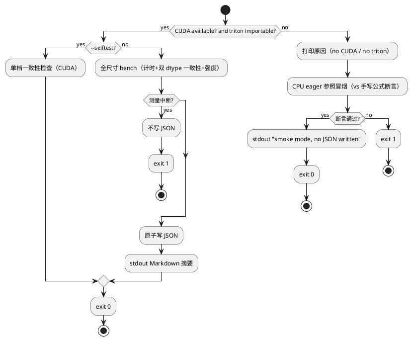

# AR-v0.7.0-ai-infra-kernels 设计文档

| 项目 | 内容 |
| --- | --- |
| AR 编号 | AR-v0.7.0-ai-infra-kernels |
| 状态 | 设计定稿（design 门控第 3 轮 PASS，2026-10-14；遗留 W1/W2 见 tasks.md 门控记录） |
| 前置 | AR-v0.6.0-ai-infra-foundations（已归档，基线 683 passed / 2 skipped） |
| 需求 | specs/changes/AR-v0.7.0-ai-infra-kernels/srs.md（7 FR，req 门控 PASS） |

## 1. 背景与目标

v0.6.0 建立了「手册 + 工具 + 实测数据」的 AI infra 教学范式（memory-flops-arithmetic.md / run_roofline.py / roofline.json）。深度缺口分析显示：主题 2（attention kernel）与主题 3（compile/Triton）「代码在、教学缺」密度最高，且约半数实测数据（MoE 5.8×、KV 12,335、compile 1.59×/负结果）无手册承接。

> 编号口径：按 docs/ai-infra/README.md 主题地图，主题 2 = attention kernel、主题 3 = torch.compile/Triton、主题 4 = 分布式训练（本 AR 不触碰）。srs §1 背景段「主题 5（compile 栈）」为编号笔误，以 srs §3.6 FR6「主题 2 与主题 3」及主题地图实际行为准。

本 AR 目标：
1. **attention-kernels.md**——以本仓 GQA 三路径 / ring_attention 在线 softmax / MoE grouped GEMM 代码为锚，讲透 attention kernel 演化主线；
2. **compile-stack.md**——分层拆解 torch.compile（dynamo 本机实测 + inductor 理论/云端 SOP）；
3. **Triton 微实验**——三个手写 kernel（fused SwiGLU / RMSNorm / GQA decode）+ eager A/B 计时 + 数值一致性（fp32/bf16 两口径）+ 算术强度标注 + stdout Markdown 摘要 + JSON 落盘，填补 Triton 零空白；
4. 索引/README/badge 收口，gitee 同步。

## 2. 需求摘要与 FR 映射

| FR | 内容 | 设计章节 |
| --- | --- | --- |
| FR1 | attention-kernels.md 手册（推导+代码对照+数据承接） | §4.1 |
| FR2 | compile-stack.md 手册（分层架构+调用面+分层实测） | §4.2 |
| FR3 | Triton 微实验（三 kernel + eager 参照 + bench + CLI + 强度标注 + CPU 冒烟） | §4.3 |
| FR4 | 测试（importorskip/CUDA skipif，全量回归不回退） | §4.4 |
| FR5 | 实测记录（triton_kernels.json + EXPERIMENTS + E-F-4 SOP） | §4.3.4、§4.5 |
| FR6 | 索引更新（主题 2/3 转已交付、ADR 7→6 笔误）+ README 挂载 + badge | §4.5 |
| FR7 | 收口（全量回归 683+/2、三绿、gitee 同步） | §6 |

## 3. 总体结构

```
docs/ai-infra/
├── README.md                    # [改] 主题 2/3 状态更新、L45 ADR 7→6
├── attention-kernels.md         # [新] FR1 手册
├── compile-stack.md             # [新] FR2 手册
├── memory-flops-arithmetic.md   # [不动] v0.6.0 交付
docs/results/
├── triton_kernels.json          # [新] FR5 bench+一致性+强度数据
tools/infra/
├── triton_kernels.py            # [新] FR3 三 kernel+参照+bench+CLI（单文件）
tests/
├── test_triton_kernels.py       # [新] FR4 测试
docs/
├── EXPERIMENTS.md               # [改] §6.9 Triton 微实验组
├── RUNNING_EXPERIMENTS.md       # [改] E-F-4 inductor 云端 SOP
README.md                        # [改] 挂载两手册 + badge
```

## 4. 详细设计

### 4.1 attention-kernels.md 章节骨架（FR1）

约 8 节，方法论承 v0.6.0：每节公式后接「本仓验证」，数值断言溯源 `docs/results/*.json`，图用表格，明确「能说/不能说」。

| § | 标题 | 内容与代码锚点 |
| --- | --- | --- |
| 1 | 为什么 attention 是 kernel 战场 | N² 显存问题；decode 内存受限 vs 训练计算受限；衔接 roofline 1160×（GEMM 8.5→9825.7 GFLOPs/s）与 decode 4.81 GB/s 实测 |
| 2 | SDPA 后端分层与 mask 代价 | flash / memory-efficient / math / cuDNN 四后端；`model/attention_utils.py:104-237` probe 报告能力；sm75 实际可用后端；**is_causal 折叠 vs 加性 mask 的代价**（is_causal 布尔可被后端折叠进 kernel，加性浮点 mask 需物化 [B,1,T,S] 且阻断 flash 后端——对照 modern_gpt.py:455-480,661 的 is_causal 折叠路径） |
| 3 | GQA：KV 膨胀的两种解法 | 问题：`repeat_interleave` 物化 KV 抵消显存收益。路径一 `_gqa_grouped_sdpa`（modern_gpt.py:177-242）：Q 重排 `[B,n_kv,rep,T,D]` + KV `unsqueeze(2)` 广播，零拷贝，全后端可用；路径二 `_decode_gqa_attention`（modern_gpt.py:245-297）：T==1 时原生分辨率 scores `[B,n_kv,rep,S]`，比展开式小 `2*n_rep` 倍，摆脱后端回退。数据：GQA-2 KV −75%（EXPERIMENTS.md「4,608 (-75%)」）；`_probe_sdpa_gqa_support` 弃用史 |
| 4 | FlashAttention：在线 softmax 推导 ↔ 代码逐行对照 | naive softmax 数值问题（exp 溢出）→ 三变量递推：`m_new = max(m, max(s_ij))`、`l = l·exp(m−m_new) + Σexp(s_ij−m_new)`、`acc = acc·exp(m−m_new) + exp(s_ij−m_new)@v_j`。**对照表**：推导每一步 ↔ `ring_attention.py:145-156`（m_ij/m_new/exp_scale/exp_ij/lse/acc 六行）+ 安全处理（L150 `isneginf` 替零防 NaN、L160 padding 行 l=1 防除零）。因果掩码 L132-143、padding 掩码 L139-140 |
| 5 | KV cache 与 decode 显存 | KV 斜率案例：12,335 bytes/token 峰值增长（3 次隐式拷贝）→ 修复（MIGRATION §8.2，114× 显存削减）；零拷贝 append-cache 设计；enable_gqa 后端回退内部物化陷阱（MIGRATION §8.2 全案：定位→修复→验证） |
| 6 | MoE grouped GEMM | top-1 路由 → 负载均衡 aux loss（`f·P` 公式 ↔ modern_gpt.py:1004-1007）→ 向量化 dispatch（stable sort + `seg_starts` + slots<capacity，L1018-1022）→ padded 静态形状 `[E,cap,C]`（L1031，为何利于编译/内核调度）→ gather 按路由概率加权（L1041-1042，梯度流向 router）。数据：grouped 5.8×（moe_kernel.json：16 专家 loop 11.391ms vs grouped 1.978ms） |
| 7 | Ring Attention 的真实形态与边界 | 本仓 `ring_attention.py` 是单卡 blockwise 参照（在线 softmax 教学载体）；真 Ring Attention = 多卡 P2P KV 块环传；区分与联系。「不能说」：多卡曲线本仓无数据 |
| 8 | 自测要点 | 指向 tests/ 对应测试 + 三个思考题（如：为什么 exp_scale 用 m−m_new_safe 而非 m−m_new？） |

### 4.2 compile-stack.md 章节骨架（FR2）

约 7 节，分层实测：dynamo 本机可测、inductor 理论 + 云端 SOP。

| § | 标题 | 内容与代码锚点 |
| --- | --- | --- |
| 1 | 为什么需要 compile | Python 解释开销 vs kernel 启动开销 vs kernel 内计算；衔接 v0.6.0 手册的算术强度视角 |
| 2 | 三层架构（含 cudagraphs） | Dynamo（FX 图捕获、guard 机制、recompile 计数）→ AOTAutograd（前反向分解）→ Inductor（fusion 决策/逐元素·归约合并规则、Triton codegen、max-autotune）→ **cudagraphs**（reduce-overhead 模式的图录制回放、launch 开销消除、静态显存语义）。每层输入/输出 |
| 3 | 本仓调用面 | 组合序：FSDP 包外层再 compile（trainer_base.py:755-758 FR9b）；generate 两条路径：`reduce-overhead, dynamic=True`（modern_gpt.py:2088）vs fullgraph 单 token step（2051-2081, 2276-2344 `fullgraph=True`）；为何 fullgraph 要求无 data-dependent break（2386 注释）；compile 与 EMA/checkpoint 的交互（ARCHITECTURE §2） |
| 4 | Dynamo 层实测（本机，内联代码） | `torch._dynamo.explain` / `torch._dynamo.run` 输出解读；guard 失败→recompile 演示（动态 shape/字典/属性突变各触发一次，对齐 MIGRATION §8.1 方法）；fullgraph 约束与图断裂演示；recompile 计数含义；`torch._dynamo.config` 常用项。代码块内联，读者复制可跑 |
| 5 | Inductor 层：理论与本机断裂案例 | fusion 规则与 codegen 流水线；max-autotune 与手写 Triton（本 AR FR3）的分工；**教学案例**：本仓 triton 3.8 + torch 2.5.1 版本矩阵断裂（inductor 绑定特定 triton 版本），为何「不修环境」——降级 triton 3.1 会破坏手写 kernel 依赖；版本兼容矩阵表 |
| 6 | 实测数据解读：何时值得 compile | compile 1.59×（256 tok，EXPERIMENTS.md §6.4）/ 64 tok 负结果（inference.json：78.99 vs 184.06 tok/s）——小 batch 下 kernel 启动开销占比、CUDAGraph（reduce-overhead）何时反超；编译成本摊平边界。「能说/不能说」：单卡 sm75 数据，不外推 |
| 7 | 云端 E-F-4 SOP | inductor 全链路验证 SOP，对齐 E-F-1/2/3 格式（RUNNING_EXPERIMENTS.md F 组）：**环境/命令/产物/判据**四要素（详细步骤作为「命令」的展开）+ 状态表登记 + 更新历史 |

### 4.3 tools/infra/triton_kernels.py 接口契约（FR3）

单文件（用户裁定 D1），结构承 `run_roofline.py`：kernel 定义区 / eager 参照区 / 强度公式区 / bench 区 / CLI 区。

#### 4.3.1 Kernel 与包装签名（含异常契约）

```python
# --- Triton kernels（@triton.jit）---
_swiglu_kernel(x_ptr, w_gate_ptr, w_up_ptr, y_ptr,
               M, N, K,
               stride_xm, stride_wg_n, ...,   # 各矩阵 stride
               BLOCK_M: tl.constexpr, BLOCK_N: tl.constexpr, BLOCK_K: tl.constexpr)
# 逐 (BLOCK_M, BLOCK_N) tile：acc_g = Σ x·wgᵀ、acc_u = Σ x·wuᵀ；
# y = silu(acc_g) * acc_u；tl.dot 分块累加（fp32 累加）

_rmsnorm_kernel(x_ptr, w_ptr, y_ptr, n_rows, N,
                eps, BLOCK_N: tl.constexpr)
# 每程序一行：row = load(x_row)；ms = mean(row*row)；
# y = row * rsqrt(ms + eps) * w；单行 BLOCK_N = next_power_of_2(N)，掩码补零参与 mean 需除真实 N

_gqa_decode_kernel(q_ptr, k_ptr, v_ptr, y_ptr,
                   S, D_rep..., scale,
                   stride_..., BLOCK_S: tl.constexpr)
# grid=(B*n_kv,)：每程序一个 (b, kv_head)。
# q 块 [rep, D] 常驻寄存器；沿 S 分块：s_blk = q @ k_blkᵀ * scale；
# 在线 softmax（m/l/acc 标量-寄存器递推，呼应手册 §4 推导）；
# y = acc / l → store [rep, D]

# --- Python 包装（形状校验 + grid 计算 + launch）---
def triton_swiglu(x: Tensor, w_gate: Tensor, w_up: Tensor) -> Tensor
    # x [M,K]、w_gate/w_up [N,K] → 返回 [M,N]；dtype 限 fp32/bf16
    # 异常：x.ndim != 2 或 w 形状不匹配 → ValueError；
    #       dtype 非 fp32/bf16 → ValueError；device 非 CUDA → ValueError
def triton_rmsnorm(x: Tensor, weight: Tensor, eps: float = 1e-5) -> Tensor
    # x [M,N]、weight [N] → 返回 [M,N]
    # 异常：x.ndim != 2 / weight.shape[0] != N / dtype 或 device 不符 → ValueError
def triton_gqa_decode(q: Tensor, k: Tensor, v: Tensor, scale: float | None = None) -> Tensor
    # q [B,n_head,1,D]→view [B,n_kv,rep,D]；k/v [B,n_kv,S,D]；返回 [B,n_head,1,D]
    # 语义对齐 _decode_gqa_attention（modern_gpt.py:245）
    # 异常：n_head % n_kv_head != 0 → ValueError；q T != 1 → ValueError；
    #       形状/维度不匹配 → ValueError

# --- 算术强度公式（口径与 utils/infra_math 的 FLOPs/bytes 定义一致）---
def swiglu_flops(M, N, K) -> int       # 4*M*N*K（gate/up 两 GEMM）+ 3*M*N（silu·mul 逐元素）
def swiglu_bytes(M, N, K, dtype_size) -> int   # 读 x(M*K) + wg/wu(2*N*K) + 写 y(M*N)
def rmsnorm_flops(M, N) -> int         # ~5*M*N（平方和/均值/rsqrt/两次乘）
def rmsnorm_bytes(M, N, dtype_size) -> int     # 读 x(M*N)+w(N) + 写 y(M*N)
def gqa_decode_flops(B, n_kv, rep, S, D) -> int  # 4*B*n_kv*rep*S*D（scores + AV 两批 GEMM）
def gqa_decode_bytes(B, n_kv, rep, S, D, dtype_size) -> int  # q + k/v + y
```

约束：仅基础 Triton 特性（tl.load/store/dot/max/exp、constexpr、掩码），sm75 无 TMA/warp spec。

#### 4.3.2 Eager 参照函数

```python
def eager_swiglu(x, w_gate, w_up) -> Tensor   # F.silu(x @ w_gate.T) * (x @ w_up.T)
def eager_rmsnorm(x, weight, eps=1e-5) -> Tensor  # x * torch.rsqrt(x.pow(2).mean(-1, keepdim=True) + eps) * weight
                                               # 公式对齐 model/modern_gpt.py:37 RMSNorm
def eager_gqa_decode(q, k, v, scale=None) -> Tensor  # 逻辑对齐 _decode_gqa_attention（逐行同式）
```

参照函数为纯 PyTorch、CPU 可跑——供测试在 CPU 上独立验证（见 §4.4），亦为无 CUDA/triton 环境的冒烟对象（见 §4.3.3）。

#### 4.3.3 Bench 设计（含 CPU 冒烟降级路径）

**CUDA 完整路径（本机 GPU）**：
- 计时：`torch.cuda.Event` 成对计时；每 (kernel, size) 先 `n_warmup=10` 预热再 `n_iter=50` 取**中位数**（抗异常值，mean/min 同时记入 JSON）
- 尺寸表（`--quick` 缩减为 1 档，全量 3 档）：
  - swiglu：M∈{1024, 4096, 16384}，N=1024，K=512
  - rmsnorm：M∈{1024, 4096, 16384}，N=1024
  - gqa_decode：B=8，n_head=16，n_kv=8，D=64，S∈{512, 2048, 8192}
- 显存预算：单 tensor ≤ 16384×1024×4B = 64 MiB，全程 < 1 GB（RTX 5000 4GB 安全）
- **一致性两口径**：每 (kernel, size) 在 fp32（atol=1e-5/rtol=1e-4）与 bf16（atol=1e-2/rtol=1e-2，fp32 累加下 bf16 舍入量级）下各跑一次 allclose 与 max_abs_err；容差记入 JSON
- **算术强度标注**：每 (kernel, size) 按 §4.3.1 公式计算 FLOPs/bytes → `intensity_flops_per_byte` 记入 JSON（口径与 utils/infra_math 一致：fp32 元素 4B，逐元素乘加计 2 FLOPs）
- tf32 状态记入 metadata（`torch.backends.cuda.matmul.allow_tf32` 默认 False，显式记录不隐含）
- **stdout Markdown 摘要**：bench 结束打印 Markdown 表（kernel/尺寸/dtype/eager_ms/triton_ms/加速比/强度/allclose），替代绘图（gitee PNG 预算 + srs 要求）
- 测量中断：**不写部分 JSON**，exit 1；JSON 一次性原子写出（先全部测完再写）

**CPU 冒烟降级路径（无 CUDA 或无 triton）**：
- 打印原因（`no CUDA device` / `triton not installed`）
- 以 eager 参照实现冒烟：小尺寸（各 kernel 1 档）在 CPU 上跑 eager 参照 vs 手写公式断言 allclose，验证逻辑可测（与 tests §4.4 CPU 组同一逻辑）
- 降级成功 → **exit 0**（降级完成也是成功路径），stdout 明示「smoke mode, no JSON written」；**不写 JSON**（无 GPU 计时数据，避免伪数据落盘）
- 降级中参照断言失败 → exit 1

**退出码语义**：`0` 成功（完整 bench 产出 JSON，或 CPU 冒烟降级成功）；`1` 失败（一致性断言失败/测量中断/降级冒烟断言失败）；`2` argparse 用法错误（argparse 内置）。

#### 4.3.4 JSON schema（docs/results/triton_kernels.json）

```json
{
  "meta": {"device": "NVIDIA Quadro RTX 5000", "torch": "2.5.1+cu121",
            "triton": "3.8.0", "allow_tf32": false, "timestamp": "ISO-8601",
            "quick": false, "timing": "cuda-event median of 50 after 10 warmup"},
  "measurements": [
    {"kernel": "swiglu", "size": {"M": 4096, "N": 1024, "K": 512},
     "triton_ms": 0.0, "eager_ms": 0.0, "speedup": 0.0,
     "triton_ms_mean": 0.0, "eager_ms_mean": 0.0,
     "intensity_flops_per_byte": 0.0}
  ],
  "consistency": [
    {"kernel": "swiglu", "size": {"M": 4096, "N": 1024, "K": 512},
     "dtype": "float32", "allclose": true, "max_abs_err": 0.0,
     "atol": 1e-05, "rtol": 1e-04},
    {"kernel": "swiglu", "size": {"M": 4096, "N": 1024, "K": 512},
     "dtype": "bfloat16", "allclose": true, "max_abs_err": 0.0,
     "atol": 0.01, "rtol": 0.01}
  ]
}
```

说明：schema 为本 AR 自定，**松散承袭 roofline.json 风格**（元信息 + 分段测量记录；roofline.json 实际键为 version/mode/gpu_name/spec_bandwidth_gbs/segments，非同构 schema）。speedup 诚实记录不设阈值（用户裁定）。

#### 4.3.5 CLI

对齐 srs FR3 触发条件 `python tools/infra/triton_kernels.py [--quick]`（无子命令，默认执行 bench）：

```
python tools/infra/triton_kernels.py [--quick] [--json PATH]   # bench；默认 --json docs/results/triton_kernels.json
python tools/infra/triton_kernels.py --selftest                # 单档快速一致性检查（CUDA），不写 JSON
```

无 CUDA/triton 时以上任一入口自动落入 §4.3.3 CPU 冒烟降级路径（不报错退出）。

#### 4.3.6 边界条件矩阵与流程图

| 场景类型 | 场景 | 行为 |
| --- | --- | --- |
| 正常 | 本机 CUDA + triton，bench | 三 kernel 全尺寸计时+双 dtype 一致性+强度 → JSON + stdout Markdown 摘要，exit 0 |
| 正常 | 本机 CUDA，`--selftest` | 单档一致性检查，不写 JSON，exit 0 |
| 边界 | `--quick` | 每 kernel 1 档，其余逻辑同全量 |
| 边界 | 尺寸非 BLOCK 整数倍（如 rmsnorm N 非 2 的幂） | 掩码补零 + 除真实 N，一致性断言覆盖 |
| 边界 | bf16 输入 | kernel fp32 累加，atol=1e-2/rtol=1e-2 口径 |
| 异常 | 无 CUDA / 无 triton | CPU 冒烟降级：eager 参照 vs 公式断言，exit 0（不写 JSON）；断言失败 exit 1 |
| 异常 | 测量中断（Ctrl-C 等） | 不写部分 JSON，exit 1 |
| 异常 | 非法入参（形状/dtype/device） | ValueError（包装层契约 §4.3.1） |



### 4.4 测试设计（FR4）

`tests/test_triton_kernels.py`，模块级 `pytest.importorskip("triton")`；CUDA 用例 `@pytest.mark.skipif(not torch.cuda.is_available(), ...)`。预计 17-19 用例：

| 组 | 用例 | 条件 |
| --- | --- | --- |
| eager 参照正确性（CPU） | `test_eager_swiglu_matches_manual`：与手写 einsum 公式 allclose | CPU |
| | `test_eager_rmsnorm_matches_reference_class`：与 `model.modern_gpt.RMSNorm` 前向 allclose（fp32，srs FR4 AC） | CPU |
| | `test_eager_gqa_decode_matches_sdpa`：与 `F.scaled_dot_product_attention`（grouped 形式）allclose | CPU |
| | `test_eager_gqa_decode_matches_decode_helper`：与 `_decode_gqa_attention` allclose（语义对齐契约） | CPU |
| 强度公式（CPU） | `test_intensity_formulas_small`：小形状手算值 vs §4.3.1 公式（六函数逐一断言） | CPU |
| 形状校验 | `test_triton_wrapper_invalid_shape_gqa`：q 头数不被 n_kv 整除 → ValueError | CPU |
| | `test_triton_wrapper_invalid_shape_swiglu`：w_gate 形状不匹配/ndim≠2 → ValueError | CPU |
| | `test_triton_wrapper_invalid_shape_rmsnorm`：weight 长度≠N → ValueError | CPU |
| kernel 数值一致性（CUDA） | `test_triton_swiglu_allclose` / `test_triton_rmsnorm_allclose` / `test_triton_gqa_decode_allclose`：三 kernel vs eager 参照，fp32 atol=1e-5/rtol=1e-4 | CUDA |
| | `test_triton_consistency_bf16`：三 kernel bf16 输入 fp32 累加 vs eager bf16，atol=1e-2/rtol=1e-2 | CUDA |
| bench 逻辑 | `test_bench_invalid_kernel_name`：ValueError | CPU |
| | `test_bench_interrupt_no_partial_json`：monkeypatch 计时函数中途抛异常 → 目标 JSON 路径无文件产生且入口返回 1（数据完整性：不写部分 JSON） | CPU |
| | `test_cpu_smoke_mode`：monkeypatch `torch.cuda.is_available`→False，CLI 入口运行 → exit 0、无 JSON 文件产生、stdout 含 smoke 提示 | CPU |
| | `test_cpu_smoke_assertion_failure`：monkeypatch eager 参照返回错误值 → CPU 冒烟入口 exit 1 | CPU |
| | `test_bench_json_roundtrip`：CUDA 环境跑 `--quick --json` 临时文件，schema 字段齐全（含 intensity/dtype）；无 CUDA 环境 skip。`--selftest` 入口（CUDA-only）不设 pytest 用例，由 T004 本机实测覆盖（CI 无法覆盖 CUDA 路径，与 §4.4 覆盖率口径③一致） | CUDA |
| CLI | `test_cli_help_smoke`：`--help` 退出码 0 | CPU |
| | `test_cli_usage_error_exit_2`：非法参数（未知 flag）→ argparse exit 2 | CPU |

无 CUDA 的 CI 环境下：importorskip + skipif 使 CUDA 用例全 skip，不阻塞全量回归。

**覆盖率目标（口径）**：① 全量回归基线 683 passed / 2 skipped 零回退（新增用例全过或合规 skip）；② 本文件 CPU 可达路径（eager 参照/强度公式/形状校验/bench 逻辑/CLI）用例全覆盖；③ CUDA kernel 路径以本机实测 JSON 为执行证据（CI 无法覆盖，非用例缺口）。不设独立行覆盖率指标（承 v0.6.0 全仓口径）。

### 4.5 文档与索引变更设计（FR5/FR6）

| 文件 | 变更 |
| --- | --- |
| docs/ai-infra/README.md | 主题 2（attention kernel）→ 已交付：attention-kernels.md；主题 3（compile/Triton）→ 已交付：compile-stack.md + tools/infra/triton_kernels.py（注明「手写 kernel 教学级，非生产库」边界）；L45「7 篇 ADR」→「6 篇」 |
| README.md | 「AI infra 手册」区挂两新手册；badge 681+ → 实际值（T007 收口时以全量回归结果为准，预期 683+ 或以上） |
| RUNNING_EXPERIMENTS.md | F 组新增 E-F-4：inductor 云端验证 SOP（**环境/命令/产物/判据**四要素 + 状态表登记 + 更新历史），标注「云端空闲后执行，非本 AR 阻塞项」 |
| EXPERIMENTS.md | 新增 §6.9 Triton 微实验组：表格承接 triton_kernels.json 关键数字（speedup + intensity + max_abs_err）+ 「能说/不能说」边界（sm75 教学级、未 autotune） |
| docs/results/triton_kernels.json | bench 落盘（§4.3.4 schema） |

## 5. 关键设计决策

| # | 决策 | 理由 |
| --- | --- | --- |
| D1 | Triton 单文件 `tools/infra/triton_kernels.py`（kernel+参照+强度+bench+CLI 一体） | 用户裁定；与 run_roofline.py 同构；@jit 须 .py 源文件天然满足 |
| D2 | GQA kernel 完整复刻 `_decode_gqa_attention`（scores+softmax+×V），kernel 内沿 S 分块 + 在线 softmax | 用户裁定；与 `_decode_gqa_attention`/SDPA 双对照闭环；寄存器 m/l/acc 递推直接呼应手册 §4 ring_attention 推导——两本手册与微实验三点闭环 |
| D3 | dynamo recompile 演示为手册内联代码，不新增仓库文件 | 用户裁定；承 E-F-1/MIGRATION §8.1 内联先例；演示性代码不建仓 |
| D4 | 测量纪律：cuda.Event、10 warmup、50 iter 取中位数；中断不写部分 JSON；JSON 原子一次写出 | 承 v0.6.0「测量中断不写部分 JSON」裁决；中位数抗调度异常值 |
| D5 | 一致性两口径：fp32 atol=1e-5/rtol=1e-4；bf16 atol=1e-2/rtol=1e-2（kernel fp32 累加，差异主要来自 bf16 输入舍入与归约顺序）；均记入 JSON；tf32 状态显式记入 meta | srs FR3「fp32/bf16 两口径」要求；fp32 容差为 srs 验收量级，bf16 容差按舍入量级推导并记录 |
| D6 | 加速比诚实报告不设阈值；sm75 基础特性（无 TMA）；教学定位声明 | 用户裁定；sm75 无 TMA/warp spec；eager 本身已高度优化（cuBLAS），诚实记录「手写 kernel 常慢于 eager」这一教学事实本身即为内容 |
| D7 | CPU 冒烟降级语义：无 CUDA/triton → eager 参照冒烟，exit 0、不写 JSON；断言失败/测量中断 exit 1；argparse 用法错误 exit 2 | srs FR3 异常处理要求（打印原因+CPU 参照冒烟+退出码语义化）；不写 JSON 避免无 GPU 计时的伪数据落盘；与 tasks T003「CPU 冒烟降级」口径统一 |

## 6. 影响面分析与验收对照

- **新增**：4 文件（两手册、triton_kernels.py、test_triton_kernels.py）+ 1 JSON
- **修改**：docs/ai-infra/README.md、README.md、RUNNING_EXPERIMENTS.md、EXPERIMENTS.md
- **不动**：model/ 与 training/ 生产代码零改动（Triton 微实验独立，用户裁定）；utils/infra_math.py 不动（强度公式在工具内实现，口径对齐其定义）
- **风险**：triton 3.8 API 与教学材料差异 → 已冒烟（add_kernel allclose），kernel 仅用基础 API；4GB 显存 → 尺寸表预算 <1GB；Windows triton 已验证可用；inductor 断裂不触发（本工具不 import torch._inductor）；bf16 容差过紧 → 以 fp32 累加为前提推导，实测超限则如实记录并在 EXPERIMENTS 注明（不静默放宽）
- **FR 验收对照**：FR1→§4.1；FR2→§4.2；FR3→§4.3；FR4→§4.4；FR5→§4.3.4+§4.5；FR6→§4.5；FR7→T007 收口（全量 683+/2、三绿、gitee）

### 6.1 验收核验清单（AC → 核验方式）

| AC（srs） | 核验方式 |
| --- | --- |
| FR1-AC1 推导↔ring_attention 行锚点 | 人工对照：手册对照表逐行 vs ring_attention.py:145-156 |
| FR1-AC2 数据追溯（5.8×/12,335/−75%） | 人工对照：moe_kernel.json / MIGRATION §8.2 / EXPERIMENTS.md L52 |
| FR1-AC3 GQA 三路径语义 | 人工对照：modern_gpt.py:163-297 判定条件 |
| FR2-AC1 dynamo 演示可复现 | 手册内联代码本机复跑（dynamo 层，无断裂） |
| FR2-AC2 1.59×/负结果数值一致 | 人工对照：EXPERIMENTS.md §6.4 + inference.json（双源） |
| FR2-AC3 配置项语义 | 人工对照：trainer_base.py:755-758 / modern_gpt.py:2029-2088, 2276-2344 |
| FR3-AC1 三 kernel 一致性+JSON ≤5min | 本机运行 CLI + triton_kernels.json 存在性 |
| FR3-AC2 fp32 allclose 量级 | §4.4 CUDA 用例 + JSON consistency 段 |
| FR3-AC3 无 GPU 环境 pytest | §4.4 importorskip/skipif 用例（CI 即该环境） |
| FR4-AC1 无 GPU 全过或 skip | CI 全量回归 |
| FR4-AC2 RMSNorm 对照 | `test_eager_rmsnorm_matches_reference_class` |
| FR5-AC1 E-F-4 四要素 | 人工对照 RUNNING_EXPERIMENTS.md F 组格式 |
| FR5-AC2 EXPERIMENTS 与 JSON 逐值一致 | 人工对照 + 舍入口径注明 |
| FR6-AC1 链接 100% 存在 | T005 链接存在性检查（脚本或逐条核验） |
| FR6-AC2 README 新增两行不破坏结构 | 人工检查 |
| FR7-AC1/2/3 回归零/三绿/gitee | T007 全量 pytest + lint 三绿 + mirror 推送输出 |

## 7. 未决问题

无（需求澄清 2 轮 + 本设计 3 项用户裁定 + 门控第 1 轮修复计划均闭环）。
