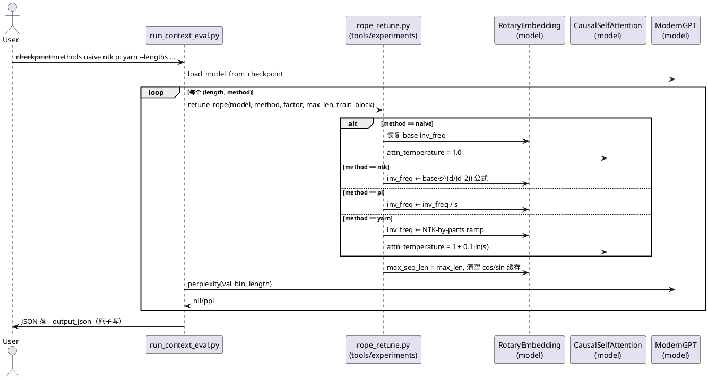
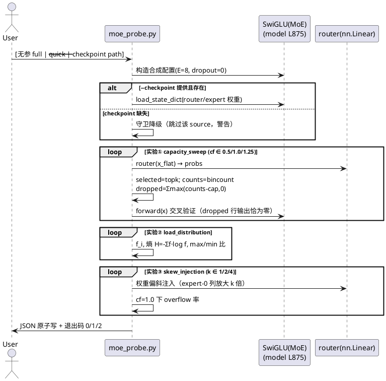
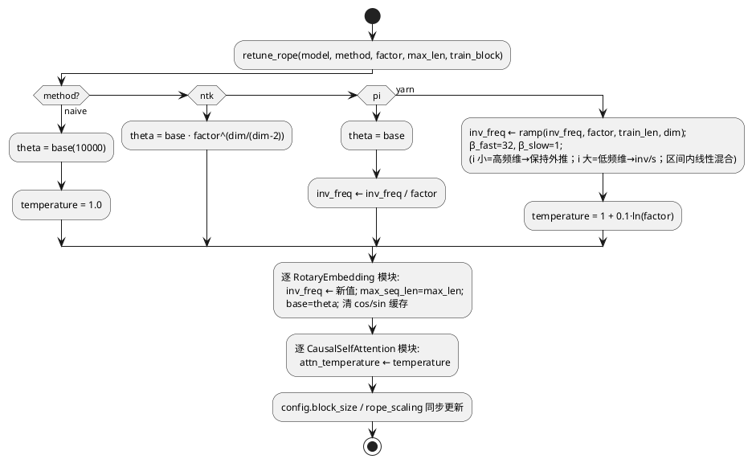
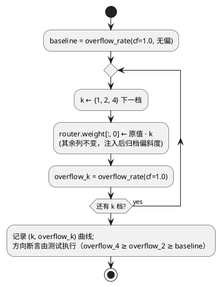

# 1 AR概述

| 组件名称 | nanoGPT-Modern 学习路径（docs/ai-infra 深化 + model/tools 扩展） |
| --- | --- |
| AR系统流水号 | AR-v0.8.5-moe-long-context |
| AR描述 | MoE 系统工程 + 长上下文深化（主题 2/8）：RotaryEmbedding 扩展 PI/YaRN（首个改 model/ 的 infra AR）、两本深化手册、compile-stack §0 GPU 执行模型前置章、moe_probe 纯 CPU 探针、RoPE 扩展对照与 needle 网格两个实验入口、实验矩阵补登 E-A-8/E-A-9/E-C-6、本地低算力档实测+云端回填 |

# 2 动态行为

## 交互时序图

RoPE 扩展对照实验（E-A-8）主链路（needle 入口复用同一 retune 通道）：



moe_probe（纯 CPU 探针）主链路：



# 3 功能点分解

| 序号 | 功能点名称 | 功能点描述 | 溯源 |
| --- | --- | --- | --- |
| F1 | GPU 执行模型前置章 | compile-stack.md 新增 §0：SM/warp/occupancy/内存层级/cp.async/TMA，roofline.json 算术闭合（容差比值 ∈ [0.5,2]） | FR6 |
| F2 | rope_scaling type 枚举扩展 | config_models 校验 type ∈ {ntk,pi,yarn}、factor ≥ 1.0、可选 train_len；ModernGPTConfig.effective_block_size 与 Block 构造点（L359-363）支持三类型 | FR2 |
| F3 | RotaryEmbedding PI/YaRN | pi：inv_freq/s；yarn：NTK-by-parts ramp（β_fast=32/β_slow=1）+ 复用 attn_temperature 机制（1+0.1·ln s）；缺省行为逐位不变 | FR2 |
| F4 | train CLI 暴露 | train_pretrain 新增 --rope_scaling_type/--rope_factor → 组装 rope_scaling dict | FR2 |
| F5 | rope_retune 共享模块 | tools/experiments/rope_retune.py：retune_rope(model, method, factor, max_len, train_block) 四档统一入口（naive 恢复含温度复位） | FR5 |
| F6 | run_context_eval.py | 四档（naive/ntk/pi/yarn）× 多长度 PPL 对照入口，--quick 档，JSON 原子写 | FR5 |
| F7 | run_needle_eval.py | 包装 NeedleEvaluator 的 depth×context 网格 CLI；tiktoken gpt2 tokenizer；可选 --rope_method/--rope_factor 走 retune 通道 | FR5 |
| F8 | moe_probe.py | 纯 CPU 三实验：capacity_sweep/load_distribution/skew_injection；镜像公式+forward 交叉验证；守卫降级/退出码/原子写 | FR4 |
| F9 | 手册 long-context.md | NTK 复盘→PI/YaRN 机制与本仓实现对照→滑窗+cache 驱逐→needle 方法论→MLA 理论节（内嵌 MQA/GQA/MLA 对比表，理论档明标） | FR1 |
| F10 | 手册 moe-systems.md | 机制深化（L1007-1031）→容量/负载实验解读→专家并行理论节（all-to-all 通信量推导，理论档明标）→E-A-5 未赢归因四因子分解→grouped GEMM 5.8× 复盘 | FR3 |
| F11 | 实验矩阵登记 | RUNNING_EXPERIMENTS 补 E-A-8/E-A-9/E-C-6（逐参核对 argparse）；EXPERIMENTS 记录节：本地低算力档实测+云端回填占位 | FR7 |
| F12 | 索引与质量收口 | 主题地图/roadmap/根 README 索引；全量零回归（760/3 基线）；三绿；gitee 同步 | FR8 |

# 4 实现设计

## 4.1 功能实现思路

**核心决策 D1（req 门控 WARN-2）：rope_scaling 保留 dict 形态**（方案对比见 srs 澄清与上文章案）：`{"type": "ntk"|"pi"|"yarn", "factor": float, ["train_len": int]}`。理由：全链 65 处既有 dict 事实（config_models.py:72、modern_gpt.py:80/360、run_ntk_eval.py:47、test_rope_ntk.py、hf_model.py、hydra modern.yaml），NTK 路径与 checkpoint 兼容性零迁移。`train_len` 键仅 yarn 需要（ramp 区间按训练长度计算），缺省由构造点注入 `config.block_size`。

**核心决策 D2：YaRN 温度复用既有 `attn_temperature` 机制**——modern_gpt.py:351/585/843 已实现 attn_scale = temperature/√d 且对所有后端生效。YaRN 的 t = 1 + 0.1·ln(s) 在 retune 时写入 config 与各 CausalSelfAttention 模块属性；naive 档复位 1.0。**不新增任何注意力代码路径**。

**核心决策 D3：PI/YaRN 在 inv_freq 域实现**（而非位置域）：PI 的 m·(inv/s) ≡ (m/s)·inv 数学恒等；YaRN per-dim ramp 直接改 inv_freq 向量。缓存构建/惰性切片逻辑（_ensure_cache L102-111）不动。

**核心决策 D4：run_ntk_eval.py 不改**（E-A-7 登记命令保持字节稳定，吸取 E-F-4 教训）；新入口 run_context_eval.py + 共享模块 rope_retune.py。retune 函数与 run_ntk_eval.retune_rope 的 NTK 分支语义一致（同 theta 公式），以测试断言锁定。

**核心决策 D5（req 门控 WARN-1）：roofline 闭合容差** = 理论峰值/实测峰值比值 ∈ [0.5, 2]；超界必须在 §0 文中解释（如带宽墙/时钟差异）。

## 4.2 功能实现设计

### 4.2.1 流程图

retune_rope 按类型分发（分支逻辑）：



moe_probe 实验③ 偏斜注入（分支逻辑）：



### 4.2.2 流程说明

1. **PI/YaRN 数学**（手册 §与实现共源）：
   - PI：`inv_freq' = inv_freq / s`，位置 m 的旋转角 `m·inv_freq' = (m/s)·inv_freq`，即位置线性压缩到 [0, train_len)。
   - YaRN（Peng et al. 2023）：对第 i 维（i=0..D/2-1），
     `d_corr(r) = D·ln(train_len/(r·2π)) / (2·ln base)`；
     ramp 区间 `[min(d_corr(1), d_corr(32)), max(...)]`；
     i < ramp_lo → `inv' = inv/s`（低频维全插值）；i > ramp_hi → `inv' = inv`（高频维保持外推）；区间内线性混合。
     注意 i 与波长关系：i 小 ↔ 频率高（inv 大、波长短）→ 保持外推；i 大 ↔ 频率低 → 插值。**实现以等价数值断言测试锁定方向**（低 i 不动、高 i 除以 s）。
   - YaRN 温度：`t = 1 + 0.1·ln(s)`，经 D2 机制作用于 attn logits。
2. **retune 后缓存失效**：inv_freq 是 buffer，retune 逐模块 `copy_` 并清 `_cos_cached/_sin_cached`，与 run_ntk_eval L48-57 同法。
3. **moe_probe 镜像公式**：capacity = int(cf·T_total/E)（L1012 同式）、stable sort 保序取前 capacity（L1018-1022 同语义）；`dropped = Σ_e max(counts_e - cap, 0)` 为精确丢 token 数。交叉验证：forward 输出中被丢 token 行恒为零（out_flat 仅对 keep 集合赋值，L1040-1042）。
4. **needle 网格**：depth 语义 = needle 插入位置占 haystack 比例（needle_in_haystack.py:61-92 既有）；--quick 网格 [512,1024]×[0.0,0.5,1.0]×1 trial ⊆ full [512,1024,2048,4096]×[0,0.25,0.5,0.75,1.0]×3。

### 4.3 接口描述

**I1 utils/config_models.py — ModernGPTModelConfig.rope_scaling 校验（修改）**

| 项 | 内容 |
| --- | --- |
| 签名 | `rope_scaling: dict \| None = None`（字段不变，新增 `field_validator("rope_scaling")`） |
| 参数约束 | 非空 dict 时：`type ∈ {"ntk","pi","yarn"}`；`factor` float 且 `>= 1.0`；可选 `train_len` int > 0 |
| 返回值 | 校验通过的 dict（不改写内容） |
| 异常 | pydantic ValidationError，消息双语、列合法值（如 `type must be one of ntk/pi/yarn`） |
| 兼容 | `_check_ablation_combos` 的 learned+rope_scaling 拒绝保留，消息泛化为「不支持 rope 缩放 (NTK/PI/YaRN)」且保留 `learned` 关键词（test_ablation_switches.py:327 断言仅含 learned） |

**I2 model/modern_gpt.py — RotaryEmbedding（修改）**

| 项 | 内容 |
| --- | --- |
| 签名 | `__init__(dim, max_seq_len=8192, base=10000.0, rope_scaling: dict \| None = None)` 不变 |
| 行为 | type=="pi"：inv_freq 除以 factor；type=="yarn"：按 4.2.2 ramp 重算 inv_freq（用 `rope_scaling.get("train_len", max_seq_len)`）；type=="ntk"：既有 theta 公式不变；其他/缺省：不变 |
| 属性 | 新增只读 property `rope_type: str \| None`（None 表示无缩放，供测试/工具内省） |
| 异常 | 构造期 type 非法 → ValueError（模型层独立于 pydantic 的防御校验，消息与 I1 一致） |

**I3 model/modern_gpt.py — ModernGPTConfig.effective_block_size（修改）**：factor 读取从 `type=="ntk"` 扩展为任一合法 type（factor ≥ 1.0）；Block 构造点 L359-363 的 rope_factor 同步扩展；yarn 时构造点向 rope_scaling 副本注入 `train_len=config.block_size`（不修改调用方原 dict）。

**I4 training/train_pretrain.py — CLI（修改）**

| 项 | 内容 |
| --- | --- |
| 新参数 | `--rope_scaling_type {none,ntk,pi,yarn} default none`；`--rope_factor float default 1.0` |
| 组装 | type != none → `rope_scaling={"type": type, "factor": factor}`；none → None |
| 异常 | factor < 1.0 → argparse 错误退出 2 |

**I5 tools/experiments/rope_retune.py（新增）**

| 项 | 内容 |
| --- | --- |
| 签名 | `retune_rope(model, method: str, factor: float, max_len: int, train_block: int) -> None`；`ntk_theta(dim, factor, base=10000.0) -> float`；`yarn_inv_freq(dim, factor, train_len, base=10000.0) -> torch.Tensor`；`pi_inv_freq(dim, factor, base=10000.0) -> torch.Tensor` |
| method 域 | {"naive","ntk","pi","yarn"}；非法 → ValueError |
| 行为 | 见 4.2.1 流程图；naive 档复位 base=10000、temperature=1.0、rope_scaling=None |
| 副作用 | 逐 RotaryEmbedding/CausalSelfAttention 模块就地改写；同步 model.config |

**I6 tools/experiments/run_context_eval.py（新增 CLI）**：`--checkpoint(必填) --val_bin --output_json(必填) --lengths --methods --batch_size --num_batches --seed --train_block --quick`。quick：lengths=[512,1024]、num_batches=4。row schema：`{length, method, factor, nll, ppl, tokens, temperature}`。异常：checkpoint/val_bin 缺失 → 明确报错 exit 1（实验工具不静默降级）；非法 method → exit 2。

**I7 tools/experiments/run_needle_eval.py（新增 CLI）**：`--checkpoint(必填) --output_json(必填) --context_lengths --depths --num_trials --max_new_tokens --max_context_length --rope_method {none,ntk,pi,yarn} --rope_factor --quick`。tokenizer：`tiktoken.get_encoding("gpt2")`（50257 词表与本仓 ckpt 对齐）；tiktoken 不可用 → exit 1 明确报错。quick：[512,1024]×[0.0,0.5,1.0]×1。产物 schema：`{checkpoint, rope_method, rope_factor, grid_params, summary{overall_accuracy, by_depth, by_length}, scores[], raw[]}`。rope_method != none 时经 I5 retune 后评估。

**I8 tools/infra/moe_probe.py（新增 CLI）**：`--config_json(可选输出路径，缺省 docs/results/moe_probe.json 由 --quick 控制) --quick --checkpoint(可选) --seed`。三实验产物 schema：`{meta{tool,timestamp,seed,torch_version}, config{E, T_total, capacity_factors, hidden}, experiments[{name, source, metrics{...}}], warnings[]}`。metrics：①`{cf, capacity, dropped, drop_rate, kept}`；②`{f_i[], entropy, max_min_ratio}`；③`{k, overflow_rate}`。退出码：0 成功（含守卫降级跳过）/1 运行错误（含中断，不写部分 JSON）/2 入参非法。守卫：`--checkpoint` 文件缺失 → 该 source 跳过、warnings 记录、exit 0。原子写：tmp+rename（v0.7.5 惯例）。

## 4.4 代码设计

```
model/modern_gpt.py            [修改] RotaryEmbedding PI/YaRN + rope_type property；
                                      effective_block_size/Block 构造点三类型扩展
training/train_pretrain.py     [修改] --rope_scaling_type/--rope_factor → rope_scaling dict
utils/config_models.py         [修改] rope_scaling field_validator + learned 组合消息泛化
tools/experiments/rope_retune.py      [新增] retune_rope/pi_inv_freq/yarn_inv_freq/ntk_theta
tools/experiments/run_context_eval.py [新增] E-A-8 四档对照入口
tools/experiments/run_needle_eval.py  [新增] E-A-9 needle 网格入口
tools/infra/moe_probe.py              [新增] E-C-6 纯 CPU 探针
tests/test_rope_pi_yarn.py            [新增] FR2 用例（含 NTK 零回归锁定）
tests/test_rope_retune.py             [新增] I5 用例
tests/test_moe_probe.py               [新增] FR4 契约用例（subprocess+in-process abort）
tests/test_context_eval_entry.py      [新增] I6 契约用例（argparse/quick⊆full/schema）
tests/test_needle_eval_entry.py       [新增] I7 契约用例（tokenizer guard/网格/tiny 端到端）
docs/ai-infra/long-context.md         [新增] F9 手册
docs/ai-infra/moe-systems.md          [新增] F10 手册
docs/ai-infra/compile-stack.md        [修改] §0 前置章
docs/RUNNING_EXPERIMENTS.md / docs/EXPERIMENTS.md / docs/ai-infra/README.md / README.md [修改] F11/F12
docs/ai-infra/roadmap-gap-analysis.md           [修改] F12（v0.8.5 状态更新）
```

边界原则：`run_ntk_eval.py`、`needle_in_haystack.py`、MoE 前向（L975-1046）零改动；工具只读模型。moe_probe 直接实例化 `SwiGLU`（model/modern_gpt.py:875）而非整模型（纯 CPU 快）。

# 5 重构设计

无重构。说明两点：① run_ntk_eval.py 的 NTK retune 与 I5 的 ntk 分支为同公式两处实现——选择不合并（E-A-7 命令字节稳定优先），由测试 `test_rope_retune.py::test_ntk_branch_matches_run_ntk_eval` 断言两实现 inv_freq allclose 锁定一致性；② config_models learned 组合错误消息泛化不构成重构（保留 learned 关键词，既有断言不受影响）。

# 6 测试设计

## 6.1 单元测试（UT）

覆盖 F2/F3（test_rope_pi_yarn.py）与 F5（test_rope_retune.py）：

| 用例 | 断言要点 | 对应验收 |
| --- | --- | --- |
| UT1 缺省不变 | rope_scaling=None 与 {} 的 inv_freq/cos 表 == 基线 base=10000 直算 | FR2-AC1 |
| UT2 NTK 零回归 | type=ntk factor=2 inv_freq == 旧公式 base·2^(d/(d-2)) 直算（不依赖旧代码） | FR2-AC1 |
| UT3 PI 数学等价 | pi factor=2 表在位置 m 的 cos/sin == 基线表位置 m/2（allclose 1e-6） | FR2-AC2 |
| UT4 YaRN 极端因子 | factor=16：表无 NaN/Inf，freq 单调性保持，temperature=1+0.1·ln16 | FR2-AC3 |
| UT5 YaRN ramp 边界 | ramp_lo 以下维 inv'==inv/s；ramp_hi 以上维 inv'==inv；区间内混合值介于两者之间 | FR2-AC3 |
| UT6 非法 type | config_models 构造 type="banana" → ValidationError 列合法值；RotaryEmbedding 直接构造 → ValueError | FR2-AC4 |
| UT7 factor 边界 | factor=0.5 → ValidationError；factor=1.0 → 合法且 == 无缩放行为 | FR2-AC2/AC4 |
| UT8 learned 组合 | learned+rope_scaling(pi) 仍拒绝，消息含 learned | FR2-AC4 |
| UT9 effective_block_size | pi/yarn factor=4 → block_size×4；ntk 不变 | FR2 |
| UT10 train CLI 组装 | --rope_scaling_type pi --rope_factor 2 → config.rope_scaling=={"type":"pi","factor":2.0}；--rope_scaling_type none（缺省）→ rope_scaling=None；--rope_factor 0.5 → argparse SystemExit 2 | F4 |
| UT11 retune 分发 | naive→复位 base/temperature；pi→模块 inv_freq == pi_inv_freq 直算；yarn→模块 attn_temperature 全体改写且 naive 复位 1.0 | FR2/F5 |
| UT12 retune 非法 method | retune_rope(method="banana") → ValueError 消息列合法域 | I5 异常 |
| UT13 train_len 越界 | config train_len=0 / -1 → ValidationError；合法 train_len 透传 | I1 边界 |
| UT14 ntk 分支一致 | I5 ntk 分支 inv_freq == run_ntk_eval.ntk_theta 公式直算 | D4 |
| UT15 rope_type 内省 | rope_type property：None（无缩放）/pi/yarn 各返回正确值 | I2 |

## 6.2 接口测试

test_context_eval_entry.py / test_needle_eval_entry.py / test_moe_probe.py（契约，v0.7.5 范式）：

| 用例 | 断言要点 | 对应验收 |
| --- | --- | --- |
| IT1 moe_probe full | subprocess exit 0；JSON schema 键齐（meta/config/experiments/warnings）；三实验 name 齐全 | FR4 |
| IT2 守卫降级 | --checkpoint 不存在 → exit 0，warnings 含 skipped 标记 | FR4 异常 |
| IT3 中断退出 1 | in-process monkeypatch 实验函数抛异常 → exit 1，目标 JSON 不存在（无部分文件） | FR4 异常 |
| IT4 非法入参 | --seed abc 等 → exit 2 | FR4 异常 |
| IT5 quick 耗时 | --quick 全程 ≤ 30s（纯 CPU 断言档） | NFR |
| IT6 context_eval 契约 | --help 正常；--methods 非法值 → exit 2；quick 参数集 ⊆ full 参数集（断言常量集合） | FR5 |
| IT7 needle 端到端 | tiny 随机 ckpt（block 64）+ 网格 [64]×[0.0,1.0]×1 → exit 0，summary 键齐 | FR5 |
| IT8 tokenizer guard | monkeypatch tiktoken 缺失 → exit 1 且消息含 tiktoken | FR5 异常 |
| IT9 checkpoint guard | context/needle 入口 --checkpoint 缺失 → exit 1（不静默降级） | FR5 异常 |
| IT10 needle retune 联动 | --rope_method yarn --rope_factor 2：评估前模块 inv_freq 已改（tiny ckpt 断言） | FR5 |
| IT11 context_eval 端到端 | tiny 随机 ckpt（block 64）+ tiny val_bin，--quick 跑通 → exit 0；rows 含 naive/ntk/pi/yarn 四行；每行 row schema 键齐（length/method/factor/nll/ppl/tokens/temperature） | FR5-AC1 |
| IT12 needle 非法入参 | run_needle_eval --rope_method banana → exit 2；--depths abc → exit 2 | I7 异常 |

## 6.3 业务场景测试

| 场景 | 验证 | 对应验收 |
| --- | --- | --- |
| BS1 容量方向律 | cf=0.5 drop_rate > cf=1.0 drop_rate；cf=1.0 无偏 < 5% | FR4-AC1/AC2 |
| BS2 偏斜放大律 | overflow(k=4) ≥ overflow(k=2) ≥ baseline（cf=1.0） | FR4-AC3 |
| BS3 镜像=真实 | probe 公式 dropped 数 == forward 输出零行数（同输入同权重） | FR4 |
| BS4 网格维度完整 | needle --quick 产物 depth/context 两轴均非空 | FR5-AC2 |
| BS5 本地低算力实测 | E-A-8/E-A-9/E-C-6 本地档跑通，记录节明标「本地低算力档，云端全量待回填」 | FR5-AC3/FR7 |
| BS6 手册数值溯源 | long-context MLA 表 MQA/GQA 行 == infra_math gqa 口径复算；moe-systems 归因数字 == EXPERIMENTS §6.2/§6.6；§0 roofline 闭合比值 ∈ [0.5,2] | FR1/FR3/FR6-AC |
| BS7 公式-实现对照 | long-context PI/YaRN 公式推导与 model/modern_gpt.py 实现（T002 产物）逐行语义一致（手册写作时的核查项，T003 执行） | FR1-AC1 |
| BS8 既有数字追溯 | long-context 引用的 E-A-7 数字 == docs/results/ntk_eval.json；滑窗语义 == test_sliding_window.py 断言 | FR1-AC3 |
| BS9 机制-代码对照 | moe-systems 机制描述与 modern_gpt.py L1007-1031 逐行对照一致（T006 执行） | FR3-AC1 |
| BS10 EP 手算复核 | moe-systems 专家并行通信量公式对本仓假想配置（8 专家 2 卡）的手算例可复算一致（T006 执行） | FR3-AC3 |
| BS11 §0-§5 衔接 | compile-stack §0 无前向依赖可独立先读，且与既有 §5 fusion 决策前置关系成立（T001 执行） | FR6-AC2 |
| BS12 矩阵命令逐参核对 | E-A-8/E-A-9/E-C-6 登记命令与 run_context_eval/run_needle_eval/moe_probe 的 argparse 逐参核对，0 个不存在参数（T008 执行，脚本化 grep 核对或 checklist） | FR7-AC1 |

## 6.4 异常场景测试

| 异常 | 行为 | 用例 |
| --- | --- | --- |
| pydantic 非法 rope_scaling（type/factor/train_len 越界） | ValidationError，消息列合法域 | UT6/UT7/UT13 |
| RotaryEmbedding 直接构造非法 type | ValueError（模型层防御） | UT6 |
| 实验中断（probe/context/needle） | exit 1，无部分 JSON | IT3（probe in-process；context/needle 由原子写保证+代码审查） |
| 数据源缺失（probe --checkpoint） | 守卫降级 exit 0 + warnings + skipped | IT2 |
| 实验必需资源缺失（context val_bin / needle tiktoken / checkpoint） | exit 1 明确报错（实验工具不降级） | IT8/IT9 |
| 入参非法（所有新 CLI） | exit 2 | IT4/IT6 |
| YaRN 极端 factor | 无 NaN/Inf（表级断言） | UT4 |

**覆盖率目标：** srs FR1-FR8 每条 Given/When/Then ≥ 1 个可执行用例或可核查项。功能点 F1-F12 与 §6 用例映射：F1→BS6/BS11、F2/F3→UT1-UT9/UT15、F4→UT10、F5→UT11/UT12/UT14、F6→IT6/IT9/IT11、F7→IT7/IT8/IT10、F8→IT1-IT5/BS1-3、F9→BS7/BS8（+BS6 MLA 行）、F10→BS9/BS10（+BS6 归因行）、F11→BS5/BS12、F12→T010 回归/三绿/链接检查。srs 验收标准追溯：FR1-AC1→BS7、FR1-AC2→BS6(MLA 行)、FR1-AC3→BS8、FR2-AC1→UT1/UT2、FR2-AC2→UT3、FR2-AC3→UT4/UT5、FR2-AC4→UT6/UT7/UT8、FR3-AC1→BS9、FR3-AC2→BS6(归因行)、FR3-AC3→BS10、FR4-AC1..3→BS1/BS2/IT1-IT5、FR4-AC4→IT5/T010（契约用例纯 CPU 设计+全量回归）、FR5-AC1→IT11、FR5-AC2→BS4、FR5-AC3→BS5、FR6-AC1→BS6(roofline 行)+D5、FR6-AC2→BS11、FR7-AC1→BS12、FR7-AC2→BS5、FR8→T010。无未覆盖功能点；6.4 异常场景与 4.3 接口异常声明一一对应（I1→UT6/UT13、I2→UT6/UT15、I4→UT10、I5→UT12、I6/I7/I8→IT3/IT4/IT8/IT9）。
